# AiiA – Nền tảng Data Lakehouse hồ sơ 360°

**AiiA** là nền tảng dữ liệu theo kiến trúc **Data Lakehouse** giúp nhà trường xây dựng **hồ sơ 360°** cho **sinh viên, giảng viên và cán bộ**. Hệ thống tích hợp dữ liệu từ các nguồn **được phép**, chuẩn hóa và quản trị dữ liệu (chất lượng, danh mục, phân loại nhạy cảm, phân quyền, kiểm toán), sau đó cung cấp lớp **báo cáo/BI** phục vụ phân tích, vận hành và ra quyết định **có kiểm soát**. Ở mức nâng cao, hệ thống bổ sung lineage, phân quyền chi tiết theo dòng/cột, phát hiện bất thường, semantic model, báo cáo tự động và trợ lý hỏi-đáp chỉ trả lời trên dữ liệu người hỏi được cấp quyền.

> Ký hiệu phạm vi dùng trong tài liệu: **[MVP]** = yêu cầu cơ bản, **[ADV]** = yêu cầu nâng cao.

**Mục lục**

1. [Phân tích đề bài top-down (Research)](#1-phân-tích-đề-bài-top-down-research)
2. [Requirements – Use Case, User Stories INVEST, Acceptance Criteria](#2-requirements--use-case-user-stories-invest-acceptance-criteria)
3. [Kiến trúc thông tin (Information Architecture)](#3-kiến-trúc-thông-tin-information-architecture)
4. [Thiết kế UI/UX và tương tác Front-end](#4-thiết-kế-uiux-và-tương-tác-front-end)
5. [Kiến trúc C4](#5-kiến-trúc-c4)
6. [Cơ sở dữ liệu và hợp đồng OpenAPI](#6-cơ-sở-dữ-liệu-và-hợp-đồng-openapi)
7. [Cấu trúc thư mục Frontend, Backend và Data Pipeline](#7-cấu-trúc-thư-mục-frontend-backend-và-data-pipeline)
8. [Thiết kế chi tiết lớp và tuần tự](#8-thiết-kế-chi-tiết-lớp-và-tuần-tự)

Xem thêm: [Tài liệu](#tài-liệu) · [Tiến độ dự án](#tiến-độ-dự-án)

---

## 1. Phân tích đề bài top-down (Research)

### 1.1. Bối cảnh và vấn đề

Dữ liệu của một trường đại học thường nằm rải rác ở nhiều hệ thống độc lập: quản lý đào tạo, LMS, nhân sự, tài chính – học phí, thư viện, nghiên cứu khoa học, công tác sinh viên, khảo sát… Hệ quả:

| Vấn đề hiện trạng | Hậu quả | Năng lực AiiA cần có |
| --- | --- | --- |
| Dữ liệu phân mảnh (data silo), mỗi phòng ban một hệ thống | Không có bức tranh đầy đủ về một người học/người dạy | Tích hợp đa nguồn, hồ sơ 360° |
| Cùng một người có nhiều mã/định danh khác nhau ở từng hệ thống | Trùng lặp, đếm sai, báo cáo lệch | Chuẩn hóa, đối soát danh tính (identity resolution), golden record |
| Dữ liệu sai, thiếu, trễ nhưng không ai phát hiện | Ra quyết định trên số liệu sai | Quy tắc chất lượng dữ liệu, cách ly bản ghi lỗi, phát hiện bất thường |
| Báo cáo làm thủ công bằng Excel, mỗi đơn vị một định nghĩa chỉ số | “Nhiều phiên bản sự thật”, tốn công | Lớp Gold + semantic model, dashboard BI, báo cáo tự động |
| Dữ liệu cá nhân nhạy cảm bị chia sẻ không kiểm soát | Rủi ro pháp lý về bảo vệ dữ liệu cá nhân, mất niềm tin | Phân loại nhạy cảm, phân quyền RBAC + dòng/cột, che dữ liệu, audit log |
| Không biết số liệu trên báo cáo đến từ đâu | Khó giải trình, khó sửa lỗi | Data catalog, lineage, hiển thị nguồn/độ mới dữ liệu |
| Lãnh đạo không đọc được SQL/BI phức tạp | Chậm có câu trả lời | Trợ lý hỏi-đáp ngôn ngữ tự nhiên trên dữ liệu đã cấp quyền |

### 1.2. Mục tiêu và chỉ số thành công

| Mục tiêu | Chỉ số đo (gợi ý cho bản demo) |
| --- | --- |
| Tích hợp được nhiều nguồn dữ liệu mẫu | ≥ 5 nguồn mẫu (SIS, LMS, HRM, Tài chính, Thư viện) ingest thành công qua ít nhất 2 hình thức (file, DB/API) |
| Hồ sơ 360° hợp nhất, đáng tin cậy | ≥ 95% bản ghi người được hợp nhất về một `person_id`; mỗi thuộc tính có nguồn và thời điểm cập nhật |
| Dữ liệu có chất lượng kiểm soát được | 100% dataset Gold có quy tắc DQ; điểm DQ hiển thị theo 5 chiều; bản ghi lỗi không lọt vào Gold |
| BI phục vụ ra quyết định | ≥ 4 dashboard mẫu (Đào tạo, Nhân sự, Nghiên cứu, Chất lượng dữ liệu); thời gian tải < 3 giây trên dữ liệu mẫu |
| Kiểm soát truy cập | 0 trường hợp người xem thấy dữ liệu ngoài phạm vi đơn vị/mức nhạy cảm (kiểm thử phân quyền) |
| [ADV] Hỏi-đáp có kiểm soát | Câu trả lời luôn kèm chỉ số, bộ lọc và nguồn; 100% câu hỏi vượt quyền bị từ chối trong bộ kiểm thử |

### 1.3. Phân rã bài toán top-down

Phân rã từ **mục tiêu → năng lực (capability) → chức năng**. Mỗi nhánh lá về sau trở thành một nhóm User Story ở mục 2.

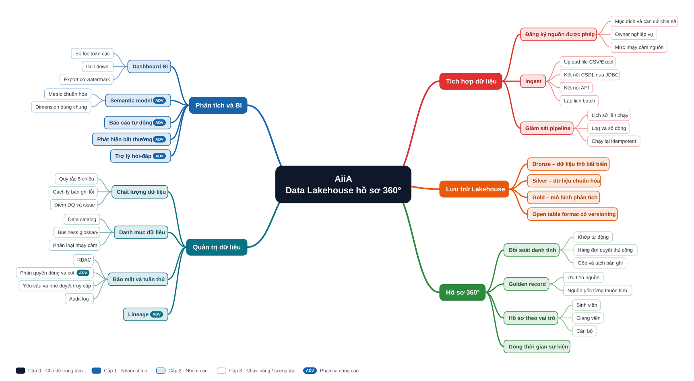

### 1.4. Các bên liên quan (Stakeholders)

| Nhóm | Ví dụ | Nhu cầu chính | Vai trò trong hệ thống |
| --- | --- | --- | --- |
| Ban giám hiệu, lãnh đạo khoa/phòng | Hiệu trưởng, Trưởng khoa | Số liệu tổng hợp, xu hướng, cảnh báo sớm | Report Viewer |
| Phòng chức năng | Phòng Đào tạo, Tổ chức cán bộ, Công tác SV, KH&CN | Báo cáo vận hành, tra cứu hồ sơ trong phạm vi nghiệp vụ | Report Viewer, BI Analyst |
| Trung tâm dữ liệu / CNTT | Kỹ sư dữ liệu | Kết nối nguồn, vận hành pipeline | Data Engineer |
| Bộ phận quản trị dữ liệu | Chuyên viên quản trị dữ liệu, DPO | Chất lượng, phân loại, phê duyệt quyền, tuân thủ | Data Steward |
| Quản trị hệ thống | Admin CNTT | Tài khoản, vai trò, chính sách, kiểm toán | Platform Admin |
| Chủ thể dữ liệu | Sinh viên, giảng viên, cán bộ | Dữ liệu cá nhân được dùng đúng mục đích, an toàn | Không đăng nhập ở phạm vi hiện tại (xem 1.9) |

### 1.5. Nguồn dữ liệu mẫu được phép

| Mã nguồn | Hệ thống nguồn | Dữ liệu chính | Đối tượng | Hình thức ingest | Tần suất | Mức nhạy cảm cao nhất |
| --- | --- | --- | --- | --- | --- | --- |
| SRC-SIS | Quản lý đào tạo (SIS) | Lý lịch SV, chương trình, lớp, đăng ký học phần, điểm, cảnh báo học vụ, tốt nghiệp | SV, GV | CSDL (JDBC) | Hằng ngày | RESTRICTED (CCCD, ngày sinh) |
| SRC-LMS | Hệ thống học tập trực tuyến (LMS) | Lượt truy cập, nộp bài, tiến độ khóa học | SV, GV | API | Hằng ngày | INTERNAL |
| SRC-HRM | Quản lý nhân sự | Hồ sơ cán bộ/GV, chức danh, học hàm học vị, hợp đồng, đơn vị | GV, CB | CSDL (JDBC) | Hằng tuần | RESTRICTED (lương, CCCD) |
| SRC-FIN | Tài chính – học phí | Học phí phải nộp/đã nộp, học bổng, miễn giảm | SV | File CSV/Excel | Hằng tuần | CONFIDENTIAL |
| SRC-LIB | Thư viện | Lượt mượn/trả, tài nguyên số | SV, GV, CB | File CSV | Hằng tuần | INTERNAL |
| SRC-RES | Quản lý KH&CN | Đề tài, công bố khoa học, hướng dẫn | GV, CB | File Excel | Hằng tháng | INTERNAL |
| SRC-STA | Công tác sinh viên | Điểm rèn luyện, khen thưởng – kỷ luật, ký túc xá | SV | File Excel | Theo học kỳ | CONFIDENTIAL |
| SRC-SUR | Khảo sát | Đánh giá giảng dạy, khảo sát việc làm sau tốt nghiệp | SV, GV | File CSV | Theo đợt | CONFIDENTIAL (ẩn danh hóa) |

> Dữ liệu mẫu là **dữ liệu giả lập (synthetic)**, không dùng dữ liệu thật của người học/người lao động trong quá trình phát triển và demo.

### 1.6. Kiến trúc khái niệm Data Lakehouse

Kiến trúc theo mô hình **Medallion (Bronze → Silver → Gold)**, với lớp **quản trị (governance plane)** xuyên suốt và lớp **phục vụ (serving)** cho BI và trợ lý hỏi-đáp. Đây là kiến trúc mức khái niệm; chi tiết container/thành phần sẽ được chốt ở phần C4.

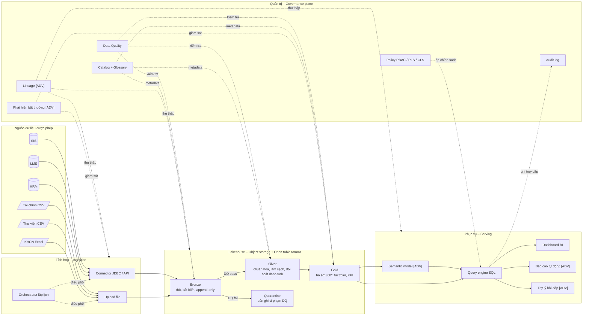

**Công nghệ ứng viên** (lựa chọn cuối cùng xem [5.4. Quyết định kiến trúc](#54-quyết-định-kiến-trúc)):

| Thành phần | Ứng viên mã nguồn mở | Ghi chú lựa chọn |
| --- | --- | --- |
| Object storage | MinIO / S3 | Lưu file Parquet của Bronze/Silver/Gold |
| Open table format | Apache Iceberg / Delta Lake | ACID, time-travel, schema evolution |
| Xử lý/biến đổi | Apache Spark, dbt | dbt cho Silver → Gold, sinh lineage tự nhiên |
| Query engine | Trino / DuckDB | Trino cho đa người dùng; DuckDB đủ cho demo nhỏ |
| Điều phối | Airflow / Dagster | Dagster có khái niệm asset, hợp lineage |
| Chất lượng dữ liệu | Great Expectations / Soda Core | Quy tắc khai báo, xuất kết quả theo run |
| Catalog/Lineage | OpenMetadata / DataHub, OpenLineage | Catalog, glossary, lineage cột |
| Phân quyền | Keycloak (IAM) + OPA / Apache Ranger | SSO, RBAC, chính sách dòng/cột |
| BI | Apache Superset / Metabase hoặc FE tự xây | FE tự xây giúp kiểm soát UX hồ sơ 360° và Q&A |
| Trợ lý hỏi-đáp | LLM (Claude) + text-to-SQL trên semantic model | Truy vấn chạy dưới danh tính người hỏi |

### 1.7. Mô hình hồ sơ 360° mức khái niệm

Một **Person** (con người thật) là trung tâm; một người có thể đồng thời mang nhiều vai trò (ví dụ cán bộ đang học cao học → vừa là Cán bộ vừa là Sinh viên). Mỗi vai trò có một **hồ sơ vai trò**, mỗi hồ sơ gồm nhiều **khía cạnh (facet)** đến từ các nguồn khác nhau. Mô hình dữ liệu chi tiết (DBML/ER) sẽ thực hiện ở bước sau.

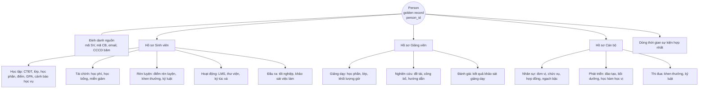

### 1.8. Phạm vi

| Hạng mục | MVP (cơ bản) | ADV (nâng cao) | Ngoài phạm vi |
| --- | --- | --- | --- |
| Ingest | Upload file, connector JDBC/API, lập lịch, giám sát run | Phát hiện bất thường volume/freshness | Streaming thời gian thực, CDC log-based |
| Hồ sơ 360° | Đối soát danh tính, golden record, hồ sơ SV/GV/CB, timeline, nguồn từng thuộc tính | — | Chủ thể dữ liệu tự đăng nhập xem hồ sơ của mình |
| Chất lượng dữ liệu | Quy tắc, cách ly, điểm DQ, issue | Bất thường số liệu chỉ số | Tự động sửa dữ liệu nguồn |
| Quản trị | Catalog, phân loại nhạy cảm, RBAC, yêu cầu truy cập, audit | Lineage, impact analysis, RLS/CLS chi tiết, mô phỏng quyền | Ghi ngược dữ liệu về hệ thống nguồn |
| BI | Dashboard, bộ lọc, drill-down, export, thiết kế dashboard | Semantic model, báo cáo tự động, trợ lý hỏi-đáp | Mô hình dự báo ML phức tạp (dropout prediction…) |

### 1.9. Giả định, ràng buộc và rủi ro

| Loại | Nội dung |
| --- | --- |
| Giả định | Nhà trường có văn bản/thỏa thuận cho phép chia sẻ dữ liệu từ từng hệ thống nguồn; mỗi nguồn có owner nghiệp vụ chịu trách nhiệm. |
| Giả định | Đăng nhập qua SSO của trường (OIDC); người dùng có thông tin đơn vị công tác để áp phạm vi dữ liệu. |
| Ràng buộc pháp lý | Xử lý dữ liệu cá nhân phải tuân thủ quy định bảo vệ dữ liệu cá nhân hiện hành của Việt Nam (Nghị định 13/2023/NĐ-CP và Luật Bảo vệ dữ liệu cá nhân 2025 – cần bộ phận pháp chế rà soát): đúng mục đích, tối thiểu hóa, có kiểm soát truy cập và ghi nhận. |
| Ràng buộc kỹ thuật | Dữ liệu demo là dữ liệu giả lập; hệ thống chạy được trên một máy chủ/bộ Docker Compose. |
| Rủi ro | Khớp danh tính sai → gộp nhầm hai người. *Giảm thiểu:* ngưỡng tự động cao, vùng xám cần duyệt, cho phép tách (unmerge), lưu lịch sử. |
| Rủi ro | Tái định danh qua số liệu tổng hợp nhóm nhỏ. *Giảm thiểu:* ẩn nhóm < k (k = 5) trong dashboard và hỏi-đáp. |
| Rủi ro | Trợ lý AI trả lời sai hoặc vượt quyền. *Giảm thiểu:* chỉ truy vấn trên metric đã chứng nhận, chạy dưới quyền người hỏi, luôn hiển thị truy vấn/nguồn, ghi log. |
| Rủi ro | Admin kỹ thuật có quyền quá rộng. *Giảm thiểu:* tách quyền quản trị hệ thống và quyền đọc dữ liệu RESTRICTED. |

---

## 2. Requirements – Use Case, User Stories INVEST, Acceptance Criteria

Phần này xác định hệ thống phải cung cấp chức năng gì, ai tương tác với hệ thống và điều kiện nào được dùng để xác nhận chức năng hoạt động đúng. **User Story (US)** mô tả nhu cầu từ góc nhìn người dùng; **Acceptance Criteria (AC)** mô tả kết quả có thể kiểm thử; **Use Case (UC)** mô tả trình tự tương tác giữa tác nhân và hệ thống.

### 2.1. Product Mind Map

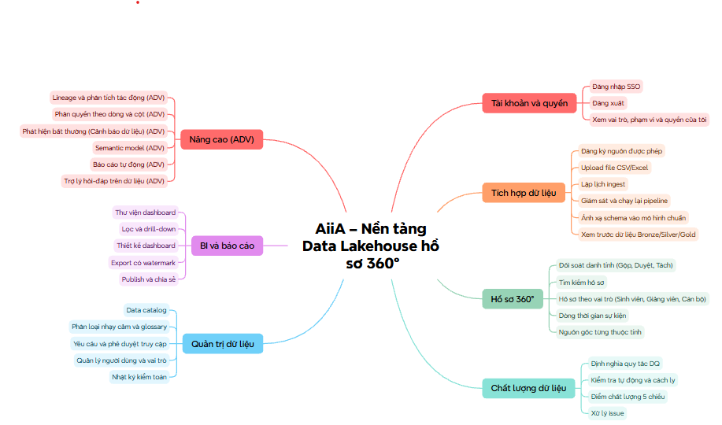

| Nhóm nghiệp vụ | Mô tả |
| --- | --- |
| Tài khoản và quyền | Đăng nhập qua SSO, xem vai trò, phạm vi đơn vị và các quyền dữ liệu/dashboard đang có hiệu lực. |
| Tích hợp dữ liệu | Đăng ký nguồn được phép, ingest bằng file hoặc connector, lập lịch, giám sát và chạy lại pipeline. |
| Hồ sơ 360° | Hợp nhất định danh từ nhiều nguồn thành một `person_id`, dựng golden record và hồ sơ theo vai trò SV/GV/CB. |
| Chất lượng dữ liệu | Quy tắc kiểm tra theo 5 chiều (đầy đủ, duy nhất, hợp lệ, nhất quán, kịp thời), cách ly bản ghi lỗi, theo dõi điểm DQ. |
| Quản trị dữ liệu | Danh mục dữ liệu, phân loại nhạy cảm, quy trình cấp quyền có mục đích và thời hạn, kiểm toán truy cập. |
| BI và báo cáo | Dashboard theo quyền người xem, bộ lọc, drill-down, xuất báo cáo, thiết kế và chia sẻ dashboard. |
| Nâng cao | Lineage, RLS/CLS, cảnh báo bất thường, semantic model, báo cáo tự động, trợ lý hỏi-đáp có kiểm soát. |

### 2.2. Các tác nhân (Actors)

| Tác nhân | Trách nhiệm |
| --- | --- |
| **Platform Admin (Quản trị hệ thống)** | Quản lý người dùng, vai trò, phạm vi đơn vị, chính sách phân quyền; xem nhật ký kiểm toán. Không mặc định đọc dữ liệu RESTRICTED. |
| **Data Engineer (Kỹ sư dữ liệu)** | Đăng ký và cấu hình nguồn, upload file, lập lịch, giám sát/chạy lại pipeline, ánh xạ schema, khám phá dữ liệu kỹ thuật. |
| **Data Steward (Chuyên viên quản trị dữ liệu)** | Định nghĩa quy tắc DQ, xử lý issue, duyệt đối soát danh tính, quản lý catalog/glossary/phân loại nhạy cảm, phê duyệt yêu cầu truy cập, xử lý cảnh báo bất thường. |
| **BI Analyst (Chuyên viên phân tích)** | Thiết kế dashboard, định nghĩa metric trong semantic model, publish và chia sẻ dashboard, cấu hình báo cáo tự động. |
| **Report Viewer (Người dùng báo cáo)** | Lãnh đạo, phòng chức năng, khoa: xem dashboard, tra cứu hồ sơ 360° trong phạm vi được cấp, export, đăng ký nhận báo cáo, hỏi-đáp, yêu cầu thêm quyền. |
| **System (Scheduler / AI Service)** | Tác nhân thời gian/hệ thống: chạy pipeline theo lịch, chạy DQ, phát hiện bất thường, gửi báo cáo định kỳ, tự thu hồi quyền hết hạn. |

> Một người dùng có thể mang nhiều vai trò cùng lúc (ví dụ BI Analyst đồng thời là Report Viewer). Mọi vai trò có quyền cơ bản của Report Viewer trên dữ liệu được cấp.

### 2.3. Yêu cầu theo nguyên tắc INVEST

#### 2.3.1. Nguyên tắc INVEST

| Tiêu chí | Ý nghĩa |
| --- | --- |
| **I – Independent (Độc lập)** | User Story có mục tiêu riêng và hạn chế phụ thuộc vào các Story khác để thuận tiện sắp xếp ưu tiên và triển khai. |
| **N – Negotiable (Có thể thương lượng)** | Nội dung chi tiết và cách thực hiện có thể được trao đổi, điều chỉnh giữa các bên, miễn vẫn đáp ứng nhu cầu của người dùng. |
| **V – Valuable (Có giá trị)** | User Story mang lại lợi ích rõ ràng cho người dùng hoặc bên liên quan. |
| **E – Estimable (Có thể ước lượng)** | Mục tiêu, phạm vi và điều kiện xử lý đủ rõ để nhóm phát triển ước lượng công sức thực hiện. |
| **S – Small (Đủ nhỏ)** | User Story có phạm vi vừa đủ để hoàn thành trong một vòng lặp phát triển; Story quá lớn cần được chia nhỏ. |
| **T – Testable (Có thể kiểm thử)** | User Story có tiêu chí chấp nhận cụ thể để kiểm tra và xác định đã đáp ứng yêu cầu hay chưa. |

#### 2.3.2. Danh sách User Stories

| ID | Phạm vi | Tác nhân | User Story |
| --- | :---: | --- | --- |
| **US01** | MVP | Người dùng nội bộ | Tôi muốn đăng nhập bằng tài khoản SSO của trường để sử dụng các chức năng được cấp quyền. |
| **US02** | MVP | Người đã đăng nhập | Tôi muốn đăng xuất để kết thúc phiên làm việc trên thiết bị. |
| **US03** | MVP | Người đã đăng nhập | Tôi muốn xem vai trò, phạm vi đơn vị và các quyền đang có hiệu lực để biết mình được xem dữ liệu nào. |
| **US04** | MVP | Data Engineer | Tôi muốn đăng ký một nguồn dữ liệu kèm mục đích và căn cứ cho phép để chỉ dữ liệu hợp lệ được đưa vào nền tảng. |
| **US05** | MVP | Data Engineer | Tôi muốn upload file CSV/Excel theo mẫu để ingest nhanh dữ liệu từ hệ thống chưa có kết nối. |
| **US06** | MVP | Data Engineer | Tôi muốn lập lịch ingest định kỳ cho nguồn để dữ liệu được cập nhật tự động. |
| **US07** | MVP | Data Engineer | Tôi muốn theo dõi và chạy lại các lần ingest để phát hiện và khắc phục lỗi kịp thời. |
| **US08** | MVP | Data Engineer | Tôi muốn ánh xạ cột của nguồn vào mô hình chuẩn để dữ liệu từ nhiều nguồn có cùng cấu trúc. |
| **US09** | MVP | Data Engineer | Tôi muốn xem trước dữ liệu theo lớp Bronze/Silver/Gold để kiểm tra kết quả biến đổi. |
| **US10** | MVP | Data Steward | Tôi muốn duyệt các cặp bản ghi nghi trùng để hợp nhất đúng một người thành một hồ sơ. |
| **US11** | MVP | Report Viewer | Tôi muốn tìm kiếm hồ sơ 360° theo mã, tên, email hoặc đơn vị để tra cứu nhanh một người. |
| **US12** | MVP | Report Viewer | Tôi muốn xem hồ sơ 360° sinh viên để nắm toàn diện tình hình học tập, tài chính, rèn luyện và hoạt động. |
| **US13** | MVP | Report Viewer | Tôi muốn xem hồ sơ 360° giảng viên để đánh giá giảng dạy và nghiên cứu. |
| **US14** | MVP | Report Viewer | Tôi muốn xem hồ sơ 360° cán bộ để nắm thông tin nhân sự và quá trình phát triển. |
| **US15** | MVP | Report Viewer | Tôi muốn xem dòng thời gian sự kiện của một hồ sơ để hiểu diễn biến theo thời gian. |
| **US16** | MVP | Report Viewer | Tôi muốn biết mỗi thông tin trên hồ sơ đến từ nguồn nào và cập nhật khi nào để đánh giá độ tin cậy. |
| **US17** | MVP | Data Steward | Tôi muốn định nghĩa quy tắc chất lượng cho dataset để phát hiện dữ liệu sai, thiếu, trùng. |
| **US18** | MVP | System | Tôi muốn tự động chạy kiểm tra chất lượng sau mỗi lần ingest và cách ly bản ghi lỗi để dữ liệu sai không lọt vào lớp phân tích. |
| **US19** | MVP | Data Steward | Tôi muốn xem điểm chất lượng theo dataset, nguồn và chiều chất lượng để ưu tiên khắc phục. |
| **US20** | MVP | Data Steward | Tôi muốn xử lý các issue chất lượng (gán, ghi chú, đóng, xử lý lại) để theo dõi việc khắc phục đến cùng. |
| **US21** | MVP | Người đã đăng nhập | Tôi muốn tìm dataset trong data catalog để biết dữ liệu nào đang có, ai sở hữu và ý nghĩa ra sao. |
| **US22** | MVP | Data Steward | Tôi muốn gắn mức nhạy cảm cho cột và định nghĩa thuật ngữ nghiệp vụ để dữ liệu được bảo vệ và hiểu thống nhất. |
| **US23** | MVP | Report Viewer / Data Steward | Tôi muốn yêu cầu (hoặc phê duyệt) quyền truy cập dataset/dashboard có mục đích và thời hạn để truy cập được kiểm soát. |
| **US24** | MVP | Platform Admin | Tôi muốn quản lý người dùng, vai trò và phạm vi đơn vị để kiểm soát ai được dùng nền tảng. |
| **US25** | MVP | Platform Admin | Tôi muốn xem nhật ký kiểm toán truy cập dữ liệu nhạy cảm để giải trình khi có sự cố. |
| **US26** | MVP | Report Viewer | Tôi muốn xem danh sách dashboard mình được cấp quyền để chọn báo cáo cần dùng. |
| **US27** | MVP | Report Viewer | Tôi muốn lọc và drill-down trên dashboard để phân tích theo năm học, khoa, ngành, đơn vị. |
| **US28** | MVP | BI Analyst | Tôi muốn tạo và chỉnh sửa dashboard từ các dataset Gold để phục vụ nhu cầu báo cáo mới. |
| **US29** | MVP | Report Viewer | Tôi muốn xuất dashboard/bảng ra PDF hoặc CSV để chia sẻ trong cuộc họp. |
| **US30** | MVP | BI Analyst | Tôi muốn publish dashboard và chia sẻ cho vai trò/đơn vị để người cần dùng có thể truy cập. |
| **US31** | ADV | Data Steward / Data Engineer | Tôi muốn xem lineage từ nguồn đến dashboard để biết số liệu được tạo ra như thế nào. |
| **US32** | ADV | Data Engineer | Tôi muốn xem các thành phần phía sau bị ảnh hưởng trước khi thay đổi schema/mapping để tránh làm hỏng báo cáo. |
| **US33** | ADV | Platform Admin | Tôi muốn cấu hình chính sách phân quyền theo dòng (đơn vị) và theo cột (che/ẩn) để mỗi người chỉ thấy đúng phần dữ liệu được phép. |
| **US34** | ADV | System | Tôi muốn phát hiện bất thường về khối lượng, độ mới và chỉ số để cảnh báo sớm sự cố dữ liệu hoặc biến động nghiệp vụ. |
| **US35** | ADV | Data Steward / Report Viewer | Tôi muốn xem, xác nhận và đóng cảnh báo bất thường để biết sự cố đã được xử lý. |
| **US36** | ADV | BI Analyst | Tôi muốn định nghĩa metric và dimension chuẩn trong semantic model để mọi báo cáo dùng chung một định nghĩa. |
| **US37** | ADV | Report Viewer | Tôi muốn đăng ký nhận báo cáo định kỳ qua email để không phải vào hệ thống mỗi tuần. |
| **US38** | ADV | System | Tôi muốn tự sinh báo cáo định kỳ kèm tóm tắt bằng ngôn ngữ tự nhiên để người đọc nắm nhanh điểm chính. |
| **US39** | ADV | Report Viewer | Tôi muốn hỏi bằng tiếng Việt và nhận câu trả lời kèm biểu đồ, chỉ số và nguồn trên dữ liệu được cấp quyền để có câu trả lời nhanh mà không cần biết SQL. |
| **US40** | ADV | Platform Admin | Tôi muốn xem nhật ký hỏi-đáp và cấu hình chủ đề bị chặn để bảo đảm trợ lý không bị lạm dụng. |

#### 2.3.3. Rà soát tính INVEST của các nhóm Story

| Nhóm User Story | I – Phụ thuộc cần thiết | N – Phần có thể thay đổi | V – Giá trị | E/S – Ranh giới ước lượng và độ nhỏ | T – Cách kiểm thử |
| --- | --- | --- | --- | --- | --- |
| **US01–US03** Tài khoản | Cần IdP/SSO; quyền cần dữ liệu US24 | Nhà cung cấp SSO, cách hiển thị quyền | Truy cập an toàn, minh bạch quyền | Mỗi Story một thao tác | Tài khoản khóa, phiên hết hạn, quyền hết hạn không hiển thị |
| **US04–US09** Tích hợp | Ingest cần nguồn đã đăng ký; mapping cần dữ liệu Bronze | Loại connector, định dạng file, tần suất | Đưa dữ liệu vào nền tảng có kiểm soát | Tách đăng ký, upload, lịch, giám sát, mapping, preview | Thiếu căn cứ bị từ chối, sai header, chạy lại không nhân bản |
| **US10–US16** Hồ sơ 360° | Cần Silver đã chuẩn hóa; xem cần quyền | Ngưỡng khớp, các tab hồ sơ, bố cục | Bức tranh toàn diện một người | Tách đối soát, tìm kiếm, từng loại hồ sơ, timeline, nguồn | Gộp/tách đúng, không thấy hồ sơ ngoài phạm vi, trường bị che |
| **US17–US20** Chất lượng | Cần dataset trong catalog; US18 cần pipeline | Loại quy tắc, ngưỡng, cách tính điểm | Dữ liệu đáng tin | Tách định nghĩa, thực thi, tổng hợp, xử lý issue | Bản ghi lỗi vào quarantine, điểm tính đúng, issue đổi trạng thái |
| **US21–US25** Quản trị | Phê duyệt cần Steward; audit cần các thao tác khác ghi log | Nhãn nhạy cảm, quy trình duyệt | Tuân thủ, kiểm soát truy cập | Tách catalog, phân loại, cấp quyền, người dùng, audit | Che dữ liệu theo nhãn, quyền tự hết hạn, log không sửa được |
| **US26–US30** BI | Cần Gold; xem cần publish | Loại biểu đồ, bố cục, định dạng export | Ra quyết định dựa trên số liệu | Tách xem, lọc, thiết kế, export, publish | Số liệu khác nhau theo quyền người xem, nhóm < 5 bị ẩn, watermark |
| **US31–US32** Lineage [ADV] | Cần metadata từ pipeline/dbt | Mức chi tiết bảng/cột | Giải trình, đánh giá tác động | Tách xem lineage và impact | Đồ thị đúng chiều, danh sách ảnh hưởng đúng |
| **US33** Phân quyền chi tiết [ADV] | Cần vai trò, phân loại cột | Kiểu che (mask/hash/ẩn) | Tối thiểu hóa truy cập | Một màn hình chính sách + mô phỏng | Mô phỏng “xem như” cho kết quả khác nhau theo người |
| **US34–US35** Bất thường [ADV] | Cần lịch sử run/chỉ số | Thuật toán, ngưỡng | Phát hiện sự cố sớm | Tách phát hiện và xử lý cảnh báo | Bơm dữ liệu giảm 50% sinh cảnh báo |
| **US36–US38** Semantic & báo cáo tự động [ADV] | Báo cáo tự động cần dashboard/metric | Công thức, lịch gửi, mẫu tóm tắt | Một định nghĩa chỉ số, tiết kiệm công | Tách metric, đăng ký, sinh báo cáo | Metric validate, người nhận chỉ thấy số liệu theo quyền mình |
| **US39–US40** Hỏi-đáp [ADV] | Cần semantic model đã chứng nhận và policy | Mô hình LLM, giao diện chat | Truy cập dữ liệu không cần SQL | Tách hỏi-đáp và quản trị log | Bộ câu hỏi vượt quyền bị từ chối 100%, câu trả lời có nguồn |

#### 2.3.4. Quy tắc nghiệp vụ (Business Rules)

| Mã | Quy tắc thiết kế |
| --- | --- |
| **BR01** | Chỉ ingest từ nguồn **đã đăng ký** có owner nghiệp vụ, mục đích sử dụng, căn cứ cho phép (số văn bản/thỏa thuận) và ở trạng thái `ACTIVE`. |
| **BR02** | Lớp **Bronze bất biến (append-only)**: lưu nguyên trạng kèm metadata `batch_id`, `source_id`, `ingested_at`, `checksum`. Không sửa trực tiếp dữ liệu Bronze. |
| **BR03** | Bản ghi vi phạm quy tắc DQ mức `BLOCKING` bị đưa vào **quarantine**, không được ghi vào Silver/Gold; vi phạm mức `WARNING` vẫn đi tiếp nhưng tạo issue. |
| **BR04** | Gold và hồ sơ 360° chỉ được dựng từ Silver. Mỗi thuộc tính của golden record lưu **nguồn, thời điểm cập nhật và quy tắc ưu tiên (survivorship)** đã áp dụng (ví dụ SIS ưu tiên cho thông tin học vụ, HRM ưu tiên cho thông tin nhân sự). |
| **BR05** | Đối soát danh tính: điểm khớp ≥ **0,95** (trùng định danh mạnh) được gộp tự động; **0,75 – 0,95** vào hàng đợi chờ Steward duyệt; < 0,75 coi là khác người. Mọi thao tác gộp đều có thể **tách lại (unmerge)** và được lưu lịch sử. |
| **BR06** | Một người thật chỉ có **một `person_id`**, có thể gắn nhiều hồ sơ vai trò (SV, GV, CB) cùng lúc. |
| **BR07** | Mọi cột được phân loại 4 mức: `PUBLIC`, `INTERNAL`, `CONFIDENTIAL`, `RESTRICTED` (CCCD, lương, sức khỏe, kỷ luật…). Cột chưa phân loại được xử lý như `CONFIDENTIAL`. Cột `RESTRICTED` mặc định bị che. |
| **BR08** | **Từ chối mặc định (deny by default).** Quyền hiệu lực = vai trò (RBAC) ∧ phạm vi đơn vị (dòng) ∧ mức nhạy cảm (cột) ∧ quyền dataset/dashboard còn hạn. Platform Admin không mặc định có quyền đọc dữ liệu `RESTRICTED` (tách quyền). |
| **BR09** | Yêu cầu truy cập phải nêu **mục đích, phạm vi và thời hạn (tối đa 180 ngày)**; chỉ Data Steward phụ trách dataset được duyệt; quyền **tự động thu hồi** khi hết hạn. Người yêu cầu không tự duyệt yêu cầu của chính mình. |
| **BR10** | Mọi truy cập hồ sơ cá nhân, dữ liệu `CONFIDENTIAL`/`RESTRICTED`, thao tác export, thay đổi quyền/chính sách và câu hỏi gửi trợ lý đều được ghi **audit log bất biến** (không sửa/xóa qua ứng dụng). |
| **BR11** | Dashboard luôn truy vấn **dưới danh tính người xem**: cùng một dashboard, mỗi người thấy số liệu theo quyền của mình, không theo quyền người tạo. |
| **BR12** | Chống tái định danh: các ô số liệu tổng hợp có **nhóm nhỏ hơn k = 5** người bị ẩn và hiển thị “< 5” trên dashboard, export và câu trả lời hỏi-đáp. |
| **BR13** | Export chỉ áp dụng cho dữ liệu người dùng được quyền xem; tệp có **watermark** (người xuất, thời điểm); cột `RESTRICTED` không bao giờ được export. |
| **BR14** | Mỗi lần chạy pipeline **idempotent**: chạy lại cùng `batch_id`/cùng checksum không tạo bản ghi trùng ở Silver/Gold. |
| **BR15** | Mỗi dataset Gold có **SLA độ mới**; vượt SLA hiển thị nhãn “Dữ liệu cũ” trên mọi nơi dùng dataset đó. |
| **BR16** | [ADV] Trợ lý hỏi-đáp chỉ sinh truy vấn trên **metric đã chứng nhận (`CERTIFIED`)** trong semantic model, thực thi dưới danh tính người hỏi, luôn trả kèm metric, bộ lọc, thời điểm dữ liệu và truy vấn đã chạy; không trả dữ liệu dòng chi tiết `RESTRICTED`; từ chối câu hỏi vượt quyền hoặc thuộc chủ đề bị chặn. |
| **BR17** | [ADV] Cảnh báo bất thường chỉ **cảnh báo**, không tự động sửa hay xóa dữ liệu; vòng đời `OPEN → ACKNOWLEDGED → RESOLVED/DISMISSED`. |
| **BR18** | [ADV] Báo cáo tự động được tính quyền theo **người nhận tại thời điểm gửi**; người nhận mất quyền thì không nhận báo cáo đó nữa. Chỉ gửi đến địa chỉ email nội bộ của trường. |
| **BR19** | [ADV] Thay đổi chính sách phân quyền và metric được **quản lý phiên bản**; có thể xem lại và khôi phục phiên bản trước. |
| **BR20** | Tóm tắt/câu trả lời do AI sinh ra luôn được **gắn nhãn “Do AI tạo”** và liên kết tới số liệu gốc để người dùng kiểm chứng. |

#### 2.3.5. Acceptance Criteria (AC – Tiêu chí chấp nhận)

| Mã AC | Tiêu chí chấp nhận |
| --- | --- |
| **AC01** | Đăng nhập SSO thành công tạo phiên và đưa người dùng về trang chủ theo vai trò; tài khoản `INACTIVE` hoặc chưa được cấp vai trò bị từ chối với thông báo rõ ràng. |
| **AC02** | Sau đăng xuất, phiên bị hủy; truy cập lại trang bảo vệ chuyển về P01 Đăng nhập. |
| **AC03** | Người dùng thấy vai trò, đơn vị, danh sách quyền dataset/dashboard còn hiệu lực kèm ngày hết hạn; không tự sửa được vai trò hoặc phạm vi. |
| **AC04** | Đăng ký nguồn bắt buộc có: tên, loại (FILE/JDBC/API), owner nghiệp vụ, mục đích, căn cứ cho phép, mức nhạy cảm, đối tượng dữ liệu. Thiếu trường bị từ chối; nguồn connector chỉ chuyển `ACTIVE` khi kiểm tra kết nối thành công, ngược lại giữ `DRAFT`. |
| **AC05** | Chỉ nhận CSV/XLSX ≤ 50 MB; hiển thị xem trước 20 dòng; header không khớp mẫu báo đúng cột lỗi; thành công tạo một batch Bronze có checksum; file trùng checksum được cảnh báo và không ingest lại nếu người dùng không xác nhận. |
| **AC06** | Lịch dạng cron hợp lệ được lưu và hiển thị thời điểm chạy kế tiếp; có thể tạm dừng/tiếp tục lịch; lịch không hợp lệ bị từ chối. |
| **AC07** | Mỗi lần chạy có trạng thái `QUEUED`/`RUNNING`/`SUCCEEDED`/`PARTIAL`/`FAILED`, số dòng đọc/ghi/cách ly, thời lượng, log; chạy lại một batch không tạo bản ghi trùng (BR14). |
| **AC08** | Mọi trường bắt buộc của mô hình chuẩn phải được ánh xạ; kiểu dữ liệu không tương thích bị báo lỗi; mỗi lần lưu tạo phiên bản mapping mới; có xem trước kết quả biến đổi. |
| **AC09** | Xem trước tối đa 100 dòng/lớp; cột `CONFIDENTIAL`/`RESTRICTED` bị che theo quyền người xem; mỗi lần xem trước được ghi audit. |
| **AC10** | Hàng đợi hiển thị cặp nghi trùng với điểm khớp và các trường so sánh song song (giống/khác được đánh dấu); thao tác Gộp/Không trùng/Để sau; Gộp cập nhật golden record; Tách khôi phục hai hồ sơ ban đầu. |
| **AC11** | Tìm kiếm theo mã, họ tên, email, đơn vị chỉ trả hồ sơ trong phạm vi quyền; hồ sơ ngoài phạm vi và hồ sơ không tồn tại hiển thị cùng một thông báo “Không tìm thấy” (không rò rỉ sự tồn tại). |
| **AC12** | Hồ sơ SV có các tab Tổng quan, Học tập, Tài chính, Rèn luyện, Hoạt động, Đầu ra; mỗi tab hiển thị độ mới dữ liệu; trường không có quyền hiển thị dạng che kèm biểu tượng khóa và nút “Yêu cầu quyền”. |
| **AC13** | Hồ sơ GV có các tab Tổng quan, Giảng dạy, Nghiên cứu, Đánh giá; tuân theo cùng quy tắc che và độ mới như AC12. |
| **AC14** | Hồ sơ CB có các tab Tổng quan, Nhân sự, Phát triển, Thi đua; tuân theo cùng quy tắc che và độ mới như AC12. Người có nhiều vai trò thấy bộ chuyển vai trò trên cùng một hồ sơ. |
| **AC15** | Dòng thời gian sắp xếp theo thời gian giảm dần, lọc được theo loại sự kiện và nguồn, phân trang; sự kiện thuộc tab không có quyền không hiển thị. |
| **AC16** | Mỗi thuộc tính có thao tác xem nguồn: hệ thống nguồn, thời điểm cập nhật, quy tắc ưu tiên; nếu các nguồn mâu thuẫn và người xem đủ quyền, hiển thị giá trị từ từng nguồn. |
| **AC17** | Quy tắc gồm dataset, cột, loại (NOT_NULL, UNIQUE, RANGE, REGEX, REFERENCE, FRESHNESS, CUSTOM_SQL), ngưỡng, mức `BLOCKING`/`WARNING`, chiều chất lượng, mô tả; phải chạy thử trên mẫu trước khi kích hoạt. |
| **AC18** | Sau mỗi lần ingest, tất cả quy tắc `ACTIVE` của dataset được chạy; bản ghi vi phạm `BLOCKING` vào quarantine và không xuất hiện ở Silver/Gold; vi phạm `WARNING` tạo issue; kết quả gắn với `run_id`. |
| **AC19** | Điểm DQ = tỉ lệ bản ghi đạt, hiển thị theo dataset, nguồn và 5 chiều; có xu hướng 30 ngày; nhấn vào điểm đi tới danh sách quy tắc và issue tương ứng. |
| **AC20** | Issue có trạng thái `OPEN`/`IN_PROGRESS`/`RESOLVED`/`WONT_FIX`, người phụ trách, ghi chú; sau khi sửa có thể xử lý lại bản ghi quarantine, bản ghi đạt được đưa vào Silver. |
| **AC21** | Catalog tìm được theo tên, tag, owner, lớp, nguồn; dataset chưa được cấp quyền chỉ hiển thị metadata (mô tả, schema, owner), không hiển thị dữ liệu, kèm nút yêu cầu quyền. |
| **AC22** | Steward gắn mức nhạy cảm cho cột; thay đổi được áp dụng cho các truy vấn sau đó; thuật ngữ glossary có định nghĩa, owner và liên kết tới cột/metric. |
| **AC23** | Yêu cầu bắt buộc có mục đích, phạm vi, thời hạn ≤ 180 ngày; Steward duyệt/từ chối kèm lý do; người yêu cầu nhận thông báo; quyền hết hạn tự thu hồi; không tự duyệt yêu cầu của mình. |
| **AC24** | Admin tạo, khóa/mở khóa người dùng, gán vai trò và đơn vị; không thể gỡ vai trò Admin của tài khoản Admin cuối cùng; người bị khóa mất quyền ngay ở lần gọi API tiếp theo. |
| **AC25** | Audit log lọc theo người, thời gian, đối tượng, hành động; không có thao tác sửa/xóa; mỗi bản ghi có người, thời điểm, hành động, đối tượng, kết quả (cho phép/từ chối). |
| **AC26** | Thư viện chỉ liệt kê dashboard người dùng được xem; có tìm kiếm, nhóm theo chủ đề, đánh dấu yêu thích, hiển thị độ mới dữ liệu. |
| **AC27** | Bộ lọc toàn cục áp dụng cho tất cả biểu đồ; nhấn vào phần tử biểu đồ để drill-down và có breadcrumb quay lại; trạng thái lọc lưu trên URL để chia sẻ; ô nhóm < 5 hiển thị “< 5”. |
| **AC28** | Analyst chọn dataset/metric, loại biểu đồ, kéo-thả bố cục; lưu nháp; xem trước với quyền của chính Analyst; dashboard nháp không xuất hiện với người khác. |
| **AC29** | Export PDF/CSV chỉ gồm dữ liệu được quyền; tệp có watermark người xuất + thời điểm; cột `RESTRICTED` bị loại; thao tác được ghi audit. |
| **AC30** | Publish chuyển dashboard `DRAFT → PUBLISHED`; chia sẻ cho vai trò/đơn vị/người dùng; người được chia sẻ thấy số liệu theo quyền của họ (BR11). |
| **AC31** | Đồ thị lineage thể hiện nguồn → Bronze → Silver → Gold → metric → dashboard; nhấn nút xem chi tiết; Gold hỗ trợ lineage mức cột; mở được từ trang dataset và dashboard. |
| **AC32** | Trước khi lưu thay đổi mapping/schema, hệ thống liệt kê các dataset, metric, dashboard phía sau bị ảnh hưởng và yêu cầu xác nhận. |
| **AC33** | Chính sách gồm điều kiện dòng (theo đơn vị/thuộc tính người dùng) và quy tắc cột (che một phần, băm, ẩn) cho từng vai trò; có chức năng “xem như người dùng X” trước khi lưu; mỗi lần lưu tạo phiên bản. |
| **AC34** | Phát hiện: số dòng lệch > 30% so với trung bình 4 lần chạy gần nhất, dataset vượt SLA độ mới, chỉ số lệch > 3 độ lệch chuẩn so với lịch sử; tạo cảnh báo có mức độ, đối tượng, giá trị kỳ vọng và thực tế. |
| **AC35** | Cảnh báo chuyển trạng thái theo BR17; xác nhận ghi người và thời điểm; có liên kết tới dataset/dashboard/run liên quan; người xem chỉ thấy cảnh báo trên đối tượng mình có quyền. |
| **AC36** | Metric có tên, định nghĩa nghiệp vụ, công thức, dimension cho phép, owner, trạng thái `DRAFT`/`CERTIFIED`/`DEPRECATED`; công thức được kiểm tra hợp lệ trước khi lưu; mỗi lần sửa tạo phiên bản. |
| **AC37** | Đăng ký gồm dashboard, tần suất (ngày/tuần/tháng), định dạng (PDF/liên kết), người nhận nội bộ; có thể tạm dừng/hủy; người nhận chỉ nhận số liệu theo quyền của mình (BR18). |
| **AC38** | Báo cáo tự động gồm ảnh chụp dashboard, 3–5 điểm chính được tóm tắt bằng tiếng Việt, nhãn “Do AI tạo” và liên kết dashboard gốc; lỗi sinh tóm tắt vẫn gửi báo cáo không có tóm tắt. |
| **AC39** | Câu trả lời gồm văn bản, bảng/biểu đồ, metric đã dùng, bộ lọc áp dụng, thời điểm dữ liệu, truy vấn có thể mở xem; câu hỏi vượt quyền hoặc chủ đề bị chặn nhận thông báo từ chối kèm lý do chung; có phản hồi hữu ích/không hữu ích. |
| **AC40** | Nhật ký hỏi-đáp hiển thị người hỏi, câu hỏi, truy vấn sinh ra, kết quả (trả lời/từ chối) và phản hồi; lọc theo thời gian/người/kết quả; Admin thêm/xóa chủ đề bị chặn. |

### 2.4. Các ca sử dụng (Use Cases)

#### 2.4.1. Sơ đồ Use Case tổng quan

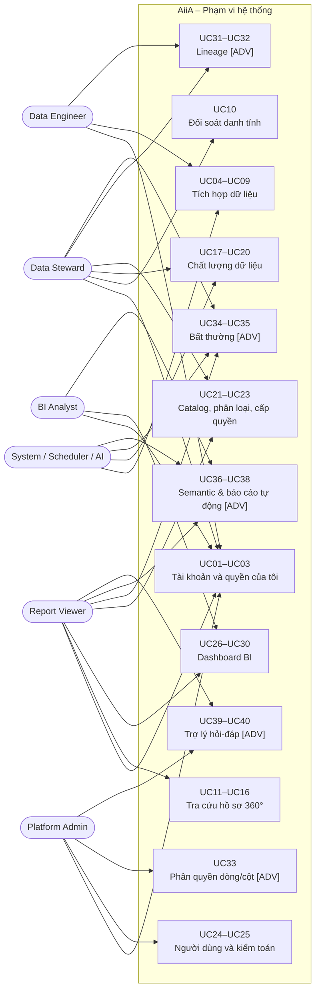

#### 2.4.2. Danh sách Use Cases

| Use Case | Tên ca sử dụng | Actor chính | US liên quan | Phạm vi |
| --- | --- | --- | --- | :---: |
| UC01 | Đăng nhập SSO | Người dùng nội bộ | US01 | MVP |
| UC02 | Đăng xuất | Người đã đăng nhập | US02 | MVP |
| UC03 | Xem hồ sơ và quyền của tôi | Người đã đăng nhập | US03 | MVP |
| UC04 | Đăng ký nguồn dữ liệu | Data Engineer | US04 | MVP |
| UC05 | Upload file dữ liệu | Data Engineer | US05 | MVP |
| UC06 | Lập lịch ingest | Data Engineer | US06 | MVP |
| UC07 | Giám sát và chạy lại pipeline | Data Engineer | US07 | MVP |
| UC08 | Ánh xạ schema vào mô hình chuẩn | Data Engineer | US08 | MVP |
| UC09 | Xem trước dữ liệu theo lớp | Data Engineer | US09 | MVP |
| UC10 | Duyệt đối soát danh tính | Data Steward | US10 | MVP |
| UC11 | Tìm kiếm hồ sơ 360° | Report Viewer | US11 | MVP |
| UC12 | Xem hồ sơ sinh viên | Report Viewer | US12 | MVP |
| UC13 | Xem hồ sơ giảng viên | Report Viewer | US13 | MVP |
| UC14 | Xem hồ sơ cán bộ | Report Viewer | US14 | MVP |
| UC15 | Xem dòng thời gian hồ sơ | Report Viewer | US15 | MVP |
| UC16 | Xem nguồn gốc thuộc tính | Report Viewer | US16 | MVP |
| UC17 | Định nghĩa quy tắc chất lượng | Data Steward | US17 | MVP |
| UC18 | Thực thi kiểm tra chất lượng và cách ly | System | US18 | MVP |
| UC19 | Xem điểm chất lượng dữ liệu | Data Steward | US19 | MVP |
| UC20 | Xử lý issue chất lượng | Data Steward | US20 | MVP |
| UC21 | Tra cứu data catalog | Người đã đăng nhập | US21 | MVP |
| UC22 | Phân loại nhạy cảm và glossary | Data Steward | US22 | MVP |
| UC23 | Yêu cầu và phê duyệt truy cập | Report Viewer, Data Steward | US23 | MVP |
| UC24 | Quản lý người dùng và vai trò | Platform Admin | US24 | MVP |
| UC25 | Xem nhật ký kiểm toán | Platform Admin | US25 | MVP |
| UC26 | Xem thư viện dashboard | Report Viewer | US26 | MVP |
| UC27 | Lọc và drill-down dashboard | Report Viewer | US27 | MVP |
| UC28 | Thiết kế dashboard | BI Analyst | US28 | MVP |
| UC29 | Export báo cáo | Report Viewer | US29 | MVP |
| UC30 | Publish và chia sẻ dashboard | BI Analyst | US30 | MVP |
| UC31 | Xem lineage | Data Steward, Data Engineer | US31 | ADV |
| UC32 | Phân tích tác động thay đổi | Data Engineer | US32 | ADV |
| UC33 | Cấu hình chính sách dòng/cột | Platform Admin | US33 | ADV |
| UC34 | Phát hiện bất thường | System | US34 | ADV |
| UC35 | Xử lý cảnh báo bất thường | Data Steward, Report Viewer | US35 | ADV |
| UC36 | Quản lý semantic model | BI Analyst | US36 | ADV |
| UC37 | Đăng ký báo cáo định kỳ | Report Viewer | US37 | ADV |
| UC38 | Sinh và gửi báo cáo tự động | System | US38 | ADV |
| UC39 | Hỏi-đáp trên dữ liệu được cấp quyền | Report Viewer | US39 | ADV |
| UC40 | Quản trị nhật ký và chủ đề chặn hỏi-đáp | Platform Admin | US40 | ADV |

#### 2.4.3. Đặc tả một số Use Case trọng tâm

**UC05 + UC18 – Upload file và kiểm tra chất lượng tự động**

- **Actor:** Data Engineer (UC05), System (UC18).
- **Tiền điều kiện:** Nguồn `ACTIVE` có loại FILE và mẫu (template) cột; dataset đích có quy tắc DQ `ACTIVE`.
- **Luồng chính:** (1) Engineer chọn nguồn, kéo-thả file → (2) Hệ thống kiểm tra định dạng, dung lượng, header, checksum, hiển thị xem trước 20 dòng → (3) Engineer xác nhận ingest → (4) Hệ thống ghi batch vào Bronze, tạo `run_id` trạng thái `RUNNING` → (5) Biến đổi theo mapping hiện hành → (6) Chạy các quy tắc DQ → (7) Bản ghi đạt ghi vào Silver, bản ghi vi phạm `BLOCKING` vào quarantine → (8) Cập nhật Gold/hồ sơ 360° liên quan → (9) Kết thúc run `SUCCEEDED` hoặc `PARTIAL` kèm thống kê.
- **Luồng thay thế:** Checksum trùng một batch trước đó → cảnh báo, chỉ tiếp tục khi Engineer xác nhận; khi chạy, BR14 bảo đảm không tạo bản ghi trùng.
- **Ngoại lệ:** Sai định dạng/header → từ chối ở bước (2), không tạo batch. Lỗi hệ thống khi biến đổi → run `FAILED`, có log và nút chạy lại.
- **Hậu điều kiện:** Batch Bronze được lưu bất biến; dữ liệu Silver/Gold không chứa bản ghi vi phạm `BLOCKING`; issue được tạo cho các vi phạm.

**UC10 – Duyệt đối soát danh tính**

- **Actor:** Data Steward.
- **Tiền điều kiện:** Có cặp ứng viên với điểm khớp trong vùng 0,75 – 0,95 (BR05).
- **Luồng chính:** (1) Steward mở hàng đợi, sắp xếp theo điểm hoặc nguồn → (2) Chọn một cặp → (3) Hệ thống hiển thị so sánh song song các trường (họ tên, ngày sinh, email, mã nguồn, đơn vị…), tô màu giống/khác, các trường `RESTRICTED` chỉ hiển thị kết quả so khớp (khớp/không khớp) → (4) Steward chọn **Gộp** → (5) Hệ thống gộp về một `person_id`, tính lại golden record, ghi lịch sử và audit.
- **Luồng thay thế:** Chọn **Không trùng** → cặp được đánh dấu `REJECTED`, không đề xuất lại trừ khi dữ liệu thay đổi; chọn **Để sau** → giữ `PENDING`.
- **Ngoại lệ:** Một trong hai bản ghi đã bị gộp ở thao tác khác → báo xung đột, tải lại cặp.
- **Hậu điều kiện:** Hồ sơ 360° phản ánh hợp nhất; thao tác có thể tách lại (unmerge).

**UC23 – Yêu cầu và phê duyệt truy cập**

- **Actor:** Report Viewer (yêu cầu), Data Steward (phê duyệt).
- **Tiền điều kiện:** Người dùng đã đăng nhập, gặp tài nguyên bị khóa (dataset, dashboard, tab hồ sơ, trường bị che).
- **Luồng chính:** (1) Người dùng nhấn “Yêu cầu quyền” tại chỗ bị khóa → (2) Hệ thống mở form điền sẵn tài nguyên, người dùng nhập mục đích, phạm vi, thời hạn → (3) Gửi, yêu cầu ở trạng thái `PENDING`, Steward phụ trách nhận thông báo → (4) Steward xem yêu cầu, lịch sử quyền của người yêu cầu và mức nhạy cảm tài nguyên → (5) Phê duyệt (có thể rút ngắn thời hạn) → (6) Quyền có hiệu lực, người yêu cầu nhận thông báo.
- **Luồng thay thế:** Steward từ chối kèm lý do → `REJECTED`.
- **Ngoại lệ:** Steward trùng người yêu cầu → không được duyệt; thời hạn > 180 ngày → từ chối gửi.
- **Hậu điều kiện:** Quyền được ghi kèm ngày hết hạn; System tự chuyển `EXPIRED` và thu hồi khi đến hạn; mọi bước ghi audit.

**UC39 – Hỏi-đáp trên dữ liệu được cấp quyền [ADV]**

- **Actor:** Report Viewer.
- **Tiền điều kiện:** Có metric `CERTIFIED` trong semantic model; người dùng có quyền trên ít nhất một metric.
- **Luồng chính:** (1) Người dùng nhập câu hỏi tiếng Việt (ví dụ “Tỉ lệ sinh viên bị cảnh báo học vụ của khoa CNTT theo học kỳ năm 2025?”) → (2) Hệ thống kiểm tra chủ đề chặn → (3) Xác định metric, dimension, bộ lọc trong phạm vi quyền người hỏi → (4) Sinh truy vấn trên semantic model → (5) Thực thi dưới danh tính người hỏi với RLS/CLS và ngưỡng k = 5 → (6) Trả câu trả lời, biểu đồ, metric, bộ lọc, thời điểm dữ liệu, truy vấn → (7) Ghi log và audit.
- **Luồng thay thế:** Câu hỏi mơ hồ → trợ lý hỏi lại để làm rõ (chọn metric/khoảng thời gian); người dùng có thể “Mở trong dashboard” để khám phá thêm.
- **Ngoại lệ:** Yêu cầu dữ liệu ngoài quyền, dữ liệu dòng chi tiết `RESTRICTED` hoặc chủ đề bị chặn → từ chối, gợi ý “Yêu cầu quyền” nếu phù hợp; không có metric phù hợp → thông báo không trả lời được thay vì suy đoán.
- **Hậu điều kiện:** Không có dữ liệu ngoài quyền bị trả về; câu trả lời có thể kiểm chứng.

### 2.5. Vai trò và phân quyền (Roles and Permissions)

#### 2.5.1. Ma trận phân quyền

Ký hiệu: **✓** = được phép, **—** = không được phép, **Phạm vi** = trong phạm vi đơn vị và quyền dataset được cấp, **Của mình** = chỉ dữ liệu/đối tượng do mình tạo hoặc phụ trách.

| Chức năng | Platform Admin | Data Engineer | Data Steward | BI Analyst | Report Viewer |
| --- | :---: | :---: | :---: | :---: | :---: |
| Đăng nhập, đăng xuất, xem quyền của tôi | ✓ | ✓ | ✓ | ✓ | ✓ |
| Đăng ký/cấu hình nguồn, upload, lập lịch | — | ✓ | — | — | — |
| Giám sát/chạy lại pipeline | Xem | ✓ | Xem | — | — |
| Ánh xạ schema | — | ✓ | Xem | — | — |
| Xem trước dữ liệu Bronze/Silver | — | ✓ (che theo nhãn) | ✓ (che theo nhãn) | — | — |
| Duyệt đối soát danh tính | — | — | ✓ | — | — |
| Tìm kiếm/xem hồ sơ 360° | — | — | Phạm vi | Phạm vi | Phạm vi |
| Định nghĩa quy tắc DQ, xử lý issue | — | Xem | ✓ | — | — |
| Xem điểm DQ | ✓ | ✓ | ✓ | ✓ | Xem nhãn DQ trên dashboard |
| Tra cứu catalog (metadata) | ✓ | ✓ | ✓ | ✓ | ✓ |
| Phân loại nhạy cảm, glossary | — | — | ✓ | Đề xuất | — |
| Gửi yêu cầu truy cập | ✓ | ✓ | ✓ | ✓ | ✓ |
| Phê duyệt yêu cầu truy cập | — | — | Dataset phụ trách | — | — |
| Quản lý người dùng, vai trò, đơn vị | ✓ | — | — | — | — |
| Xem audit log | ✓ | — | Dataset phụ trách | — | — |
| Xem dashboard, lọc, drill-down | Phạm vi | Phạm vi | Phạm vi | Phạm vi | Phạm vi |
| Export PDF/CSV | — | — | Phạm vi | Phạm vi | Phạm vi |
| Thiết kế, publish, chia sẻ dashboard | — | — | — | Của mình | — |
| [ADV] Xem lineage | ✓ | ✓ | ✓ | ✓ | — |
| [ADV] Cấu hình chính sách dòng/cột | ✓ | — | Đề xuất | — | — |
| [ADV] Xử lý cảnh báo bất thường | — | Kỹ thuật | ✓ | — | Xem và xác nhận cảnh báo chỉ số trong phạm vi |
| [ADV] Quản lý semantic model | — | — | Chứng nhận metric | ✓ | — |
| [ADV] Đăng ký báo cáo định kỳ | — | — | ✓ | ✓ | ✓ |
| [ADV] Hỏi-đáp | — | — | Phạm vi | Phạm vi | Phạm vi |
| [ADV] Nhật ký và chủ đề chặn hỏi-đáp | ✓ | — | — | — | — |

#### 2.5.2. Các trạng thái nghiệp vụ cần quản lý

| Đối tượng | Trạng thái dự kiến | Ý nghĩa |
| --- | --- | --- |
| Người dùng | `ACTIVE`, `INACTIVE` | Đang hoạt động / bị khóa. |
| Nguồn dữ liệu | `DRAFT`, `ACTIVE`, `PAUSED`, `ARCHIVED` | Đang khai báo / đang ingest / tạm dừng / ngừng sử dụng (giữ lịch sử). |
| Lần chạy pipeline | `QUEUED`, `RUNNING`, `SUCCEEDED`, `PARTIAL`, `FAILED` | Chờ / đang chạy / thành công / thành công một phần (có cách ly) / thất bại. |
| Quy tắc DQ | `DRAFT`, `ACTIVE`, `DISABLED` | Đang soạn / đang áp dụng / tạm tắt. |
| Issue DQ | `OPEN`, `IN_PROGRESS`, `RESOLVED`, `WONT_FIX` | Mới / đang xử lý / đã xử lý / chấp nhận không sửa. |
| Ứng viên khớp danh tính | `PENDING`, `AUTO_MERGED`, `MERGED`, `REJECTED`, `UNMERGED` | Chờ duyệt / tự gộp / gộp thủ công / không trùng / đã tách lại. |
| Yêu cầu truy cập | `PENDING`, `APPROVED`, `REJECTED`, `EXPIRED`, `REVOKED` | Chờ / được duyệt / bị từ chối / hết hạn / bị thu hồi sớm. |
| Dashboard | `DRAFT`, `PUBLISHED`, `ARCHIVED` | Nháp / đã chia sẻ / lưu trữ. |
| [ADV] Metric | `DRAFT`, `CERTIFIED`, `DEPRECATED` | Nháp / được chứng nhận (dùng cho Q&A) / ngừng dùng. |
| [ADV] Cảnh báo bất thường | `OPEN`, `ACKNOWLEDGED`, `RESOLVED`, `DISMISSED` | Mới / đã ghi nhận / đã xử lý / bỏ qua (dương tính giả). |
| [ADV] Đăng ký báo cáo | `ACTIVE`, `PAUSED` | Đang gửi / tạm dừng. |
| [ADV] Câu hỏi trợ lý | `ANSWERED`, `CLARIFYING`, `REFUSED`, `FAILED` | Đã trả lời / đang hỏi lại / từ chối / lỗi. |

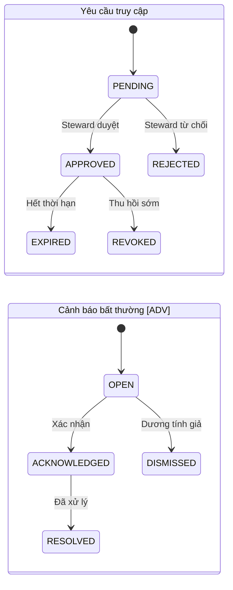

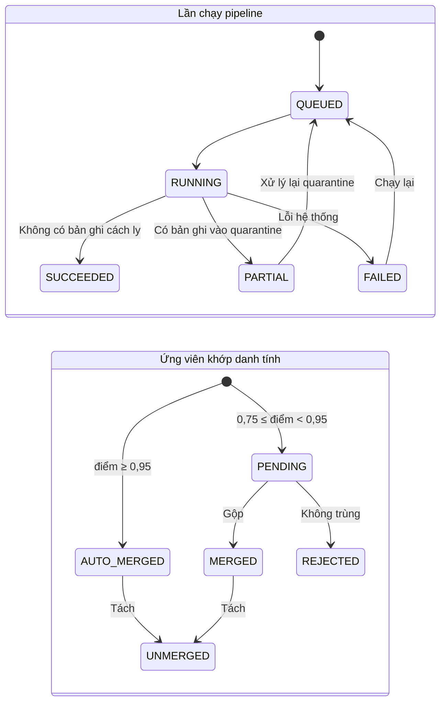

---

## 3. Kiến trúc thông tin (Information Architecture)

### 3.1. Cây phân cấp Page (Sitemap)

Ứng dụng là một **web app nội bộ** (không có khu vực công khai ngoài trang đăng nhập). Điều hướng chính chia thành 6 khu vực; mỗi khu vực chỉ hiển thị với vai trò tương ứng.


### 3.2. Phân cấp thông tin trong Page (Page → Section → Thành phần)

Sơ đồ dưới đây mô tả cấu trúc khung giao diện chung và phân rã Section của các trang trọng tâm. Nội dung đầy đủ của tất cả trang ở mục 3.3.

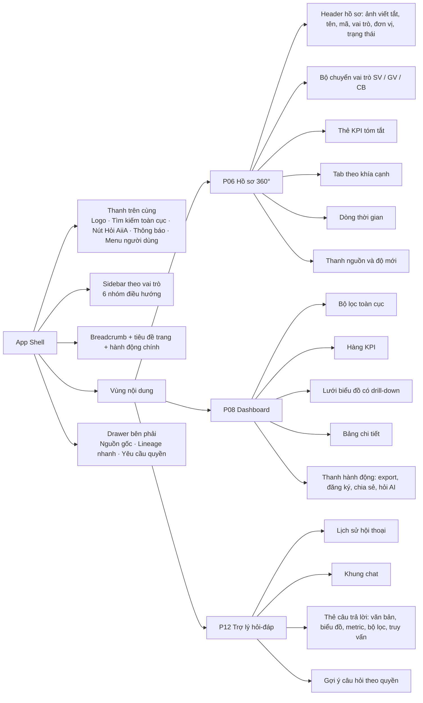

### 3.3. Nội dung từng Page theo Section

Mỗi Section là một khối nội dung giao diện; các nút, biểu mẫu và phản hồi được mô tả trong khối tương ứng. Modal, drawer và panel là thành phần của trang chứa chúng, không được tính thành Page riêng.

#### Khu vực Hệ thống & chung

##### P01 – Đăng nhập

| Section | Mô tả nội dung và chức năng |
| --- | --- |
| **Nhận diện AiiA** | Logo, tên nền tảng, mô tả ngắn và thông báo sử dụng dữ liệu đúng mục đích. |
| **Đăng nhập SSO** | Nút “Đăng nhập bằng tài khoản trường”; chuyển sang IdP và quay lại. Khóa nút khi đang chuyển hướng. |
| **Phản hồi** | Thông báo tài khoản bị khóa, chưa được cấp vai trò hoặc phiên hết hạn; sau đăng nhập quay về trang đang truy cập trước đó nếu có, ngược lại về P02. |

##### P02 – Trang chủ theo vai trò

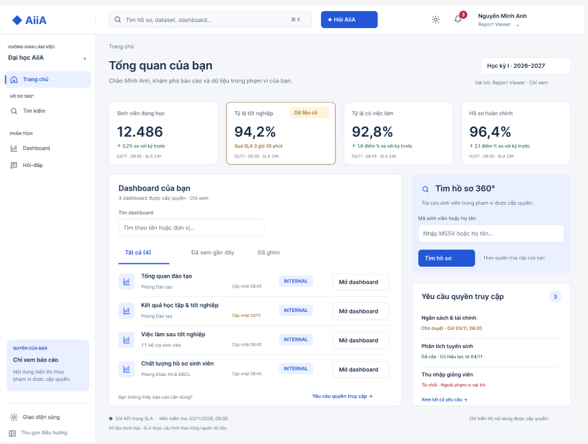

| Section | Mô tả nội dung và chức năng |
| --- | --- |
| **Lời chào và tìm kiếm nhanh** | Ô tìm kiếm hồ sơ/dataset/dashboard và ô “Hỏi AiiA” [ADV]. |
| **Widget theo vai trò** | Viewer: dashboard yêu thích, cảnh báo chỉ số. Engineer: run lỗi gần nhất, nguồn tạm dừng. Steward: issue mở, hàng đợi đối soát, yêu cầu truy cập chờ duyệt. Analyst: dashboard nháp, metric chờ chứng nhận. Admin: người dùng mới, thay đổi chính sách gần đây. |
| **Sức khỏe dữ liệu** | Điểm DQ tổng, số dataset vượt SLA độ mới, cảnh báo đang mở; nhấn để đi tới P20/P23. |
| **Truy cập gần đây** | Hồ sơ, dashboard, dataset đã xem gần đây. |

##### P03 – Hồ sơ & quyền của tôi

| Section | Mô tả nội dung và chức năng |
| --- | --- |
| **Thông tin tài khoản** | Họ tên, email, đơn vị (chỉ đọc, đồng bộ từ SSO/HRM). |
| **Vai trò và phạm vi** | Danh sách vai trò, phạm vi đơn vị áp dụng cho dữ liệu. |
| **Quyền dữ liệu đang có** | Bảng dataset/dashboard, mức truy cập, ngày hết hạn, người duyệt; nút gia hạn tạo yêu cầu mới tại P24. |
| **Đăng ký báo cáo [ADV]** | Danh sách báo cáo định kỳ đang nhận; tạm dừng/hủy. |
| **Phiên** | Nút đăng xuất. |

##### P04 – Không có quyền truy cập (403)

| Section | Mô tả nội dung và chức năng |
| --- | --- |
| **Thông báo** | Giải thích không có quyền truy cập chức năng/dữ liệu, không tiết lộ nội dung được bảo vệ. |
| **Hành động** | Nút “Yêu cầu quyền” (nếu là tài nguyên dữ liệu), nút về trang chủ. Người chưa đăng nhập được chuyển về P01. |

#### Khu vực Hồ sơ 360°

##### P05 – Tìm kiếm hồ sơ 360°

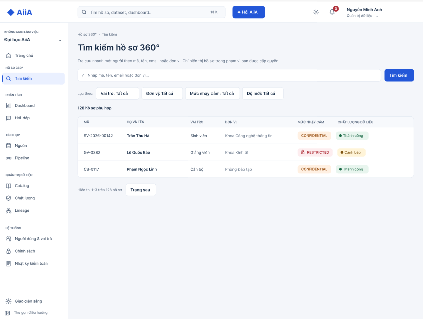

| Section | Mô tả nội dung và chức năng |
| --- | --- |
| **Thanh tìm kiếm** | Tìm theo mã, họ tên, email; gợi ý tức thì sau 2 ký tự (debounce 300 ms). |
| **Bộ lọc** | Loại hồ sơ (SV/GV/CB), đơn vị/khoa, khóa, ngành, trạng thái (đang học, bảo lưu, tốt nghiệp, đang công tác…). |
| **Kết quả** | Bảng/thẻ: tên, mã, vai trò, đơn vị, trạng thái, độ đầy đủ hồ sơ; phân trang; nhấn mở P06. Chỉ hồ sơ trong phạm vi quyền. |
| **Phản hồi trạng thái** | Đang tải, không có kết quả (gợi ý xóa bộ lọc), lỗi kèm nút thử lại. |

##### P06 – Chi tiết hồ sơ 360°

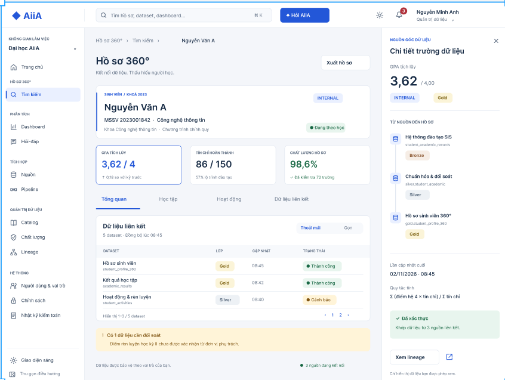

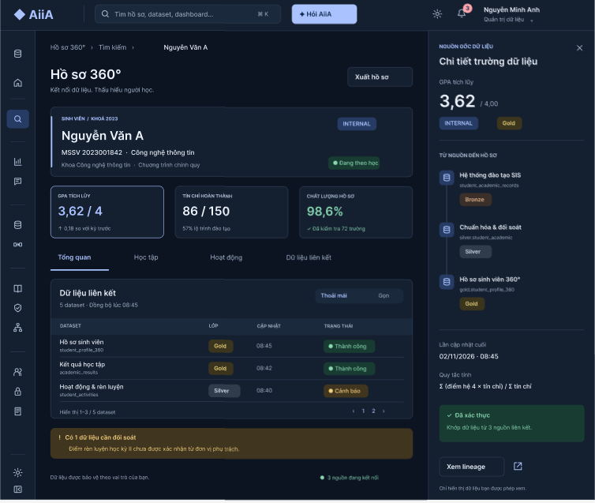

| Section | Mô tả nội dung và chức năng |
| --- | --- |
| **Header hồ sơ** | Ảnh viết tắt, họ tên, mã, đơn vị, trạng thái; định danh nhạy cảm bị che (ví dụ CCCD `0****1234`); bộ chuyển vai trò nếu một người có nhiều vai trò. |
| **Thẻ KPI tóm tắt** | SV: GPA tích lũy, tín chỉ tích lũy, điểm rèn luyện, tình trạng học phí. GV: giờ giảng năm học, số công bố, điểm đánh giá giảng dạy. CB: thâm niên, ngạch bậc, số khóa bồi dưỡng. |
| **Tab khía cạnh** | SV: Tổng quan, Học tập, Tài chính, Rèn luyện, Hoạt động, Đầu ra. GV: Tổng quan, Giảng dạy, Nghiên cứu, Đánh giá. CB: Tổng quan, Nhân sự, Phát triển, Thi đua. Tab không có quyền hiển thị khóa + “Yêu cầu quyền”. |
| **Nguồn và độ mới** | Mỗi tab có dòng “Nguồn: SIS, LMS · Cập nhật 2 giờ trước”; biểu tượng nguồn cạnh từng trường mở drawer nguồn gốc (nguồn, thời điểm, quy tắc ưu tiên, giá trị từng nguồn nếu đủ quyền). |
| **Dòng thời gian** | Sự kiện hợp nhất (nhập học, đăng ký học phần, nộp học phí, khen thưởng, công bố…), lọc theo loại/nguồn, tải thêm. |
| **Chất lượng hồ sơ** | Điểm đầy đủ, các trường thiếu, issue DQ liên quan (Steward). |
| **Phản hồi quyền và dữ liệu** | Hồ sơ không tồn tại hoặc ngoài phạm vi đều hiển thị “Không tìm thấy hồ sơ”; mọi lần mở hồ sơ được ghi audit. |

#### Khu vực Phân tích & BI

##### P07 – Thư viện dashboard

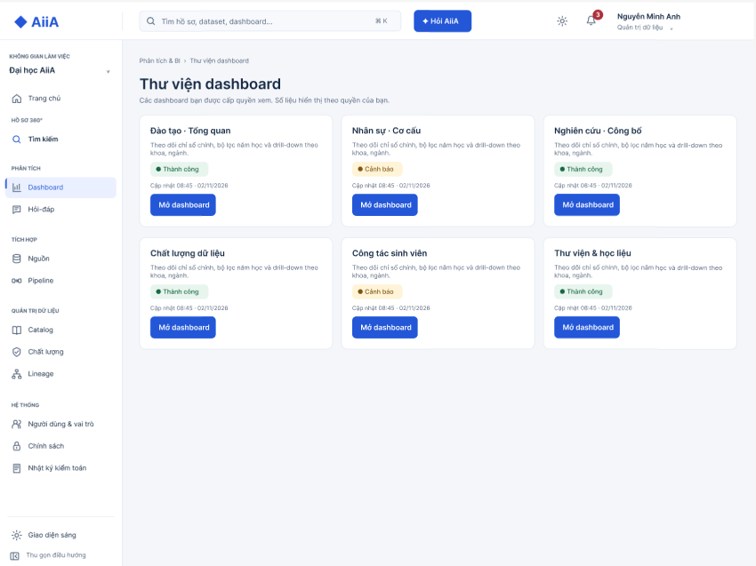

| Section | Mô tả nội dung và chức năng |
| --- | --- |
| **Thanh công cụ** | Tìm kiếm, lọc theo chủ đề (Đào tạo, Nhân sự, Nghiên cứu, Tài chính, Chất lượng dữ liệu), nút “Tạo dashboard” (Analyst). |
| **Danh sách dashboard** | Thẻ: tên, mô tả, chủ đề, owner, độ mới dữ liệu, trạng thái (Analyst thấy cả nháp của mình), sao yêu thích. |
| **Phản hồi trạng thái** | Chưa có dashboard được chia sẻ → hướng dẫn liên hệ/yêu cầu quyền. |

##### P08 – Xem dashboard

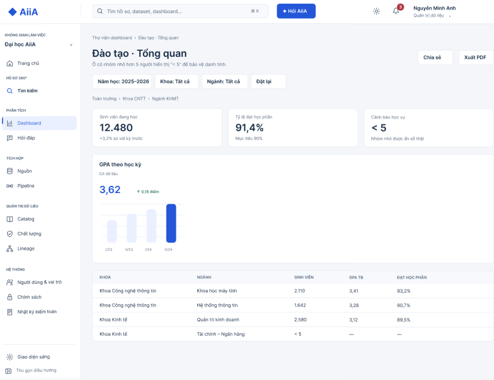

| Section | Mô tả nội dung và chức năng |
| --- | --- |
| **Header** | Tên, mô tả, owner, độ mới dữ liệu, nhãn điểm DQ của dataset nguồn, nhãn “Dữ liệu cũ” nếu vượt SLA. |
| **Bộ lọc toàn cục** | Năm học, học kỳ, khoa/đơn vị, ngành, khóa; chỉ hiện giá trị trong phạm vi quyền; lưu vào URL; nút đặt lại. |
| **Hàng KPI** | Ví dụ: tổng SV đang học, tỉ lệ cảnh báo học vụ, tỉ lệ tốt nghiệp đúng hạn, số công bố; so sánh cùng kỳ. |
| **Lưới biểu đồ** | Cột, đường, tròn, bản đồ nhiệt, bảng; tooltip; nhấn để drill-down (Trường → Khoa → Ngành → Lớp); breadcrumb drill; ô < 5 hiển thị “< 5”. |
| **Bảng chi tiết** | Sắp xếp, phân trang; dòng liên kết tới hồ sơ P06 nếu người xem có quyền. |
| **Thanh hành động** | Export PDF/CSV, Đăng ký nhận định kỳ [ADV], Chia sẻ liên kết, “Hỏi về dashboard này” [ADV], Xem lineage [ADV], Chỉnh sửa (owner). |

##### P09 – Thiết kế dashboard

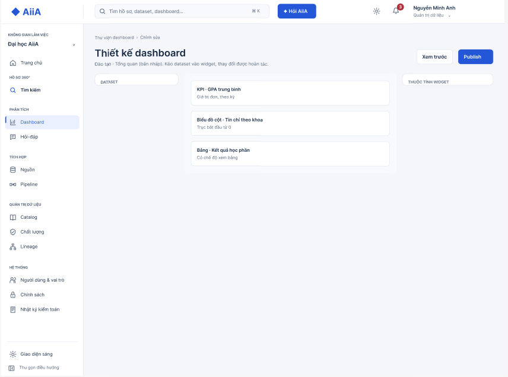

| Section | Mô tả nội dung và chức năng |
| --- | --- |
| **Thanh trên** | Tên dashboard, trạng thái nháp/đã publish, Lưu, Xem trước, Publish, Chia sẻ. |
| **Bảng dữ liệu** | Danh sách dataset Gold/metric được quyền; kéo trường vào biểu đồ. |
| **Canvas lưới** | Kéo-thả, thay đổi kích thước widget; thêm bộ lọc toàn cục; hoàn tác/làm lại. |
| **Panel thuộc tính widget** | Loại biểu đồ, trục, metric, dimension, sắp xếp, màu, drill path, tiêu đề. |
| **Modal chia sẻ** | Chọn vai trò/đơn vị/người dùng; nhắc rằng người xem thấy số liệu theo quyền của họ. |
| **Phản hồi** | Cảnh báo khi rời trang chưa lưu; lỗi truy vấn hiển thị trên widget. |

##### P10 – Semantic model [ADV]

![P10 · Semantic model [ADV]](./assets/prototypes/P10.png)

| Section | Mô tả nội dung và chức năng |
| --- | --- |
| **Danh sách metric/dimension** | Tên, định nghĩa, owner, trạng thái `DRAFT`/`CERTIFIED`/`DEPRECATED`, số dashboard sử dụng. |
| **Trình soạn metric** | Tên, định nghĩa nghiệp vụ, công thức, dataset gốc, dimension cho phép, liên kết glossary; nút Kiểm tra công thức, xem trước kết quả. |
| **Lịch sử phiên bản** | So sánh và khôi phục phiên bản. |
| **Chứng nhận** | Steward chứng nhận/ngừng metric; chỉ metric `CERTIFIED` dùng cho hỏi-đáp. |

##### P11 – Báo cáo tự động [ADV]

![P11 · Báo cáo tự động [ADV]](./assets/prototypes/P11.png)

| Section | Mô tả nội dung và chức năng |
| --- | --- |
| **Danh sách đăng ký** | Dashboard, tần suất, định dạng, người nhận, lần gửi gần nhất/kế tiếp, trạng thái. |
| **Modal tạo/sửa đăng ký** | Chọn dashboard, bộ lọc mặc định, lịch, định dạng, bật tóm tắt AI, người nhận nội bộ. |
| **Lịch sử gửi** | Thời điểm, kết quả, xem lại bản báo cáo đã gửi (theo quyền người xem). |

##### P12 – Trợ lý hỏi-đáp [ADV]

![P12 · Trợ lý hỏi-đáp [ADV]](./assets/prototypes/P12.png)

| Section | Mô tả nội dung và chức năng |
| --- | --- |
| **Danh sách hội thoại** | Hội thoại trước đây, tạo hội thoại mới. |
| **Khung chat** | Ô nhập câu hỏi, gợi ý câu hỏi dựa trên metric người dùng có quyền, trạng thái “đang phân tích…”. |
| **Thẻ câu trả lời** | Văn bản, biểu đồ/bảng, chip metric, chip bộ lọc, thời điểm dữ liệu, nhãn “Do AI tạo”, nút “Xem truy vấn”, “Mở trong dashboard”, phản hồi hữu ích/không. |
| **Hỏi lại làm rõ** | Khi câu hỏi mơ hồ, hiển thị lựa chọn (metric, khoảng thời gian, đơn vị) dạng chip. |
| **Từ chối** | Thông báo không thể trả lời do vượt quyền/chủ đề hạn chế, nút “Yêu cầu quyền” khi phù hợp. |

#### Khu vực Tích hợp dữ liệu

##### P13 – Nguồn dữ liệu

| Section | Mô tả nội dung và chức năng |
| --- | --- |
| **Thanh công cụ** | Tìm kiếm, lọc theo loại/trạng thái/mức nhạy cảm, nút “Đăng ký nguồn”. |
| **Danh sách nguồn** | Tên, loại, owner, trạng thái, lịch, lần chạy gần nhất (badge trạng thái), số dòng; menu: chạy ngay, tạm dừng, upload file, chỉnh sửa. |
| **Phản hồi** | Chưa có nguồn → hướng dẫn đăng ký nguồn đầu tiên. |

##### P14 – Đăng ký / cấu hình nguồn

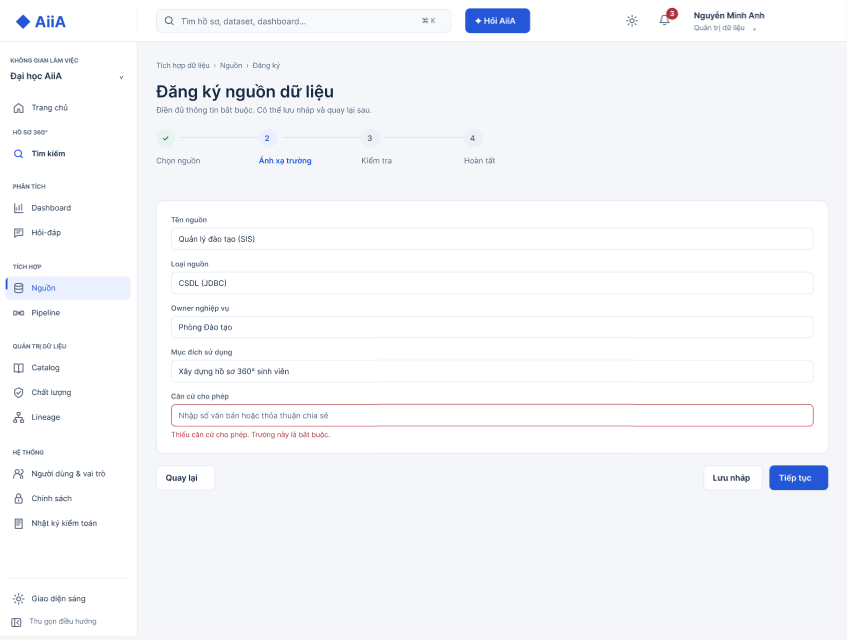

| Section | Mô tả nội dung và chức năng |
| --- | --- |
| **Bước 1 – Thông tin & căn cứ** | Tên, mô tả, owner nghiệp vụ, mục đích, căn cứ cho phép (số văn bản, tệp đính kèm), đối tượng dữ liệu, mức nhạy cảm. |
| **Bước 2 – Kết nối** | FILE: tải template, upload mẫu. JDBC/API: thông tin kết nối (bí mật lưu ở secret store, hiển thị che), nút Kiểm tra kết nối. |
| **Bước 3 – Ánh xạ schema** | Bảng cột nguồn ↔ trường mô hình chuẩn, gợi ý tự động theo tên, kiểu dữ liệu, xem trước biến đổi; [ADV] danh sách ảnh hưởng phía sau khi sửa. |
| **Bước 4 – Lịch & DQ** | Lịch cron (có bộ chọn trực quan), quy tắc DQ mặc định gợi ý; xem lại và kích hoạt. |
| **Upload file (tab)** | Kéo-thả file, kiểm tra header, xem trước 20 dòng, cảnh báo trùng checksum, xác nhận ingest. |

##### P15 – Giám sát pipeline

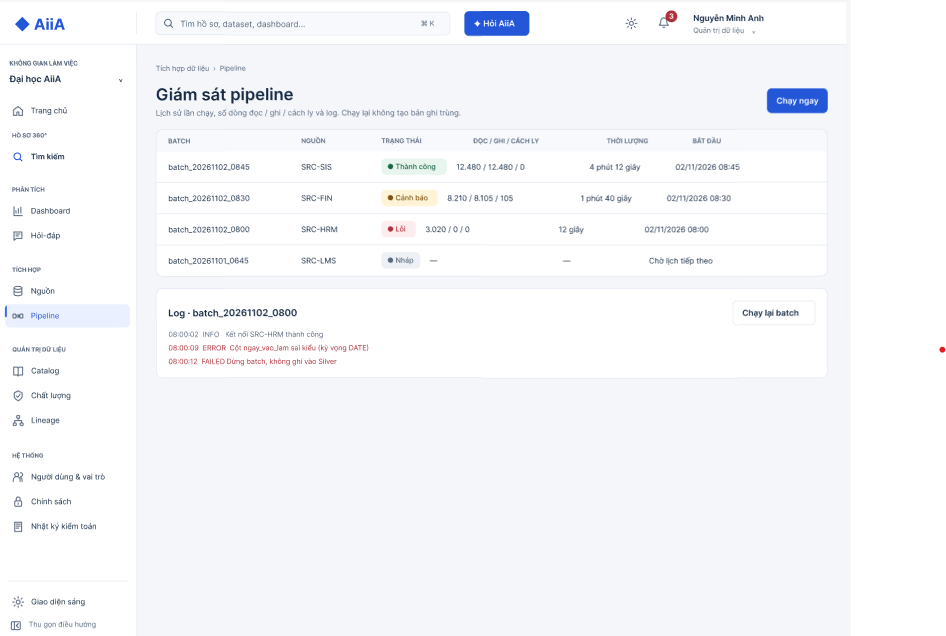

| Section | Mô tả nội dung và chức năng |
| --- | --- |
| **Tổng quan** | Số run hôm nay theo trạng thái, tỉ lệ thành công 7 ngày, thời lượng trung bình. |
| **Danh sách run** | Nguồn, `run_id`, thời gian, trạng thái, số dòng đọc/ghi/cách ly; lọc theo nguồn/trạng thái/khoảng thời gian; tự làm mới khi có run đang chạy. |
| **Drawer chi tiết run** | Các bước (Bronze → DQ → Silver → Gold) dạng stepper, log theo thời gian thực, kết quả DQ, nút Chạy lại, Xem quarantine. |

##### P16 – Data explorer

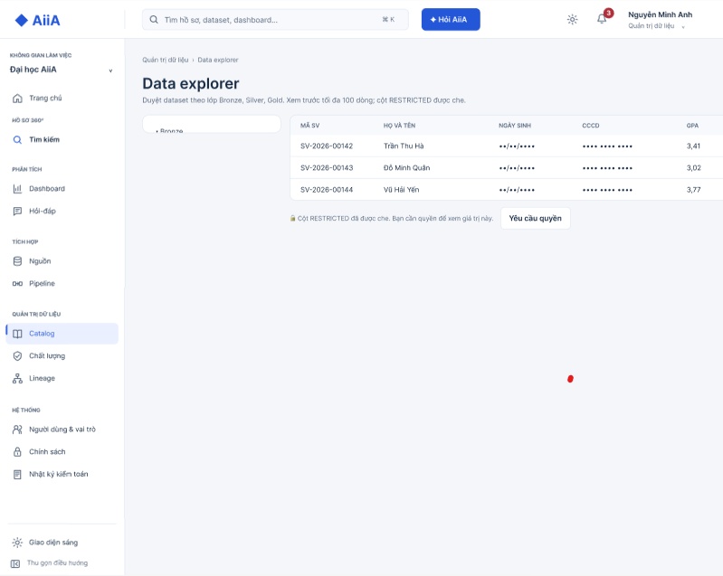

| Section | Mô tả nội dung và chức năng |
| --- | --- |
| **Cây dữ liệu** | Bronze/Silver/Gold/Quarantine → dataset. |
| **Bảng xem trước** | Tối đa 100 dòng, cột nhạy cảm bị che theo quyền, chọn batch/phiên bản (time-travel). |
| **Thông tin dataset** | Schema, số dòng, cập nhật gần nhất, liên kết P18. |

#### Khu vực Quản trị dữ liệu

##### P17 – Data catalog

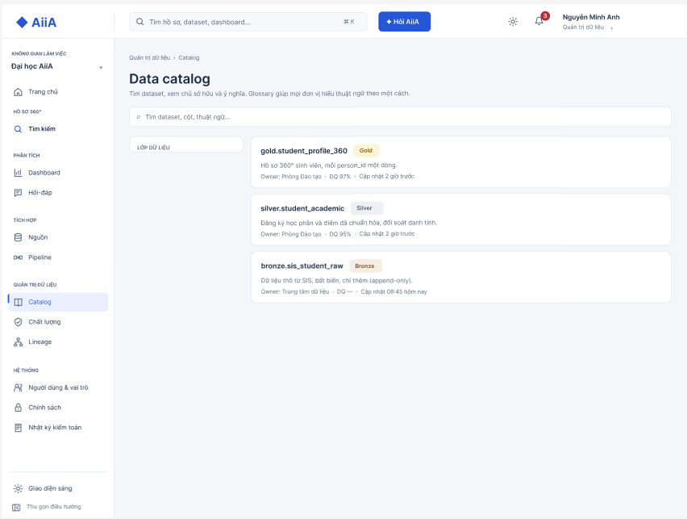

| Section | Mô tả nội dung và chức năng |
| --- | --- |
| **Tìm kiếm và facet** | Từ khóa; facet theo lớp, nguồn, owner, tag, mức nhạy cảm, có quyền/chưa có quyền. |
| **Kết quả** | Thẻ dataset: tên, mô tả, lớp, owner, điểm DQ, độ mới, biểu tượng khóa nếu chưa có quyền. |
| **Glossary (tab)** | Danh sách thuật ngữ, định nghĩa, liên kết cột/metric; Steward thêm/sửa. |

##### P18 – Chi tiết dataset

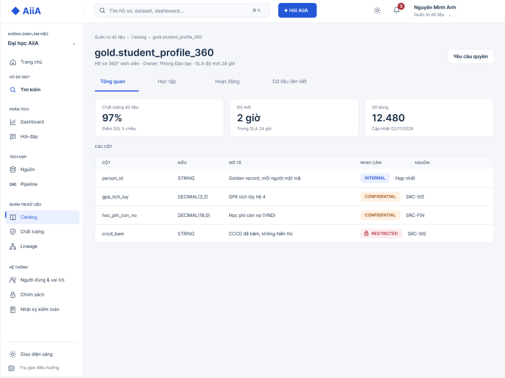

| Section | Mô tả nội dung và chức năng |
| --- | --- |
| **Header** | Tên, mô tả, owner, Steward phụ trách, lớp, nguồn, SLA độ mới, nút “Yêu cầu quyền” nếu chưa có. |
| **Tab Schema** | Cột, kiểu, mô tả, thuật ngữ, mức nhạy cảm (Steward sửa nhãn trực tiếp trong bảng). |
| **Tab Chất lượng** | Quy tắc áp dụng, điểm theo chiều, xu hướng, issue mở. |
| **Tab Lineage [ADV]** | Đồ thị thu gọn upstream/downstream, mở toàn màn hình P22. |
| **Tab Sử dụng** | Dashboard, metric dùng dataset; người có quyền truy cập (Steward). |
| **Tab Xem trước** | Theo quyền, giống P16. |

##### P19 – Quy tắc chất lượng

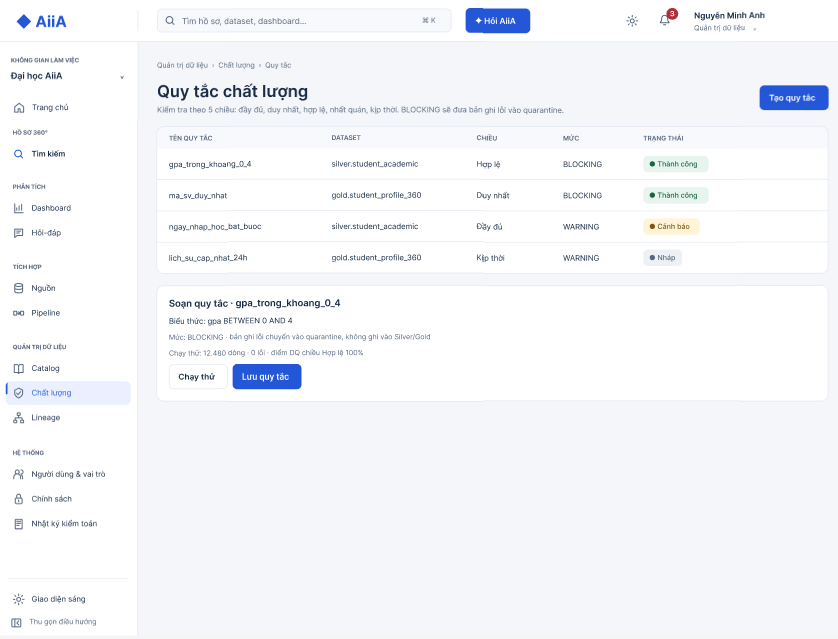

| Section | Mô tả nội dung và chức năng |
| --- | --- |
| **Danh sách quy tắc** | Dataset, cột, loại, chiều, mức, trạng thái, tỉ lệ đạt gần nhất; lọc và tìm kiếm. |
| **Trình soạn quy tắc (drawer)** | Chọn dataset/cột, loại quy tắc, tham số/ngưỡng, mức `BLOCKING`/`WARNING`, mô tả; nút Chạy thử hiển thị số bản ghi vi phạm và mẫu; Kích hoạt. |

##### P20 – Chất lượng & issue

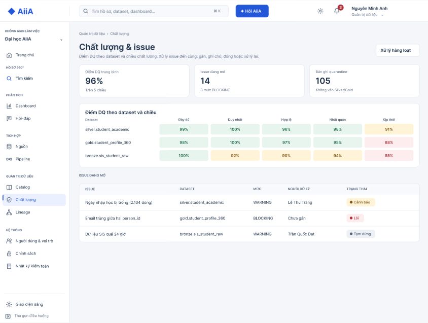

| Section | Mô tả nội dung và chức năng |
| --- | --- |
| **Thẻ điểm tổng** | Điểm DQ toàn nền tảng và theo 5 chiều; xu hướng 30 ngày. |
| **Bản đồ nhiệt** | Dataset × chiều chất lượng; nhấn ô xem quy tắc/issue. |
| **Danh sách issue** | Mã, dataset, quy tắc, số bản ghi ảnh hưởng, mức, người phụ trách, trạng thái; thao tác hàng loạt (gán, đổi trạng thái). |
| **Drawer issue** | Bản ghi mẫu vi phạm (che theo quyền), ghi chú, lịch sử, nút Xử lý lại quarantine. |

##### P21 – Đối soát danh tính

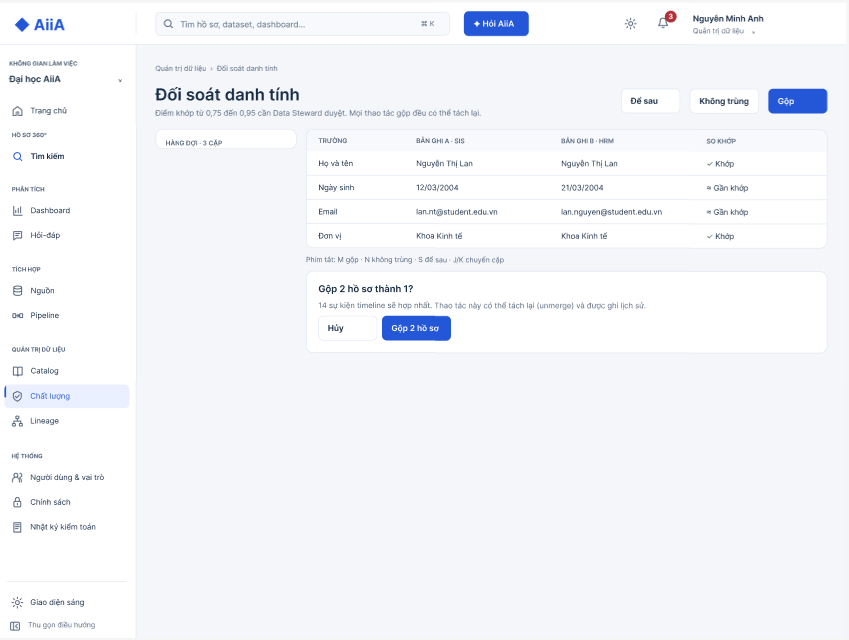

| Section | Mô tả nội dung và chức năng |
| --- | --- |
| **Hàng đợi** | Cặp ứng viên, điểm khớp, nguồn, ngày phát hiện; sắp xếp, lọc theo khoảng điểm/nguồn. |
| **So sánh song song** | Hai cột bản ghi, từng trường tô xanh (khớp), vàng (gần khớp), đỏ (khác); trường `RESTRICTED` chỉ hiển thị kết quả so khớp. |
| **Thanh quyết định** | Gộp, Không trùng, Để sau; phím tắt; xác nhận trước khi gộp. |
| **Lịch sử gộp/tách** | Tìm `person_id`, xem lịch sử, nút Tách (unmerge) kèm xác nhận. |

##### P22 – Lineage [ADV]

![P22 · Lineage [ADV]](./assets/prototypes/P22.png)

| Section | Mô tả nội dung và chức năng |
| --- | --- |
| **Thanh tìm kiếm nút** | Tìm dataset, metric, dashboard để làm tâm đồ thị. |
| **Đồ thị** | Nút theo lớp (màu theo loại), cạnh có hướng; phóng to/thu nhỏ, kéo, mở rộng upstream/downstream theo từng bậc; chế độ mức cột. |
| **Panel chi tiết nút** | Metadata, owner, run gần nhất, điểm DQ; liên kết tới trang chi tiết. |
| **Phân tích tác động** | Chọn nút → liệt kê toàn bộ phía sau bị ảnh hưởng, xuất danh sách. |

##### P23 – Cảnh báo bất thường [ADV]

![P23 · Cảnh báo bất thường [ADV]](./assets/prototypes/P23.png)

| Section | Mô tả nội dung và chức năng |
| --- | --- |
| **Bộ lọc** | Loại (volume, freshness, metric), mức độ, trạng thái, đối tượng. |
| **Danh sách cảnh báo** | Thời điểm, đối tượng, giá trị kỳ vọng/thực tế, mức độ, trạng thái. |
| **Drawer cảnh báo** | Biểu đồ chuỗi thời gian có dải kỳ vọng và điểm bất thường; liên kết run/dataset/dashboard; Xác nhận, Đã xử lý, Bỏ qua kèm ghi chú. |

##### P24 – Yêu cầu truy cập

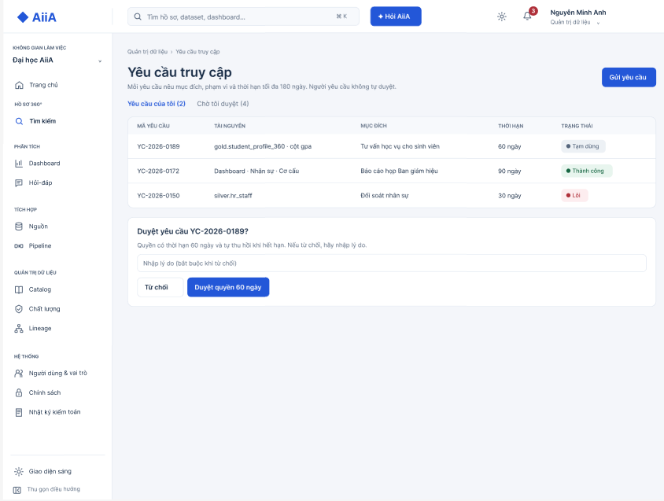

| Section | Mô tả nội dung và chức năng |
| --- | --- |
| **Tab Yêu cầu của tôi** | Tài nguyên, mục đích, thời hạn, trạng thái, người duyệt; hủy yêu cầu đang chờ. |
| **Tab Chờ tôi duyệt (Steward)** | Danh sách yêu cầu; drawer chi tiết: người yêu cầu, vai trò, đơn vị, quyền hiện có, mức nhạy cảm tài nguyên; Phê duyệt (có thể chỉnh thời hạn), Từ chối kèm lý do. |
| **Modal tạo yêu cầu** | Mở từ mọi nút “Yêu cầu quyền”: tài nguyên điền sẵn, mục đích, phạm vi, thời hạn (≤ 180 ngày). |

#### Khu vực Quản trị hệ thống

##### P25 – Người dùng & vai trò

| Section | Mô tả nội dung và chức năng |
| --- | --- |
| **Danh sách người dùng** | Tên, email, đơn vị, vai trò, trạng thái, lần đăng nhập cuối; tìm kiếm, lọc. |
| **Panel chi tiết** | Gán/gỡ vai trò, phạm vi đơn vị, khóa/mở khóa; quyền dữ liệu đang có. |
| **Hộp thoại xác nhận** | Nêu rõ thay đổi trước khi lưu; chặn gỡ Admin cuối cùng. |

##### P26 – Chính sách phân quyền [ADV]

![P26 · Chính sách phân quyền [ADV]](./assets/prototypes/P26.png)

| Section | Mô tả nội dung và chức năng |
| --- | --- |
| **Danh sách chính sách** | Tên, vai trò áp dụng, dataset, loại (dòng/cột), phiên bản, người sửa cuối. |
| **Trình soạn chính sách** | Điều kiện dòng (ví dụ `faculty_id = user.faculty_id`), quy tắc cột theo mức nhạy cảm (che một phần, băm, ẩn). |
| **Mô phỏng “Xem như”** | Chọn người dùng → xem trước dữ liệu mẫu và số dòng sau khi áp chính sách. |
| **Lịch sử phiên bản** | So sánh, khôi phục. |

##### P27 – Nhật ký kiểm toán

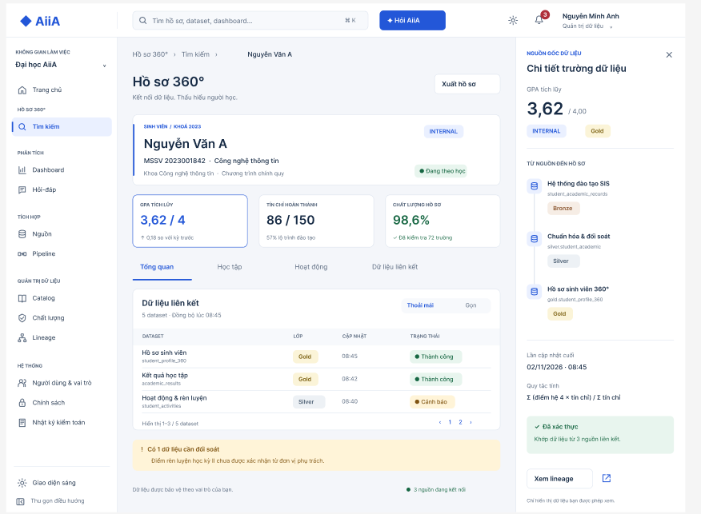

| Section | Mô tả nội dung và chức năng |
| --- | --- |
| **Bộ lọc** | Người dùng, hành động (xem hồ sơ, export, đổi quyền, hỏi AI…), đối tượng, kết quả, thời gian. |
| **Bảng log** | Chỉ đọc; thời điểm, người, hành động, đối tượng, kết quả cho phép/từ chối, địa chỉ IP. |
| **Tab Hỏi-đáp [ADV]** | Câu hỏi, truy vấn sinh ra, kết quả, phản hồi; quản lý danh sách chủ đề bị chặn. |

### 3.4. Danh mục màn hình (Screen Inventory)

| Mã | Màn hình / Page | Hình thức hiển thị | Vai trò | US liên quan |
| --- | --- | --- | --- | --- |
| P01 | Đăng nhập | Trang | Chưa đăng nhập | US01 |
| P02 | Trang chủ theo vai trò | Trang widget | Tất cả | US03, US19, US26 |
| P03 | Hồ sơ & quyền của tôi | Trang chi tiết | Tất cả | US02, US03, US37 |
| P04 | Không có quyền (403) | Trang thông báo | Người không có quyền | BR08 |
| P05 | Tìm kiếm hồ sơ 360° | Trang tìm kiếm + bộ lọc | Viewer, Analyst, Steward | US11 |
| P06 | Chi tiết hồ sơ 360° | Trang tab + drawer nguồn gốc | Viewer, Analyst, Steward | US12–US16 |
| P07 | Thư viện dashboard | Trang lưới thẻ | Tất cả | US26 |
| P08 | Xem dashboard | Trang tương tác (bộ lọc, drill-down) | Tất cả theo quyền | US27, US29 |
| P09 | Thiết kế dashboard | Trình soạn kéo-thả + modal chia sẻ | BI Analyst | US28, US30 |
| P10 | Semantic model [ADV] | Danh sách + trình soạn | BI Analyst, Steward | US36 |
| P11 | Báo cáo tự động [ADV] | Danh sách + modal | Viewer, Analyst, Steward | US37, US38 |
| P12 | Trợ lý hỏi-đáp [ADV] | Giao diện chat | Viewer, Analyst, Steward | US39 |
| P13 | Nguồn dữ liệu | Trang danh sách | Data Engineer | US04, US06 |
| P14 | Đăng ký / cấu hình nguồn | Wizard 4 bước + tab upload | Data Engineer | US04, US05, US06, US08, US32 |
| P15 | Giám sát pipeline | Danh sách + drawer log | Data Engineer (Admin, Steward xem) | US07 |
| P16 | Data explorer | Cây + bảng | Data Engineer, Steward | US09 |
| P17 | Data catalog | Tìm kiếm facet + tab glossary | Tất cả | US21, US22 |
| P18 | Chi tiết dataset | Trang tab | Tất cả theo quyền | US21, US22, US31 |
| P19 | Quy tắc chất lượng | Danh sách + drawer soạn | Data Steward | US17 |
| P20 | Chất lượng & issue | Dashboard + danh sách + drawer | Data Steward, Engineer | US18, US19, US20 |
| P21 | Đối soát danh tính | Hàng đợi + so sánh song song | Data Steward | US10 |
| P22 | Lineage [ADV] | Đồ thị tương tác | Admin, Engineer, Steward, Analyst | US31, US32 |
| P23 | Cảnh báo bất thường [ADV] | Danh sách + drawer biểu đồ | Steward, Engineer, Viewer | US34, US35 |
| P24 | Yêu cầu truy cập | Trang 2 tab + modal | Tất cả; duyệt: Steward | US23 |
| P25 | Người dùng & vai trò | Danh sách + panel + xác nhận | Platform Admin | US24 |
| P26 | Chính sách phân quyền [ADV] | Trình soạn + mô phỏng | Platform Admin | US33 |
| P27 | Nhật ký kiểm toán | Bảng log + tab hỏi-đáp | Platform Admin | US25, US40 |

### 3.5. Luồng điều hướng chính (Navigation Flow)

**Luồng A – Đưa một nguồn dữ liệu mới vào nền tảng (Data Engineer)**

```text
P13 Nguồn dữ liệu → "Đăng ký nguồn"
  → P14 Bước 1 Thông tin & căn cứ cho phép
  → P14 Bước 2 Kết nối (Kiểm tra kết nối / upload file mẫu)
  → P14 Bước 3 Ánh xạ schema → xem trước biến đổi
  → P14 Bước 4 Lịch & quy tắc DQ gợi ý → Kích hoạt (ACTIVE)
  → P15 Giám sát run đầu tiên
      ├── SUCCEEDED → P16 Data explorer kiểm tra Silver/Gold
      ├── PARTIAL   → P20 Issue DQ → xử lý → Xử lý lại quarantine
      └── FAILED    → Drawer log → sửa cấu hình (P14) → Chạy lại
```

**Luồng B – Tra cứu hồ sơ 360° (Report Viewer)**

```text
P02 Trang chủ / Tìm kiếm toàn cục
  → P05 Tìm kiếm hồ sơ → lọc theo khoa/khóa/trạng thái
  → P06 Chi tiết hồ sơ → chuyển tab khía cạnh → xem dòng thời gian
      ├── Nhấn biểu tượng nguồn → Drawer nguồn gốc thuộc tính
      └── Tab/trường bị khóa → Modal yêu cầu quyền → P24 theo dõi trạng thái
```

**Luồng C – Phân tích bằng dashboard (Report Viewer / BI Analyst)**

```text
P07 Thư viện dashboard → P08 Xem dashboard
  → Bộ lọc toàn cục → drill-down Trường → Khoa → Ngành → Lớp
  → Bảng chi tiết → P06 Hồ sơ (nếu có quyền)
  → Export PDF/CSV | Đăng ký định kỳ (P11) | Hỏi về dashboard này (P12)
BI Analyst: P07 → "Tạo dashboard" → P09 → Xem trước → Publish → Chia sẻ → P08
```

**Luồng D – Quản trị chất lượng và danh tính (Data Steward)**

```text
P02 Widget "Issue mở" / "Hàng đợi đối soát"
  → P20 Chất lượng & issue → Drawer issue → gán / ghi chú / xử lý lại → RESOLVED
  → P19 Quy tắc chất lượng → tạo quy tắc → Chạy thử → Kích hoạt
  → P21 Đối soát danh tính → so sánh → Gộp / Không trùng / Để sau
  → P24 Chờ tôi duyệt → Phê duyệt / Từ chối yêu cầu truy cập
```

**Luồng E – Hỏi-đáp có kiểm soát [ADV]**

```text
Nút "Hỏi AiiA" (thanh trên) hoặc P08 "Hỏi về dashboard này"
  → P12 Nhập câu hỏi
      ├── Câu hỏi rõ    → Thẻ câu trả lời (biểu đồ + metric + bộ lọc + nguồn) → Mở trong dashboard P08
      ├── Câu hỏi mơ hồ → Chip làm rõ → chọn → Thẻ câu trả lời
      └── Vượt quyền    → Thông báo từ chối → Modal yêu cầu quyền
```

**Luồng F – Quản trị hệ thống (Platform Admin)**

```text
P25 Người dùng & vai trò → gán vai trò / phạm vi / khóa tài khoản → xác nhận
P26 Chính sách phân quyền → soạn điều kiện dòng/cột → Mô phỏng "Xem như" → Lưu phiên bản
P27 Nhật ký kiểm toán → lọc → xem chi tiết → tab Hỏi-đáp → cập nhật chủ đề bị chặn
```

---

## 4. Thiết kế UI/UX và tương tác Front-end

### 4.1. Nguyên tắc thiết kế

| Nguyên tắc | Cách thể hiện trên giao diện |
| --- | --- |
| **Tin cậy có thể kiểm chứng** | Mọi số liệu/thuộc tính có thể truy ra nguồn: nhãn độ mới, điểm DQ, biểu tượng nguồn, “Xem truy vấn”, lineage. |
| **Riêng tư theo mặc định** | Dữ liệu nhạy cảm hiển thị che sẵn; biểu tượng khóa thay vì ẩn hoàn toàn để người dùng biết có thể yêu cầu quyền; không rò rỉ sự tồn tại của hồ sơ ngoài phạm vi. |
| **Đúng vai trò** | Sidebar, trang chủ và hành động chính thay đổi theo vai trò; không hiển thị nút người dùng không được dùng. |
| **Hé lộ dần (progressive disclosure)** | Tóm tắt → chi tiết qua tab, drawer, drill-down; wizard nhiều bước cho cấu hình phức tạp. |
| **Phản hồi rõ ràng, nhất quán** | Mọi danh sách/biểu đồ có 5 trạng thái chuẩn: đang tải, có dữ liệu, rỗng, lỗi, không có quyền. |
| **An toàn thao tác** | Hành động khó đảo ngược (gộp, khóa tài khoản, publish, đổi chính sách) luôn có hộp thoại xác nhận nêu rõ hậu quả. |
| **Tiếp cận (Accessibility)** | Mục tiêu WCAG 2.1 AA: tương phản ≥ 4.5:1, không chỉ dùng màu để mang nghĩa (kèm nhãn/biểu tượng), điều hướng bàn phím, biểu đồ có bảng dữ liệu thay thế. |

### 4.2. Bố cục khung ứng dụng (App Shell)


> 🎨 **Thiết kế Figma:** [App Shell · P05 · Tìm kiếm hồ sơ 360°](https://www.figma.com/design/NycBZgxgrAcc0uYT2Fbz5t/Untitled?node-id=17-95)
```text
┌──────────────────────────────────────────────────────────────────────────────┐
│ ◆ AiiA   [🔍 Tìm hồ sơ, dataset, dashboard…   ]   [✦ Hỏi AiiA]   🔔3   👤 ▾ │
├──────────────┬───────────────────────────────────────────────────────────────┤
│ ⌂ Trang chủ  │ Hồ sơ 360° › Tìm kiếm › Nguyễn Văn A                          │
│              │ ┌───────────────────────────────────────────────┬───────────┐ │
│ HỒ SƠ 360°   │ │                                               │  Drawer   │ │
│  Tìm kiếm    │ │              Vùng nội dung trang              │  nguồn    │ │
│ PHÂN TÍCH    │ │                                               │  gốc /    │ │
│  Dashboard   │ │                                               │  yêu cầu  │ │
│  Hỏi-đáp     │ │                                               │  quyền    │ │
│ TÍCH HỢP     │ │                                               │           │ │
│  Nguồn       │ │                                               │           │ │
│  Pipeline    │ │                                               │           │ │
│ QUẢN TRỊ DL  │ │                                               │           │ │
│  Catalog     │ │                                               │           │ │
│  Chất lượng  │ └───────────────────────────────────────────────┴───────────┘ │
│ HỆ THỐNG     │                                                               │
└──────────────┴───────────────────────────────────────────────────────────────┘
```

| Nhóm sidebar | Admin | Engineer | Steward | Analyst | Viewer |
| --- | :---: | :---: | :---: | :---: | :---: |
| Hồ sơ 360° | — | — | ✓ | ✓ | ✓ |
| Phân tích & BI | ✓ | ✓ | ✓ | ✓ | ✓ |
| Tích hợp dữ liệu | Pipeline (xem) | ✓ | Pipeline (xem) | — | — |
| Quản trị dữ liệu | Catalog, Lineage | Catalog, DQ, Lineage | ✓ | Catalog, Lineage | Catalog, Yêu cầu truy cập |
| Quản trị hệ thống | ✓ | — | — | — | — |

### 4.3. Mindmap tương tác Front-end theo khu vực

Sơ đồ liệt kê **các tương tác người dùng** (hành động + phản hồi giao diện) mà FE cần hiện thực ở từng khu vực.

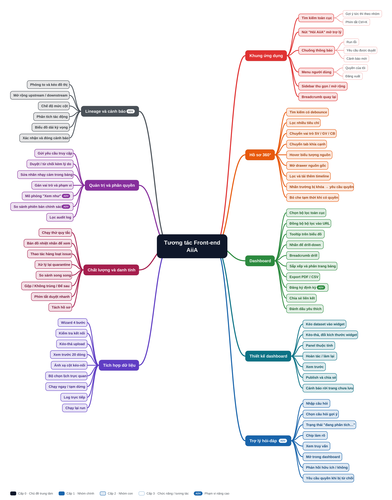

### 4.4. Danh mục mẫu tương tác (Interaction Patterns)

| Mẫu tương tác | Dùng ở | Hành vi chi tiết |
| --- | --- | --- |
| **Trường bị che + Yêu cầu quyền** | P06, P08, P16, P18 | Hiển thị `••••` hoặc che một phần + biểu tượng khóa; hover hiện tooltip “Dữ liệu mức RESTRICTED”; nhấn mở modal yêu cầu quyền với tài nguyên điền sẵn. |
| **Drawer nguồn gốc** | P06, P08 | Nhấn biểu tượng nguồn cạnh giá trị → drawer bên phải: hệ thống nguồn, thời điểm cập nhật, quy tắc ưu tiên, giá trị các nguồn (nếu đủ quyền), liên kết lineage [ADV]. Esc để đóng. |
| **Nhãn độ mới & DQ** | P06, P08, P17, P18 | Chip màu + chữ: “Cập nhật 2 giờ trước”, “DQ 97%”; vượt SLA hiển thị chip cảnh báo “Dữ liệu cũ”. |
| **Bộ lọc toàn cục đồng bộ URL** | P05, P08, P15, P20 | Đổi bộ lọc cập nhật query string; tải lại/chia sẻ liên kết giữ nguyên trạng thái; nút “Đặt lại”. |
| **Drill-down có breadcrumb** | P08 | Nhấn cột/ô → lọc sâu một cấp; breadcrumb “Toàn trường › Khoa CNTT › Ngành KHMT”; nhấn breadcrumb quay lại cấp trước. |
| **Wizard nhiều bước** | P14 | Stepper hiển thị tiến độ; không qua bước khi bước hiện tại chưa hợp lệ; lưu nháp tự động; quay lại không mất dữ liệu. |
| **So sánh song song** | P21 | Hai cột căn hàng theo trường; màu + biểu tượng (✓ khớp, ≈ gần khớp, ✗ khác); phím tắt `M` gộp, `N` không trùng, `S` để sau, `J/K` chuyển cặp. |
| **Drawer chi tiết trong danh sách** | P15, P20, P23, P24, P25 | Nhấn dòng mở drawer, danh sách vẫn giữ vị trí cuộn; cập nhật trong drawer phản ánh ngay vào dòng. |
| **Log thời gian thực** | P15 | Run đang chạy tự làm mới (polling/SSE); log tự cuộn, có nút tạm dừng cuộn. |
| **Thẻ câu trả lời AI** | P12 | Phản hồi theo luồng (streaming) văn bản trước, biểu đồ sau; nhãn “Do AI tạo”; nút “Xem truy vấn” mở khung code chỉ đọc. |
| **Hộp thoại xác nhận có hậu quả** | P09, P21, P25, P26 | Nêu đối tượng, thay đổi và ảnh hưởng (ví dụ “Gộp 2 hồ sơ thành 1, 14 sự kiện timeline sẽ hợp nhất”); nút chính đặt tên hành động cụ thể, không dùng “OK”. |
| **Toast phản hồi** | Toàn hệ thống | Thành công tự ẩn sau 4 giây; lỗi giữ đến khi đóng, kèm hành động “Thử lại”. |

### 4.5. Wireframe các màn hình trọng tâm

**P06 – Chi tiết hồ sơ 360° (Sinh viên)**

> 🎨 **Thiết kế Figma:** [P06 · Chi tiết hồ sơ 360°](https://www.figma.com/design/NycBZgxgrAcc0uYT2Fbz5t/Untitled?node-id=2-51)


```text
┌──────────────────────────────────────────────────────────────────────────────┐
│ (NA)  Nguyễn Văn A   SV2021001 · K66 · Khoa CNTT · Đang học   [SV ▾ | CB]   │
│       Email: a.nv@…edu.vn ⓘ   CCCD: 0********234 🔒  [Yêu cầu quyền]       │
├──────────────┬──────────────┬──────────────┬─────────────────────────────────┤
│ GPA 3.21 ⓘ   │ TC 98/130    │ ĐRL 82 Tốt   │ Học phí: Đã nộp đủ 🔒            │
├──────────────┴──────────────┴──────────────┴─────────────────────────────────┤
│ [Tổng quan] [Học tập] [Tài chính 🔒] [Rèn luyện] [Hoạt động] [Đầu ra]       │
│ Nguồn: SIS, LMS · Cập nhật 2 giờ trước · DQ 98%                              │
│ ┌──────────────────────────────────────┐ ┌─────────────────────────────────┐ │
│ │ GPA theo học kỳ (biểu đồ đường)      │ │ Dòng thời gian    [Lọc ▾]       │ │
│ │                                      │ │ • 10/2026 Đăng ký 6 học phần SIS│ │
│ ├──────────────────────────────────────┤ │ • 09/2026 Mượn 3 sách      LIB  │ │
│ │ Bảng học phần: mã, tên, TC, điểm     │ │ • 06/2026 Khen thưởng      STA  │ │
│ └──────────────────────────────────────┘ │ [Tải thêm]                      │ │
│                                          └─────────────────────────────────┘ │
└──────────────────────────────────────────────────────────────────────────────┘
```

**P08 – Xem dashboard**

> 🎨 **Thiết kế Figma:** [P08 · Xem dashboard](https://www.figma.com/design/NycBZgxgrAcc0uYT2Fbz5t/Untitled?node-id=18-268)


```text
┌──────────────────────────────────────────────────────────────────────────────┐
│ Tổng quan đào tạo   · Cập nhật 06:00 hôm nay · DQ 97%     [⤓ Export][✉][✦]  │
│ Năm học [2025-2026 ▾] Học kỳ [HK1 ▾] Khoa [Tất cả trong phạm vi ▾] [Đặt lại]│
├──────────────┬──────────────┬──────────────┬─────────────────────────────────┤
│ SV đang học  │ Cảnh báo HV  │ Tốt nghiệp   │ Bỏ học                          │
│ 12.430 ▲2%   │ 4,1% ▼0,3    │ đúng hạn 78% │ 1,9%                            │
├──────────────┴──────────────┴──────────────┴─────────────────────────────────┤
│ Toàn trường › Khoa CNTT                                                      │
│ ┌──────────────────────────────┐ ┌─────────────────────────────────────────┐ │
│ │ Cảnh báo HV theo ngành ▇▅▃   │ │ Xu hướng 8 học kỳ ╱╲╱                   │ │
│ │ (nhấn cột để drill-down)     │ │                                         │ │
│ └──────────────────────────────┘ └─────────────────────────────────────────┘ │
│ Bảng chi tiết: Lớp | Sĩ số | Cảnh báo | Tỉ lệ   (ô nhóm nhỏ hiển thị "< 5")  │
└──────────────────────────────────────────────────────────────────────────────┘
```

**P12 – Trợ lý hỏi-đáp [ADV]**

> 🎨 **Thiết kế Figma:** [P12 · Trợ lý hỏi-đáp](https://www.figma.com/design/NycBZgxgrAcc0uYT2Fbz5t/Untitled?node-id=19-449)

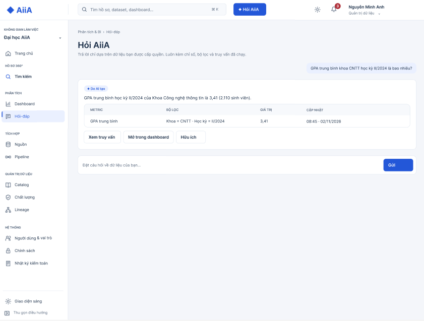
```text
┌───────────────┬──────────────────────────────────────────────────────────────┐
│ + Hội thoại   │ 👤 Tỉ lệ cảnh báo học vụ của khoa CNTT theo học kỳ năm 2025? │
│ • Cảnh báo HV │                                                              │
│ • Công bố GV  │ ✦ Tỉ lệ cảnh báo học vụ khoa CNTT giảm từ 5,2% (HK1) xuống   │
│               │   4,6% (HK2).                              [Do AI tạo]       │
│               │   ┌──────────────────────────────────────┐                   │
│               │   │  ▇ 5,2%   ▆ 4,6%                     │                   │
│               │   └──────────────────────────────────────┘                   │
│               │   Metric: ti_le_canh_bao_hoc_vu ✔  Lọc: Khoa=CNTT, 2025      │
│               │   Dữ liệu đến: 30/10/2026 06:00                              │
│               │   [Xem truy vấn] [Mở trong dashboard] 👍 👎                  │
│               ├──────────────────────────────────────────────────────────────┤
│               │ Gợi ý: [Số công bố theo khoa] [Tỉ lệ tốt nghiệp đúng hạn]    │
│               │ [ Nhập câu hỏi…                                      ] [➤]  │
└───────────────┴──────────────────────────────────────────────────────────────┘
```

**P21 – Đối soát danh tính**

> 🎨 **Thiết kế Figma:** [P21 · Đối soát danh tính](https://www.figma.com/design/NycBZgxgrAcc0uYT2Fbz5t/Untitled?node-id=21-1042)


```text
┌──────────────────────────────────────────────────────────────────────────────┐
│ Hàng đợi: 37 cặp chờ duyệt     Điểm [0,75–0,95 ▾]  Nguồn [Tất cả ▾]          │
├───────────────────┬──────────────────────────────────────────────────────────┤
│ ▸ 0,93 SIS↔HRM    │ Trường        │ Bản ghi A (SIS)    │ Bản ghi B (HRM)     │
│   0,91 SIS↔LIB    │ Họ tên        │ Trần Thị B         │ Trần Thị B      ✓   │
│   0,88 LMS↔SIS    │ Ngày sinh     │ 12/03/1995         │ 12/03/1995      ✓   │
│   0,82 HRM↔RES    │ Email         │ b.tt@st…edu.vn     │ b.tt@…edu.vn    ≈   │
│   …               │ CCCD          │ 🔒 khớp            │ 🔒              ✓   │
│                   │ Đơn vị        │ Khoa Kinh tế       │ Phòng Đào tạo   ✗   │
│                   ├──────────────────────────────────────────────────────────┤
│                   │ [M Gộp]   [N Không trùng]   [S Để sau]                   │
└───────────────────┴──────────────────────────────────────────────────────────┘
```

### 4.6. Luồng tương tác FE chi tiết

**Gặp dữ liệu bị khóa → yêu cầu quyền → dữ liệu mở khóa**

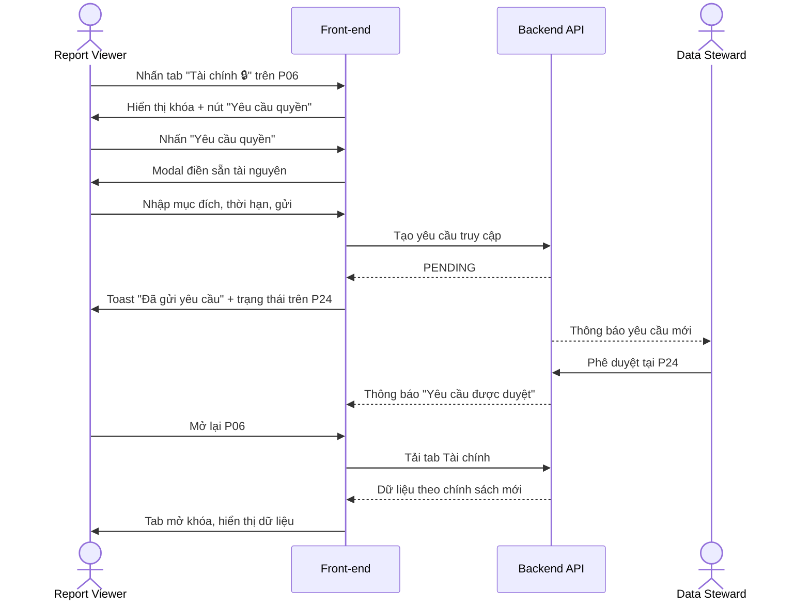

**Hỏi-đáp với kiểm soát quyền [ADV]**

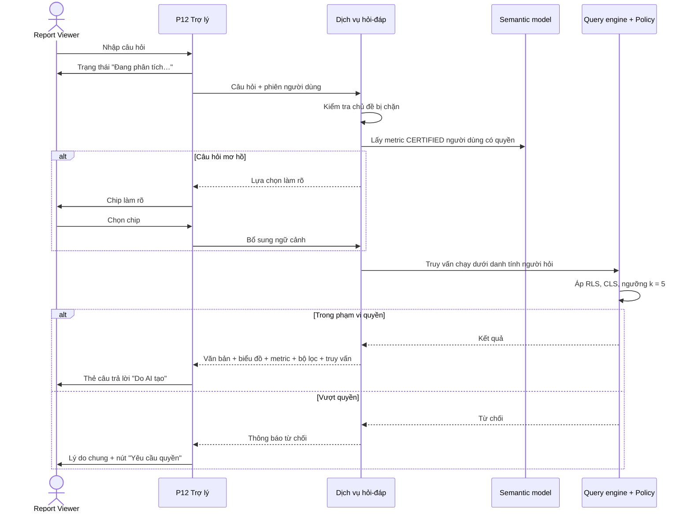

**Upload file và theo dõi kết quả ingest**

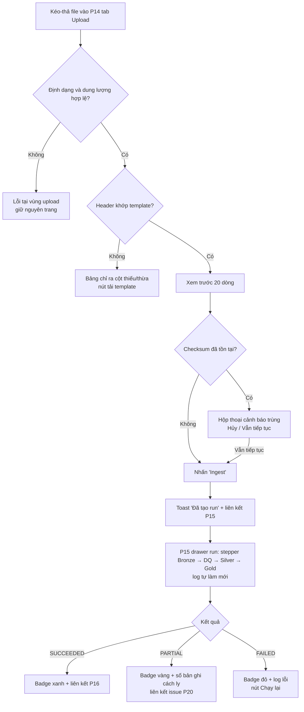

### 4.7. Trạng thái giao diện chuẩn

| Trạng thái | Biểu hiện | Hành động cho người dùng |
| --- | --- | --- |
| Đang tải | Skeleton đúng hình dạng nội dung (thẻ, bảng, biểu đồ); không dùng spinner toàn trang | — |
| Rỗng | Minh họa nhẹ + câu giải thích + hành động chính (ví dụ “Đăng ký nguồn đầu tiên”) | Nút hành động |
| Lỗi | Thông báo dễ hiểu, mã tham chiếu để báo hỗ trợ | “Thử lại” |
| Không có quyền | Biểu tượng khóa, không hiển thị dữ liệu, không tiết lộ nội dung | “Yêu cầu quyền” |
| Dữ liệu cũ | Chip cảnh báo vàng “Dữ liệu cũ – cập nhật lần cuối …” | Liên kết run/cảnh báo liên quan |
| Đã che | `••••` hoặc che một phần + 🔒 | Tooltip giải thích mức nhạy cảm |
| Nhóm nhỏ | Giá trị “< 5” thay cho số thật | Tooltip giải thích quy tắc bảo vệ |

### 4.8. Ngôn ngữ thị giác

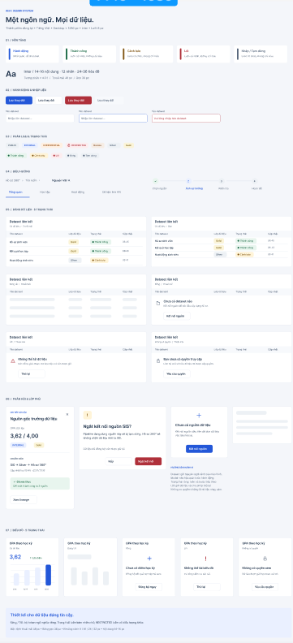

| Thành phần | Quy ước |
| --- | --- |
| Màu trạng thái | Xanh lá = thành công/đạt; vàng = cảnh báo/một phần; đỏ = lỗi/thất bại; xám = nháp/tạm dừng. Luôn đi kèm nhãn chữ. |
| Mức nhạy cảm | Chip: `PUBLIC` (xám), `INTERNAL` (xanh dương), `CONFIDENTIAL` (cam), `RESTRICTED` (đỏ + 🔒). |
| Lớp dữ liệu | Bronze (nâu đồng), Silver (bạc), Gold (vàng) dùng thống nhất trong explorer, catalog, lineage. |
| Biểu đồ | Bảng màu phân loại trung tính, tối đa 6 màu/biểu đồ; trục bắt đầu từ 0 với biểu đồ cột; mỗi biểu đồ có chế độ xem bảng. |
| Chủ đề | Hỗ trợ sáng/tối; mật độ “thoải mái” mặc định và “gọn” cho bảng dữ liệu. |
| Đáp ứng | Desktop-first (≥ 1280 px) cho vai trò kỹ thuật; Report Viewer dùng được trên máy tính bảng/điện thoại ở chế độ chỉ xem (dashboard, hồ sơ, hỏi-đáp). |
| Ngôn ngữ | Tiếng Việt mặc định; thuật ngữ kỹ thuật (Bronze, Silver, Gold, lineage, metric) giữ nguyên kèm giải thích ở tooltip/glossary. |

---

## 5. Kiến trúc C4

Mục này trình bày C1–C3. C4 Level 4 (mức code), sơ đồ lớp và sơ đồ tuần tự nằm ở [mục 8](#8-thiết-kế-chi-tiết-lớp-và-tuần-tự).

### 5.1. C1 — System Context

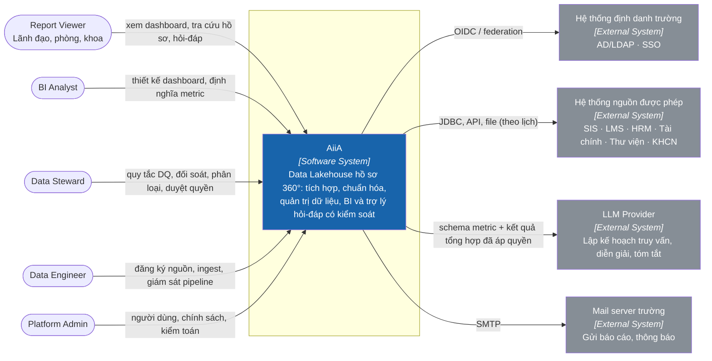

### 5.2. C2 — Container

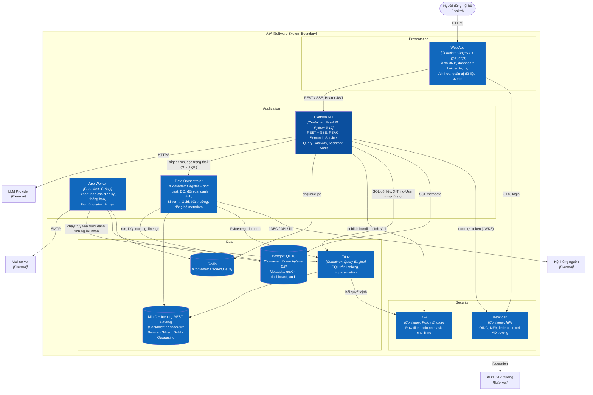

### 5.3. C3 — Component

#### 5.3.1. Platform API

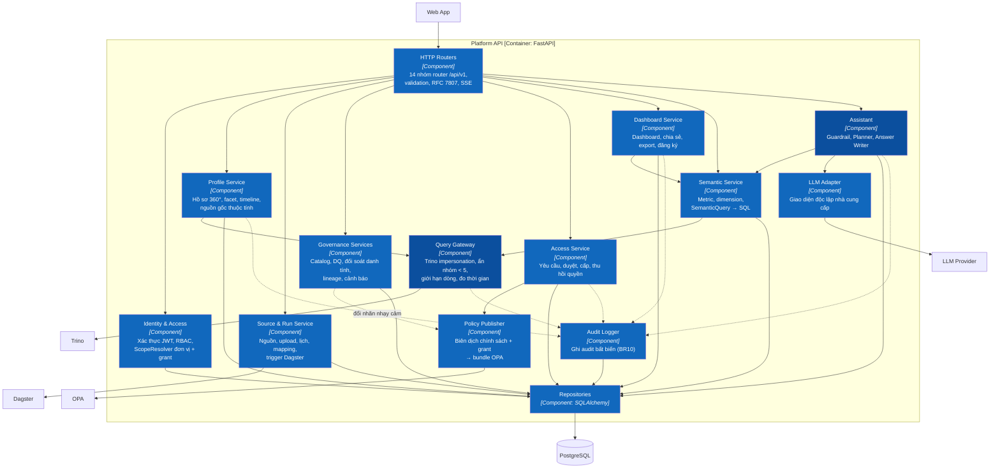

#### 5.3.2. Data Orchestrator

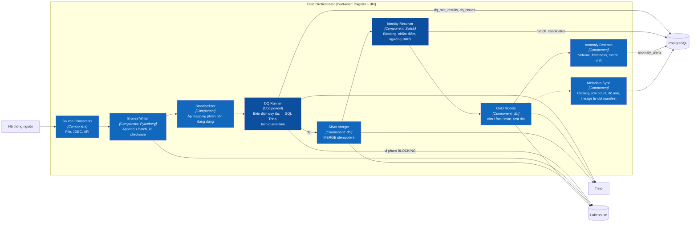

### 5.4. Quyết định kiến trúc

| # | Quyết định | Lý do | Đánh đổi |
| --- | --- | --- | --- |
| AD01 | Lakehouse **MinIO + Apache Iceberg**, truy vấn bằng **Trino** | Định dạng mở, ACID, time-travel (xem lại batch), một engine phục vụ cả BI, hồ sơ và DQ | Cần vận hành thêm Trino và catalog so với dùng một CSDL đơn |
| AD02 | Tách **control plane PostgreSQL** khỏi Lakehouse | Metadata giao dịch nhiều (quyền, issue, dashboard) cần ràng buộc chặt; dữ liệu cá nhân chỉ nằm ở Lakehouse | Hai nơi lưu trữ; đồng bộ metadata qua Metadata Sync |
| AD03 | **Thực thi phân quyền tại Trino bằng OPA** (row filter, column mask) và truy vấn bằng danh tính người dùng | Một điểm thực thi cho mọi đường truy cập: dashboard, hồ sơ, export, báo cáo, trợ lý (BR08, BR11) | Phải biên dịch chính sách sang bundle OPA và kiểm thử kỹ |
| AD04 | **Semantic Service tự xây**, LLM chỉ sinh `SemanticQuery` có cấu trúc | Chặn text-to-SQL tùy ý; mọi câu trả lời dùng metric đã chứng nhận và kiểm chứng được (BR16) | Câu hỏi ngoài semantic model sẽ bị từ chối thay vì “cố trả lời” |
| AD05 | **Dagster** điều phối, **dbt** cho Silver → Gold | Asset graph và dbt manifest cho lineage gần như miễn phí (US31) | Hai công cụ cần học |
| AD06 | Quy tắc DQ lưu ở PostgreSQL, **biên dịch thành SQL** chạy trên Trino | Steward soạn quy tắc trên UI, không cần viết code; kết quả gắn `run_id` | Tự xây bộ biên dịch thay vì dùng Great Expectations |
| AD07 | Đối soát danh tính bằng **Splink** (xác suất) + khớp định danh mạnh | Có điểm và trọng số từng trường để giải thích quyết định cho Steward | Phải hiệu chỉnh mô hình trên dữ liệu mẫu có nhãn |
| AD08 | **Keycloak** làm IdP, federation với AD/LDAP trường | OIDC chuẩn, MFA, nhóm/thuộc tính đơn vị dùng cho row filter | Thêm một thành phần cần vận hành |
| AD09 | LLM phía sau **adapter**; mặc định Claude | Đổi nhà cung cấp không ảnh hưởng nghiệp vụ (NFR27) | Chi phí gọi API; cần benchmark khi đổi mô hình |
| AD10 | Không có lời gọi tới hệ thống nguồn trong luồng request của người dùng | Ổn định, không tạo tải lên hệ thống vận hành của trường | Dữ liệu trễ theo lịch ingest (có nhãn độ mới) |

## 6. Cơ sở dữ liệu và hợp đồng OpenAPI

Bước này định nghĩa hợp đồng lưu trữ và hợp đồng HTTP nối Web App với Platform API.

### 6.1. Sơ đồ cơ sở dữ liệu

Control plane PostgreSQL gồm **39 bảng** chia 9 nhóm. Lớp Gold mô hình hồ sơ 360° dạng star schema quanh `dim_person` (golden record), mỗi hồ sơ vai trò và bảng fact là một khía cạnh của hồ sơ.

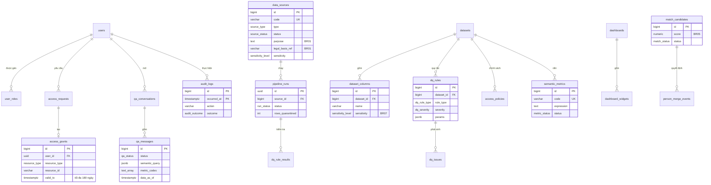

Schema hiện thực các quy tắc nghiệp vụ ngay ở tầng dữ liệu:

- Nguồn phải có mục đích và căn cứ cho phép (BR01).
- Yêu cầu truy cập tối đa 180 ngày và không cho tự duyệt (BR09).
- Chỉ tự gộp hồ sơ khi điểm ≥ 0,95 (BR05).
- Câu trả lời của trợ lý bắt buộc có metric và thời điểm dữ liệu (BR16).
- Audit log bất biến, phân vùng theo tháng (BR10).
- Không gỡ được Platform Admin cuối cùng (AC24).

Schema đã được chạy thử trọn vẹn trên PostgreSQL (PGlite), kèm kiểm thử các ràng buộc trên.

Chi tiết: [Thiết kế CSDL và từ điển dữ liệu](docs/DATABASE.md) · [DBML](src/database/aiia.dbml) · [PostgreSQL schema](src/database/aiia.sql).

### 6.2. Tài liệu API OpenAPI 3.0

Hợp đồng HTTP viết theo OpenAPI 3.0.4, chia 15 nhóm: Me, Profiles, Sources, Runs, Catalog, Data Quality, Identity, Access, Dashboards, Semantic, Reports, Alerts, Lineage, Assistant, Admin.

```text
80 path · 98 operation · 98 schema tái sử dụng
Bearer JWT (OIDC Keycloak) cho mọi endpoint
x-roles (vai trò được gọi) và x-scope (MVP | ADV) trên mọi operation
Server-Sent Events cho log pipeline và trợ lý hỏi-đáp
MaskableValue cho mọi trường có thể bị che; Problem.requestable để FE mở form yêu cầu quyền
404 thống nhất cho "không tồn tại" và "ngoài phạm vi" (AC11)
Lỗi RFC 7807 application/problem+json
```

| Nhóm | Endpoint chính | Trang |
| --- | --- | --- |
| Profiles | `GET /profiles`, `GET /profiles/{id}`, `GET /profiles/{id}/facets/{facet}`, `GET /profiles/{id}/timeline` | P05, P06 |
| Sources / Runs | `POST /sources`, `POST /sources/{id}/uploads`, `POST /sources/{id}/runs`, `GET /runs/{id}/logs` (SSE) | P13–P15 |
| Data Quality | `POST /dq/rules`, `POST /dq/rules/{id}/dry-run`, `GET /dq/scores`, `PATCH /dq/issues/{id}` | P19, P20 |
| Identity | `GET /identity/candidates`, `POST /identity/candidates/{id}/decision` | P21 |
| Access | `POST /access-requests`, `POST /access-requests/{id}/decision` | P24 |
| Dashboards / Semantic | `GET /dashboards/{id}`, `POST /semantic/query`, `POST /dashboards/{id}/exports` | P07–P10 |
| Assistant | `POST /assistant/conversations/{id}/messages` (SSE) | P12 |
| Admin | `PUT /admin/users/{id}/roles`, `POST /admin/policies/simulate`, `GET /admin/audit-logs` | P25–P27 |

Mọi operation có `operationId` ổn định, tham số, schema request/response và mã lỗi; hợp đồng đã qua `redocly lint` (chỉ còn cảnh báo vì server trỏ `localhost`). Đây là nguồn sự thật thiết kế; backend chưa được hiện thực.

- [Đặc tả OpenAPI 3.0.4](docs/api/openapi.yaml)

## 7. Cấu trúc thư mục Frontend, Backend và Data Pipeline

### 7.1. Bố cục repository

```text
PMDC-BATCH4-TUNGLD-AiiA/
├── assets/                          # [có] Ảnh mind map, sitemap; assets/mindmaps/*.txt → *.svg
├── docs/                            # [có]
│   ├── api/openapi.yaml             #   Hợp đồng API
│   ├── requirements/                #   Yêu cầu phi chức năng
│   └── DATABASE.md                  #   ER, từ điển dữ liệu, vòng đời dữ liệu
├── scripts/                         # [có] mindmap_to_svg.py
├── dockerfiles/                     # [có] Dockerfile.backend, .mock-source, .pipelines, .web (build từ gốc repo)
├── infra/                           # [có] Postgres init, Trino, Prometheus, Loki, Promtail, Tempo, Grafana, Debezium
├── sample-data/
│   └── mock-source/                 # [có] Nguồn giả lập: API + CSDL Postgres (uv)
├── src/
│   ├── database/                    # [có] aiia.dbml, aiia.sql (control plane)
│   ├── frontend/                    # [có] Angular 19 standalone, đủ P01–P27, mock API, unit + smoke test
│   ├── backend/                     # [có] FastAPI Platform API + Celery worker (uv)
│   └── pipelines/                   # [có] Dagster, dlt, PyIceberg, Soda, dbt-trino (uv)
├── compose.yaml                     # [có] Một compose, chia nhóm bằng profiles
├── docs/RUNNING.md                  # [có] Hướng dẫn chạy và kiểm tra
└── README.md
```

`[có]` = đã có trong repo · `[đích]` = cấu trúc đích, chưa hiện thực.

### 7.2. Angular Web App

```text
src/frontend/src/app/
├── app.config.ts            # Router (input binding), HttpClient + interceptor
├── app.routes.ts            # Route lazy-load; canMatch theo vai trò (roleGuard), canDeactivate khi chưa lưu
├── core/
│   ├── api/                 # schema.d.ts sinh từ openapi.yaml, models, ApiClient, service theo tag
│   ├── auth/                # SessionService (signals), guard, tài khoản demo
│   ├── http/                # Bearer token, RFC 7807 → thông báo
│   ├── mock/                # Mock API trong trình duyệt: dữ liệu tổng hợp, semantic layer, trợ lý mô phỏng
│   ├── sse/                 # Đọc luồng SSE bằng fetch (log run, trợ lý)
│   ├── ui/                  # Toast, hộp thoại xác nhận, yêu cầu quyền
│   └── util/                # Tìm kiếm không dấu, nhãn tiếng Việt
├── shared/                  # masked-value, badges (trạng thái, độ nhạy, lớp, độ tươi), data-table,
│                            # chart (ECharts nạp lười + bảng thay thế), drawer, modal, page-header, pager,
│                            # state-view, pipes, Loader<T>
├── shell/                   # App shell: topbar, sidebar theo vai trò, Ctrl+K, thông báo, host hộp thoại
└── features/
    ├── auth/  home/  me/  errors/          # P01–P04
    ├── profiles/            # P05 search, P06 detail + provenance drawer
    ├── dashboards/          # P07 library, P08 viewer, P09 builder, widget, SemanticCatalog
    ├── semantic/            # P10 [ADV]
    ├── reports/             # P11 [ADV]
    ├── assistant/           # P12 [ADV] + answer-card
    ├── sources/             # P13 list, P14 wizard + upload
    ├── runs/                # P15
    ├── explorer/            # P16
    ├── catalog/             # P17 (dataset, glossary), P18
    ├── quality/             # P19 rules, P20 scores & issues
    ├── identity/            # P21
    ├── lineage/             # P22 [ADV] (đồ thị SVG phân lớp)
    ├── alerts/              # P23 [ADV]
    ├── access/              # P24
    └── admin/               # P25 users, P26 policies [ADV], P27 audit
```

Luồng phụ thuộc: `Page (signals) → core/api service → REST / SSE` (hoặc `core/mock` khi bật mock). Feature dùng chung qua `shared/`; ngoại lệ duy nhất là `SemanticCatalog` của `dashboards/` (danh mục metric và dimension) được trợ lý và trang semantic dùng lại.

### 7.3. FastAPI Platform API và App Worker

```text
src/backend/
├── app/
│   ├── api/v1/              # Router: me, profiles, sources, runs, catalog, dq, identity, access,
│   │                        # dashboards, semantic, reports, alerts, lineage, assistant, admin
│   ├── core/                # config, db, security (JWT/JWKS, RBAC), errors (RFC 7807),
│   │                        # audit, rate_limit, telemetry (OpenTelemetry)
│   ├── schemas/             # Pydantic khớp openapi.yaml
│   ├── domain/              # ORM model, enum, state machine (run, issue, request, alert)
│   ├── repositories/        # Truy cập PostgreSQL
│   ├── services/            # profile, source, run, catalog, dq, identity, access,
│   │                        # dashboard, report, alert, lineage
│   ├── semantic/            # registry, compiler (SemanticQuery → SQL), validator
│   ├── query/               # trino_gateway (impersonation), suppression (k = 5), limits
│   ├── policy/              # scope_resolver, opa_bundle_publisher, simulate
│   ├── assistant/           # guardrails, planner, answer_writer, llm_adapter, prompts/
│   └── integrations/        # dagster_client, object_storage, mail
├── worker/
│   ├── celery_app.py
│   └── tasks/               # exports, report_delivery, notifications, access_expiry, audit_partitions
├── eval/assistant/          # Benchmark hỏi-đáp (NFR19) chạy trong CI
└── tests/                   # unit, contract (schemathesis với openapi.yaml), authz (ma trận quyền)
```

### 7.4. Data Pipeline (Dagster + dbt)

```text
src/pipelines/
├── aiia_dagster/
│   ├── definitions.py       # Đăng ký asset, job, schedule, sensor
│   ├── resources/           # trino, iceberg (PyIceberg), control_plane (PostgreSQL), minio
│   ├── connectors/          # file, jdbc, api — đọc cấu hình từ data_sources
│   ├── assets/
│   │   ├── bronze.py        # Ghi append + batch_id
│   │   ├── standardize.py   # Áp schema_mappings đang dùng
│   │   └── dbt_assets.py    # Silver/Gold từ dbt
│   ├── dq/                  # rule_compiler, runner, quarantine
│   ├── identity/            # Splink: blocking rules, model, resolver → match_candidates
│   ├── anomaly/             # volume, freshness, metric_drift → anomaly_alerts
│   ├── metadata/            # catalog_sync, lineage_sync (dbt manifest)
│   ├── schedules.py
│   └── sensors.py           # Upload mới, yêu cầu chạy từ API
└── dbt/
    ├── models/
    │   ├── silver/          # stg_<source>__<entity>, MERGE theo khóa nghiệp vụ
    │   ├── gold/            # dim_person, dim_student, fact_* (khớp schema gold trong aiia.dbml)
    │   └── marts/           # mart_student_term_kpi, ...
    ├── seeds/               # dim_term, dim_org_unit mẫu
    └── tests/               # Kiểm thử dbt bổ sung cho DQ
```

Quy tắc phụ thuộc:

```text
api → services → repositories → PostgreSQL
api → semantic → query.trino_gateway → Trino (danh tính người gọi)
api → assistant → semantic (không gọi Trino trực tiếp, không sinh SQL tự do)
assistant → llm_adapter (chỉ giao diện)
domain không phụ thuộc api hay repositories
worker → services/query, không gọi api qua HTTP
pipelines → control-plane chỉ qua resources.control_plane; không import backend
```

## 8. Thiết kế chi tiết lớp và tuần tự

Thiết kế chi tiết dẫn xuất từ thành phần C4 ở mục 5, hợp đồng dữ liệu và API ở mục 6, và cấu trúc thư mục ở mục 7.

### 8.1. C4 Level 4 — Cộng tác ở mức code

#### L4.1. Assistant (trợ lý hỏi-đáp)

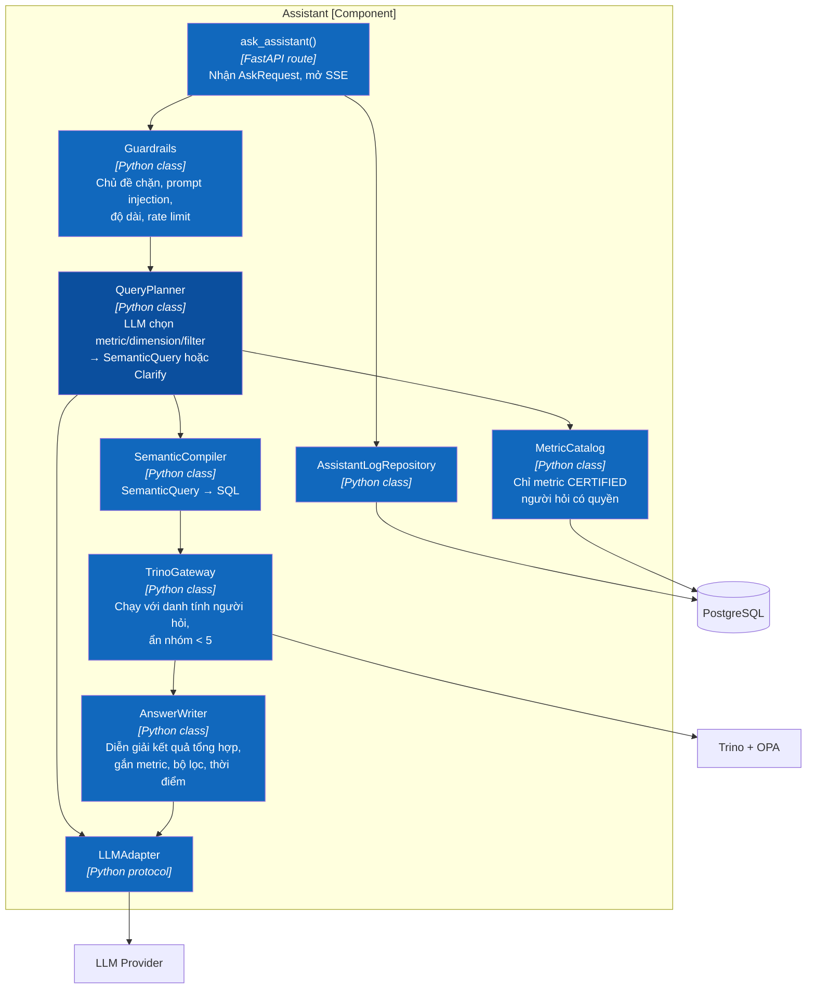

#### L4.2. Thực thi phân quyền dữ liệu (Access & Policy)

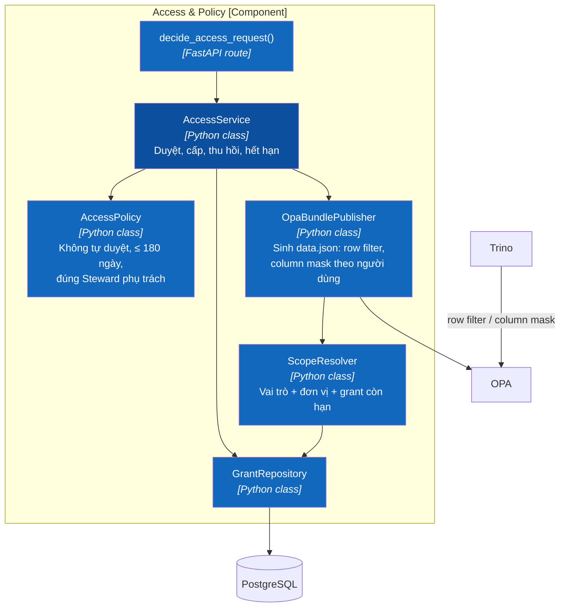

### 8.2. Sơ đồ lớp cốt lõi

#### 1. Semantic model và trợ lý

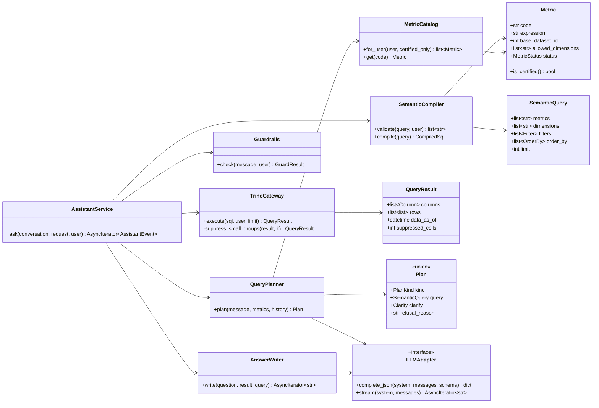

#### 2. Cấp quyền và chính sách

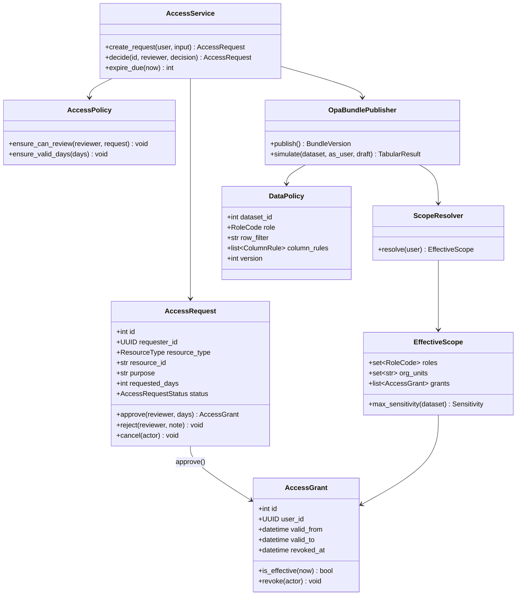

#### 3. Chất lượng dữ liệu trong pipeline

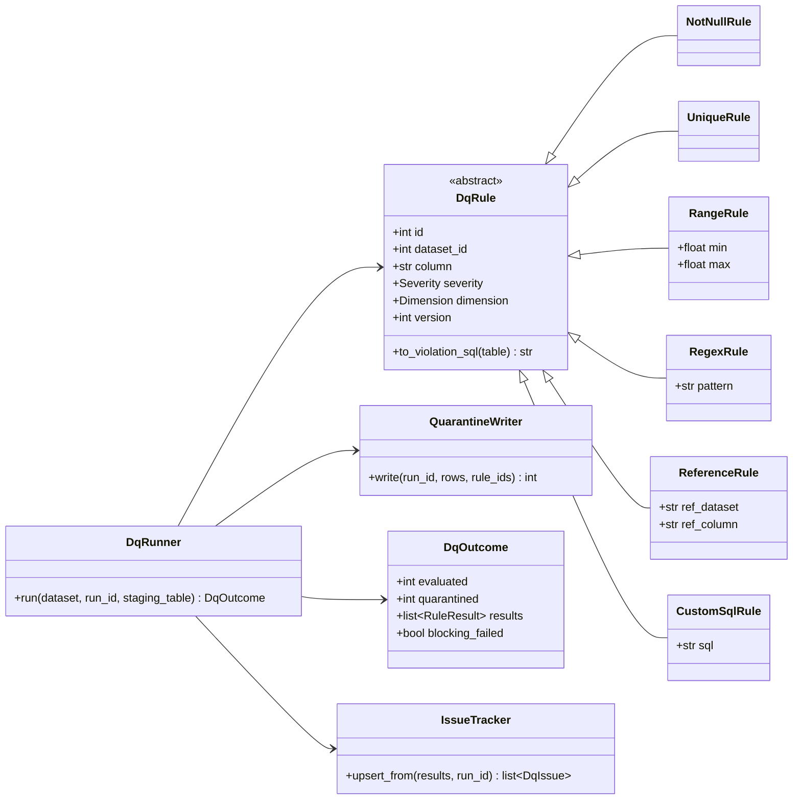

### 8.3. Sơ đồ tuần tự

Mỗi sơ đồ gắn User Story và operation OpenAPI tương ứng.

#### Upload file, ingest và kiểm tra chất lượng (US05, US18 — `POST /sources/{id}/uploads`, `POST /sources/{id}/runs`)

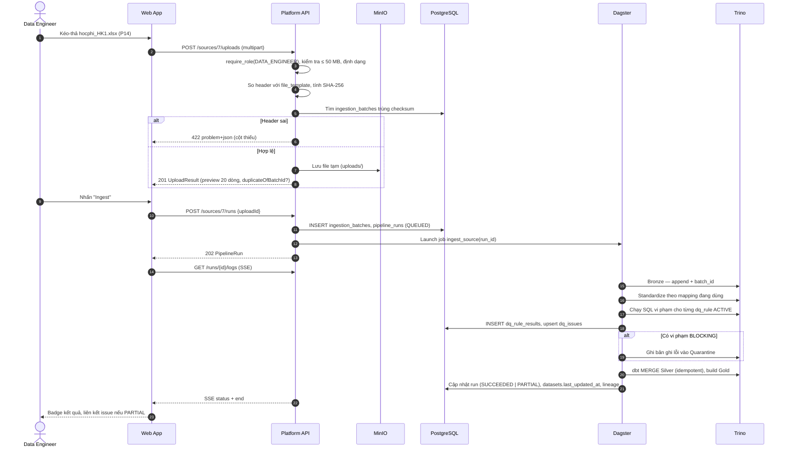

#### Truy vấn widget dashboard có phân quyền (US27 — `POST /semantic/query`)

```mermaid
sequenceDiagram
    autonumber
    actor V as Report Viewer (Khoa CNTT)
    participant W as Web App
    participant A as Platform API
    participant SC as SemanticCompiler
    participant G as TrinoGateway
    participant T as Trino
    participant O as OPA
    participant DB as PostgreSQL

    V->>W: Mở dashboard "Tổng quan đào tạo", chọn năm học
    W->>A: POST /semantic/query {metrics, dimensions, filters}
    A->>SC: validate(query, user)
    SC->>DB: Đọc metric, dimension cho phép
    alt Metric/dimension không hợp lệ hoặc không có quyền
        SC-->>A: lỗi
        A-->>W: 403 / 422 problem+json
    else Hợp lệ
        SC-->>A: SQL đã biên dịch
        A->>G: execute(sql, user)
        G->>T: Query với X-Trino-User = viewer
        T->>O: Quyền bảng? row filter? column mask?
        O-->>T: faculty_code = 'CNTT', mask cột CONFIDENTIAL
        T-->>G: Kết quả đã lọc
        G->>G: Ẩn ô có nhóm < 5 (BR12)
        G->>DB: INSERT audit_logs (QUERY, ALLOW)
        G-->>A: QueryResult (dataAsOf, suppressedCells)
        A-->>W: 200 QueryResult
        W-->>V: Biểu đồ chỉ gồm dữ liệu khoa CNTT, ô "< 5"
    end
```

#### Yêu cầu và phê duyệt truy cập (US23 — `POST /access-requests`, `POST /access-requests/{id}/decision`)

```mermaid
sequenceDiagram
    autonumber
    actor V as Report Viewer
    actor S as Data Steward
    participant W as Web App
    participant A as Platform API
    participant AS as AccessService
    participant DB as PostgreSQL
    participant P as OpaBundlePublisher
    participant O as OPA
    participant K as App Worker

    V->>W: Nhấn "Yêu cầu quyền" trên tab Tài chính 🔒
    W->>A: POST /access-requests {PROFILE_FACET, FINANCE, purpose, 90 ngày}
    A->>AS: create_request()
    AS->>DB: INSERT access_requests (PENDING), notifications cho Steward
    A-->>W: 201 AccessRequest
    S->>W: Mở P24 "Chờ tôi duyệt"
    W->>A: POST /access-requests/55/decision {APPROVE, grantedDays: 60}
    A->>AS: decide()
    AS->>AS: Kiểm tra Steward phụ trách, không tự duyệt, ≤ 180 ngày
    AS->>DB: UPDATE request APPROVED, INSERT access_grants, audit
    AS->>P: publish()
    P->>DB: Đọc grant + chính sách hiệu lực
    P->>O: PUT bundle mới
    A-->>W: 200 AccessRequest
    A-->>V: Thông báo "Yêu cầu được duyệt"
    Note over K,DB: Hằng giờ
    K->>DB: expire_access() — grant quá hạn → EXPIRED
    K->>P: publish() để thu hồi trên Trino
```

#### Hỏi trợ lý trên dữ liệu được cấp quyền (US39 — `POST /assistant/conversations/{id}/messages`)

```mermaid
sequenceDiagram
    autonumber
    actor V as Report Viewer
    participant W as Web App
    participant A as Platform API
    participant GR as Guardrails
    participant PL as QueryPlanner
    participant L as LLM Provider
    participant SC as SemanticCompiler
    participant G as TrinoGateway
    participant AW as AnswerWriter
    participant DB as PostgreSQL

    V->>W: "Tỉ lệ cảnh báo học vụ khoa CNTT theo học kỳ năm 2025?"
    W->>A: POST /assistant/conversations/{id}/messages (SSE)
    A->>GR: check(message, user)
    alt Chủ đề chặn / prompt injection
        GR-->>A: refuse
        A-->>W: SSE final {REFUSED, BLOCKED_TOPIC}
    else Hợp lệ
        A-->>W: SSE status PLANNING
        A->>PL: plan(message, metrics CERTIFIED của người hỏi)
        PL->>L: Danh mục metric + câu hỏi (không có dữ liệu dòng)
        L-->>PL: SemanticQuery JSON
        alt Mơ hồ
            PL-->>A: Clarify(options)
            A-->>W: SSE clarify
        else Rõ ràng
            A->>SC: validate + compile
            A-->>W: SSE status QUERYING
            A->>G: execute(sql, user) — RLS/CLS + k = 5
            alt Vượt quyền
                G-->>A: AccessDenied
                A-->>W: SSE final {REFUSED, OUT_OF_SCOPE, requestable}
            else Có kết quả
                G-->>A: QueryResult tổng hợp
                A->>AW: write(question, result)
                AW->>L: Kết quả tổng hợp + yêu cầu diễn giải
                L-->>AW: token stream
                AW-->>W: SSE token
                A-->>W: SSE final {ANSWERED, metricCodes, filters, dataAsOf, sql}
            end
        end
    end
    A->>DB: INSERT qa_messages, audit_logs (QA_ASK)
    W-->>V: Thẻ câu trả lời "Do AI tạo" + biểu đồ + nguồn
```

## Tài liệu

- **Yêu cầu:** [Phân tích top-down](docs/01-scope.md), [Tính năng và chức năng](docs/02-features.md), [Use case](docs/03-use-cases.md), [Tiêu chí chấp nhận Given–When–Then](docs/06-acceptance-criteria.md), [Ma trận truy vết](docs/07-traceability.md), [Backlog INVEST](docs/08-invest-requirements.md).
- **Danh mục yêu cầu:** [Quy tắc nghiệp vụ](docs/requirements/business-rules.md), [Yêu cầu phi chức năng](docs/requirements/non-functional-requirements.md).
- **UI/UX:** [Kiến trúc thông tin và UI/UX](docs/04-information-architecture.md), [Sitemap và Section từng trang](#3-kiến-trúc-thông-tin-information-architecture), [Mẫu tương tác và wireframe](#4-thiết-kế-uiux-và-tương-tác-front-end).
- **Mind map:**
  - [Product mind map](assets/product-mind-map.png)
  - [Phân rã top-down](assets/mindmaps/problem-decomposition.svg)
  - [Tương tác FE](assets/mindmaps/fe-interactions.svg)
  - [Sitemap](<assets/AiiA – Nền tảng Data Lakehouse hồ sơ 360°.png>)
  - Mã nguồn sơ đồ: [assets/mindmaps](assets/mindmaps), [scripts/mindmap_to_svg.py](scripts/mindmap_to_svg.py).
- **Kiến trúc:** [C4](#5-kiến-trúc-c4), [Quyết định kiến trúc](#54-quyết-định-kiến-trúc).
- **Cơ sở dữ liệu:** [Mô hình dữ liệu](docs/05-data-model.md), [ER và từ điển dữ liệu](docs/DATABASE.md), [DBML](src/database/aiia.dbml), [PostgreSQL schema](src/database/aiia.sql).
- **Hợp đồng API:** [OpenAPI 3.0.4](docs/api/openapi.yaml).
- **Vận hành:** [Hướng dẫn chạy](docs/RUNNING.md).

## Tiến độ dự án

- [x] Phân tích đề bài top-down, mục tiêu, bên liên quan, nguồn dữ liệu, phạm vi, rủi ro
- [x] Viết User Story theo INVEST, Business Rule, Acceptance Criteria
- [x] Xác định Use Case, tác nhân, ma trận phân quyền, trạng thái nghiệp vụ
- [x] Viết yêu cầu phi chức năng
- [x] Thiết kế kiến trúc thông tin, sitemap, Section từng trang, luồng điều hướng
- [x] Thiết kế UI/UX: app shell, mẫu tương tác, wireframe, trạng thái giao diện
- [x] Thiết kế C4 System Context, Container, Component và Code level
- [x] Thiết kế schema PostgreSQL control plane, mô hình Gold, DBML
- [x] Viết tài liệu API OpenAPI 3.0
- [x] Thiết kế cấu trúc thư mục Angular, FastAPI, Dagster + dbt
- [x] Hướng dẫn chạy: [docs/RUNNING.md](docs/RUNNING.md)
- [x] Thiết kế sơ đồ lớp và sơ đồ tuần tự
- [x] Bộ sinh dữ liệu giả lập và mock source (API + Postgres), kèm test
- [x] `compose.yaml` một file, chia profiles; Dockerfile theo khuôn uv (builder + runtime slim)
- [x] Cấu hình hạ tầng: Postgres, MinIO, Trino, Prometheus, Loki, Tempo, Grafana, Debezium
- [ ] Keycloak và OPA (chưa đưa vào compose; phân quyền hiện chưa thực thi tại Trino)
- [x] Skeleton pipeline: landing (dlt) → bronze (PyIceberg) → DQ (Soda) → silver/gold (dbt)
- [ ] Đối soát danh tính, DQ quy tắc từ UI, nạp Gold đầy đủ
- [x] Skeleton Platform API (health, readiness) với test
- [ ] Platform API theo OpenAPI, kiểm thử hợp đồng và ma trận quyền
- [x] Skeleton Angular 19 (standalone, lazy route, gọi health API)
- [x] Angular Web App: hồ sơ 360°, dashboard, tích hợp, quản trị dữ liệu (P01–P27, chạy trên mock API theo hợp đồng OpenAPI)
- [ ] [ADV] Semantic model, trợ lý hỏi-đáp, benchmark trong CI
- [ ] [ADV] Lineage, phát hiện bất thường, báo cáo tự động, chính sách dòng/cột
