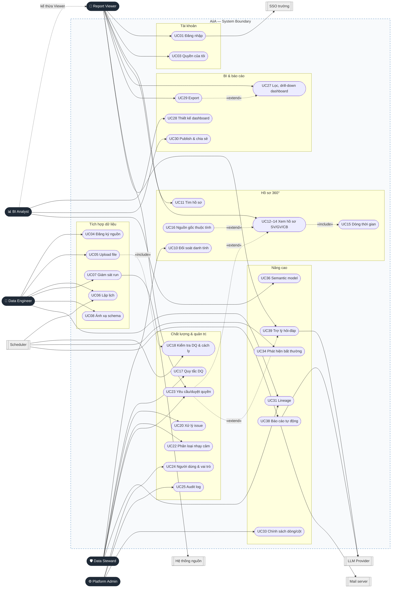

# 03 — Tác nhân, vai trò và Use case

## 1. Tác nhân (Actors)

| Tác nhân | Loại | Mô tả |
| --- | --- | --- |
| **Report Viewer** (Người dùng báo cáo) | Chính | Lãnh đạo, phòng chức năng, khoa: xem dashboard, tra cứu hồ sơ trong phạm vi, export, hỏi-đáp, yêu cầu quyền |
| **BI Analyst** (Chuyên viên phân tích) | Chính | Như Report Viewer + thiết kế dashboard, định nghĩa metric |
| **Data Steward** (Chuyên viên quản trị dữ liệu) | Chính | Quy tắc DQ, issue, đối soát danh tính, phân loại, glossary, duyệt quyền, xử lý cảnh báo |
| **Data Engineer** (Kỹ sư dữ liệu) | Chính | Đăng ký nguồn, upload, lịch, mapping, giám sát pipeline |
| **Platform Admin** (Quản trị hệ thống) | Chính | Người dùng, vai trò, chính sách, audit; không mặc định đọc dữ liệu `RESTRICTED` |
| Hệ thống định danh trường (SSO) | Phụ (hệ thống ngoài) | Xác thực OIDC |
| Hệ thống nguồn được phép | Phụ (hệ thống ngoài) | SIS, LMS, HRM, FIN… (môi trường dev: mock source) |
| LLM Provider | Phụ (hệ thống ngoài) | Lập kế hoạch truy vấn, diễn giải, tóm tắt qua adapter |
| Mail server | Phụ (hệ thống ngoài) | Gửi báo cáo định kỳ và thông báo |
| Bộ lập lịch (Scheduler) | Phụ | Kích hoạt ingest, DQ, phát hiện bất thường, gửi báo cáo, thu hồi quyền hết hạn |

Một người dùng có thể mang nhiều vai trò. Mọi vai trò đều có quyền cơ bản của Report Viewer trên dữ liệu được cấp.

## 2. Danh sách Use case

| ID | Use case | Tác nhân | Phạm vi |
| --- | --- | --- | --- |
| UC01 | Đăng nhập SSO | Mọi vai trò, *SSO* | ✅ |
| UC02 | Đăng xuất | Mọi vai trò | ✅ |
| UC03 | Xem hồ sơ và quyền của tôi | Mọi vai trò | ✅ |
| UC04 | Đăng ký nguồn dữ liệu | Data Engineer | ✅ |
| UC05 | Upload file dữ liệu | Data Engineer | ✅ |
| UC06 | Lập lịch ingest | Data Engineer, *Scheduler* | ✅ |
| UC07 | Giám sát và chạy lại pipeline | Data Engineer | ✅ |
| UC08 | Ánh xạ schema vào mô hình chuẩn | Data Engineer | ✅ |
| UC09 | Xem trước dữ liệu theo lớp | Data Engineer, Data Steward | ✅ |
| UC10 | Duyệt đối soát danh tính | Data Steward | ✅ |
| UC11 | Tìm kiếm hồ sơ 360° | Report Viewer | ✅ |
| UC12 | Xem hồ sơ sinh viên | Report Viewer | ✅ |
| UC13 | Xem hồ sơ giảng viên | Report Viewer | ✅ |
| UC14 | Xem hồ sơ cán bộ | Report Viewer | ✅ |
| UC15 | Xem dòng thời gian hồ sơ | Report Viewer | ✅ |
| UC16 | Xem nguồn gốc thuộc tính | Report Viewer | ✅ |
| UC17 | Định nghĩa quy tắc chất lượng | Data Steward | ✅ |
| UC18 | Thực thi kiểm tra chất lượng và cách ly | *Scheduler* | ✅ |
| UC19 | Xem điểm chất lượng dữ liệu | Data Steward | ✅ |
| UC20 | Xử lý issue chất lượng | Data Steward | ✅ |
| UC21 | Tra cứu data catalog | Mọi vai trò | ✅ |
| UC22 | Phân loại nhạy cảm và glossary | Data Steward | ✅ |
| UC23 | Yêu cầu và phê duyệt truy cập | Report Viewer, Data Steward | ✅ |
| UC24 | Quản lý người dùng và vai trò | Platform Admin | ✅ |
| UC25 | Xem nhật ký kiểm toán | Platform Admin | ✅ |
| UC26 | Xem thư viện dashboard | Report Viewer | ✅ |
| UC27 | Lọc và drill-down dashboard | Report Viewer | ✅ |
| UC28 | Thiết kế dashboard | BI Analyst | ✅ |
| UC29 | Export báo cáo | Report Viewer | ✅ |
| UC30 | Publish và chia sẻ dashboard | BI Analyst | ✅ |
| UC31 | Xem lineage | Data Steward, Data Engineer | ⭐ |
| UC32 | Phân tích tác động thay đổi | Data Engineer | ⭐ |
| UC33 | Cấu hình chính sách dòng/cột | Platform Admin | ⭐ |
| UC34 | Phát hiện bất thường | *Scheduler* | ⭐ |
| UC35 | Xử lý cảnh báo bất thường | Data Steward, Report Viewer | ⭐ |
| UC36 | Quản lý semantic model | BI Analyst | ⭐ |
| UC37 | Đăng ký báo cáo định kỳ | Report Viewer | ⭐ |
| UC38 | Sinh và gửi báo cáo tự động | *Scheduler*, *LLM*, *Mail* | ⭐ |
| UC39 | Hỏi-đáp trên dữ liệu được cấp quyền | Report Viewer, *LLM* | ⭐ |
| UC40 | Quản trị nhật ký và chủ đề chặn hỏi-đáp | Platform Admin | ⭐ |

✅ MVP · ⭐ Nâng cao

## 3. Sơ đồ Use case

Quy ước: `«include»` = luôn xảy ra cùng use case gốc (upload luôn kích hoạt kiểm tra DQ). `«extend»` = mở rộng có điều kiện (gặp trường bị khóa mới mở yêu cầu quyền).

## 4. Ma trận phân quyền

| Năng lực | Viewer | Analyst | Steward | Engineer | Admin |
| --- | :---: | :---: | :---: | :---: | :---: |
| Đăng nhập, quyền của tôi, catalog (metadata) | ✅ | ✅ | ✅ | ✅ | ✅ |
| Tra cứu hồ sơ 360° | Phạm vi | Phạm vi | Phạm vi | — | — |
| Xem dashboard, lọc, drill-down | Phạm vi | Phạm vi | Phạm vi | Phạm vi | Phạm vi |
| Export | Phạm vi | Phạm vi | Phạm vi | — | — |
| Thiết kế, publish dashboard | — | Của mình | — | — | — |
| Gửi yêu cầu truy cập | ✅ | ✅ | ✅ | ✅ | ✅ |
| Phê duyệt yêu cầu truy cập | — | — | Dataset phụ trách | — | — |
| Đăng ký nguồn, upload, lịch, mapping | — | — | — | ✅ | — |
| Xem trước Bronze/Silver | — | — | ✅ (che) | ✅ (che) | — |
| Quy tắc DQ, issue, đối soát danh tính, phân loại | — | — | ✅ | Xem | — |
| Người dùng, vai trò, audit | — | — | Audit dataset phụ trách | — | ✅ |
| ⭐ Chính sách dòng/cột | — | — | Đề xuất | — | ✅ |
| ⭐ Semantic model | — | ✅ | Chứng nhận | — | — |
| ⭐ Trợ lý hỏi-đáp | Phạm vi | Phạm vi | Phạm vi | — | — |
| ⭐ Nhật ký và chủ đề chặn hỏi-đáp | — | — | — | — | ✅ |

**Phạm vi** = trong đơn vị được gán và quyền dataset còn hạn; **Của mình** = đối tượng do mình tạo. Backend **bắt buộc** kiểm tra quyền; truy vấn dữ liệu chạy dưới danh tính người dùng. Ẩn nút trên giao diện chỉ phục vụ UX.

## 5. Đặc tả Use case chính

### UC05 + UC18 — Upload file và kiểm tra chất lượng

| Mục | Nội dung |
| --- | --- |
| Tác nhân | Data Engineer; Scheduler (UC18) |
| Tiền điều kiện | Nguồn `ACTIVE`, loại `FILE`, có template cột; dataset đích có quy tắc DQ `ACTIVE` |
| Kích hoạt | Kéo-thả file tại P14, tab Upload |
| Luồng chính | 1. Kiểm tra định dạng, dung lượng, header, checksum. 2. Xem trước 20 dòng. 3. Xác nhận ingest → tạo `ingestion_batches` và `pipeline_runs` (`QUEUED`). 4. Ghi landing → Bronze (append, `_batch_id`). 5. Áp mapping đang dùng. 6. Chạy quy tắc DQ (Soda, dbt tests). 7. Bản ghi đạt → Silver (MERGE idempotent); vi phạm `BLOCKING` → Quarantine. 8. dbt build Gold. 9. Run kết thúc `SUCCEEDED` hoặc `PARTIAL`. |
| Luồng thay thế | A1 — Checksum trùng: cảnh báo, chỉ tiếp tục khi người dùng xác nhận. A2 — Vi phạm `WARNING`: dữ liệu vẫn đi tiếp, tạo issue. |
| Ngoại lệ | Sai header → 422, không tạo batch. Lỗi hệ thống → run `FAILED`, có log, nút chạy lại. |
| Hậu điều kiện | Bronze bất biến có batch mới; Gold không chứa bản ghi vi phạm `BLOCKING` |

### UC10 — Duyệt đối soát danh tính

| Mục | Nội dung |
| --- | --- |
| Tác nhân | Data Steward |
| Tiền điều kiện | Có cặp ứng viên điểm 0,75–0,95 |
| Luồng chính | 1. Mở hàng đợi P21. 2. Chọn cặp → so sánh song song, trường `RESTRICTED` chỉ hiện khớp/không khớp. 3. Chọn Gộp → hợp nhất `person_id`, tính lại golden record, ghi `person_merge_events` và audit. |
| Luồng thay thế | Không trùng → `REJECTED`, không đề xuất lại trừ khi dữ liệu đổi. Để sau → giữ `PENDING`. |
| Ngoại lệ | Bản ghi đã bị gộp ở phiên khác → 409, tải lại cặp |
| Hậu điều kiện | Hồ sơ phản ánh hợp nhất; có thể tách lại |

### UC23 — Yêu cầu và phê duyệt truy cập

| Mục | Nội dung |
| --- | --- |
| Tác nhân | Report Viewer (yêu cầu), Data Steward (duyệt) |
| Kích hoạt | Nhấn “Yêu cầu quyền” tại trường, tab, dataset hoặc câu trả lời trợ lý bị khóa |
| Luồng chính | 1. Form điền sẵn tài nguyên; nhập mục đích, phạm vi, thời hạn. 2. Yêu cầu `PENDING`, thông báo cho Steward phụ trách. 3. Steward xem quyền hiện có và mức nhạy cảm → Phê duyệt (có thể rút ngắn thời hạn). 4. Tạo `access_grants`, xuất bản lại chính sách cho Trino, thông báo người yêu cầu. |
| Luồng thay thế | Từ chối kèm lý do → `REJECTED` |
| Ngoại lệ | Người duyệt là người yêu cầu → bị chặn; thời hạn > 180 ngày → 422 |
| Hậu điều kiện | Quyền có hiệu lực tới `valid_to`; worker hằng giờ chuyển quyền hết hạn sang `EXPIRED` |

### UC27 — Lọc và drill-down dashboard

| Mục | Nội dung |
| --- | --- |
| Tác nhân | Report Viewer |
| Luồng chính | 1. Mở dashboard P08. 2. Chọn bộ lọc toàn cục (chỉ hiện giá trị trong phạm vi). 3. Mỗi widget gửi `SemanticQuery` tới `POST /semantic/query`. 4. Semantic Service biên dịch SQL, chạy trên Trino dưới danh tính người xem; row filter và column mask được áp. 5. Ô có nhóm < 5 trả `suppressed`. 6. Nhấn phần tử biểu đồ → drill-down một cấp, breadcrumb cập nhật. |
| Ngoại lệ | Dataset vượt SLA → nhãn “Dữ liệu cũ”; metric không thuộc quyền → widget hiển thị trạng thái khóa |
| Hậu điều kiện | Mỗi người xem chỉ thấy số liệu đúng phạm vi của mình |

### UC39 — Hỏi-đáp trên dữ liệu được cấp quyền

| Mục | Nội dung |
| --- | --- |
| Tác nhân | Report Viewer; hệ thống ngoài: LLM Provider |
| Tiền điều kiện | Có metric `CERTIFIED` người hỏi được phép dùng |
| Luồng chính | 1. Nhập câu hỏi tiếng Việt. 2. Kiểm tra chủ đề chặn và prompt injection. 3. LLM nhận danh mục metric (không có dữ liệu) và đề xuất `SemanticQuery`. 4. Semantic Service kiểm tra và biên dịch. 5. Trino chạy dưới danh tính người hỏi. 6. LLM diễn giải **kết quả tổng hợp**. 7. Trả câu trả lời streaming kèm metric, bộ lọc, thời điểm dữ liệu, truy vấn. 8. Ghi `qa_messages` và audit. |
| Luồng thay thế | A1 — Câu hỏi mơ hồ: trả chip làm rõ. A2 — Không có metric phù hợp: trả lời “chưa trả lời được” thay vì suy đoán. |
| Ngoại lệ | Vượt quyền hoặc chủ đề chặn → `REFUSED` kèm lý do chung và nút yêu cầu quyền. LLM lỗi → thông báo thử lại, không trả kết quả chưa kiểm chứng. |
| Hậu điều kiện | Không có dữ liệu ngoài quyền bị trả về; câu trả lời kiểm chứng được |
