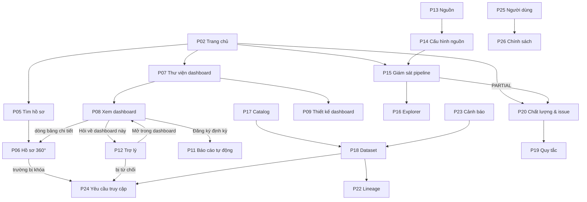

# 04 — Kiến trúc thông tin và UI/UX

## 1. Nguyên tắc tổ chức thông tin

1. **Con người là trục chính, nguồn dữ liệu là trục phụ.** Mọi dữ liệu cá nhân quy về một `person_id`; hồ sơ chia tab theo khía cạnh (học tập, tài chính, nhân sự…), không chia theo hệ thống nguồn.
2. **Nguồn gốc luôn trong tầm một cú nhấp.** Mọi thuộc tính, số liệu, câu trả lời đều xem được nguồn, thời điểm cập nhật và điểm chất lượng.
3. **Khóa hiển thị, không giấu.** Dữ liệu chưa được phép hiển thị dạng che kèm biểu tượng khóa và nút “Yêu cầu quyền”, để người dùng biết dữ liệu tồn tại và cách xin quyền hợp lệ. Ngoại lệ: hồ sơ ngoài phạm vi trả “Không tìm thấy” để không lộ sự tồn tại.
4. **AI là lớp phủ, không phải ngõ cụt.** Từ dashboard luôn hỏi được trợ lý; từ câu trả lời luôn quay về được dashboard và truy vấn gốc.
5. **Không gian làm việc theo vai trò.** Sidebar chỉ hiện các khu vực vai trò đó dùng được.

## 2. Sitemap

```text
Chung (mọi vai trò)
├── /login ....................................... P01 Đăng nhập SSO
├── / ............................................ P02 Trang chủ theo vai trò
├── /me .......................................... P03 Hồ sơ & quyền của tôi
└── /403 ......................................... P04 Không có quyền

Hồ sơ 360° (Viewer, Analyst, Steward)
├── /profiles?q=&type=&orgUnit= .................. P05 Tìm kiếm hồ sơ
└── /profiles/:personId?role=&tab= ............... P06 Chi tiết hồ sơ 360°

Phân tích & BI
├── /dashboards .................................. P07 Thư viện dashboard
├── /dashboards/:id?filters= ..................... P08 Xem dashboard
├── /dashboards/new, /dashboards/:id/edit ........ P09 Thiết kế dashboard        (Analyst)
├── /semantic .................................... P10 Semantic model           ⭐ (Analyst, Steward)
├── /reports ..................................... P11 Báo cáo tự động          ⭐
└── /assistant, /assistant/:conversationId ....... P12 Trợ lý hỏi-đáp           ⭐

Tích hợp dữ liệu (Engineer)
├── /sources ..................................... P13 Nguồn dữ liệu
├── /sources/new, /sources/:id?step= ............. P14 Đăng ký / cấu hình nguồn
├── /runs, /runs/:runId .......................... P15 Giám sát pipeline
└── /explorer?layer=&dataset= .................... P16 Data explorer

Quản trị dữ liệu (Steward; catalog cho mọi vai trò)
├── /catalog?tab=datasets|glossary ............... P17 Data catalog
├── /catalog/datasets/:id?tab= ................... P18 Chi tiết dataset
├── /quality/rules ............................... P19 Quy tắc chất lượng
├── /quality ..................................... P20 Chất lượng & issue
├── /identity .................................... P21 Đối soát danh tính
├── /lineage?nodeType=&refId= .................... P22 Lineage                  ⭐
├── /alerts ...................................... P23 Cảnh báo bất thường      ⭐
└── /access?box=mine|review ...................... P24 Yêu cầu truy cập

Quản trị hệ thống (Admin)
├── /admin/users ................................. P25 Người dùng & vai trò
├── /admin/policies .............................. P26 Chính sách phân quyền    ⭐
└── /admin/audit?tab=logs|assistant .............. P27 Nhật ký kiểm toán

Hệ thống: /403 Không có quyền · /404 Không tìm thấy
```

Ảnh sitemap dạng cây: [assets](../assets/). Nội dung Section của từng trang: [README §3.3](../README.md#33-nội-dung-từng-page-theo-section).

## 3. Phân cấp màn hình và điều hướng



**Thanh trên:** logo · tìm kiếm toàn cục (Ctrl+K) · nút “Hỏi AiiA” · thông báo · menu người dùng. **Sidebar:** 6 nhóm, ẩn nhóm vai trò không dùng được (ma trận ở [README §4.2](../README.md#42-bố-cục-khung-ứng-dụng-app-shell)).

## 4. Luồng nhiệm vụ chính (Task flows)

| Flow | Bước | Màn hình |
| --- | --- | --- |
| TF1 — Chuẩn bị họp giao ban (persona P1) | Dashboard đào tạo → lọc năm học → drill-down khoa, lớp → mở hồ sơ một SV → hỏi trợ lý so sánh các khóa | 07 → 08 → 06 → 12 |
| TF2 — Xin quyền xem dữ liệu bị khóa | Tab Tài chính 🔒 → Yêu cầu quyền → Steward duyệt → tab mở khóa | 06 → modal → 24 → 06 |
| TF3 — Đưa nguồn mới vào nền tảng | Đăng ký nguồn → kết nối → mapping → lịch & DQ → theo dõi run đầu tiên | 13 → 14 → 15 → 16 |
| TF4 — Khắc phục dữ liệu lỗi | Run `PARTIAL` → issue → xem bản ghi lỗi → sửa → xử lý lại quarantine | 15 → 20 → 15 |
| TF5 — Hợp nhất hồ sơ trùng | Hàng đợi đối soát → so sánh song song → Gộp / Không trùng | 21 → 06 |
| TF6 — Kiểm tra số liệu đáng ngờ | Cảnh báo bất thường → dataset → lineage → run liên quan | 23 → 18 → 22 → 15 |

## 5. Trạng thái màn hình (UI states)

| Trạng thái | Cách hiển thị |
| --- | --- |
| Đang tải | Skeleton theo bố cục thật; trợ lý hiển thị giai đoạn “đang phân tích / đang truy vấn” |
| Rỗng | Câu giải thích + hành động tiếp theo (“Chưa có nguồn — Đăng ký nguồn đầu tiên”) |
| Bị khóa | Giá trị che `••••` + 🔒 + nút “Yêu cầu quyền” — **trạng thái hợp lệ, không phải lỗi** |
| Nhóm nhỏ | Hiển thị “< 5” thay cho số thật, tooltip giải thích quy tắc bảo vệ |
| Dữ liệu cũ | Chip vàng “Dữ liệu cũ – cập nhật lần cuối …” |
| Do AI tạo | Nhãn “Do AI tạo” trên mọi câu trả lời và tóm tắt |
| Lỗi | Thông báo ngắn, mã tham chiếu, nút thử lại; không hiển thị kết quả chưa kiểm chứng |
| Không có quyền | Trang 403 với liên kết về trang chủ; chưa đăng nhập → P01 |

## 6. Hệ thống thiết kế (UI/UX)

### 6.1. Định hướng thị giác

“**Bảng điều khiển đáng tin**” — nền trắng sạch, chữ đậm rõ cho số liệu, màu chỉ dùng để mang nghĩa (trạng thái, mức nhạy cảm, lớp dữ liệu) và luôn đi kèm nhãn chữ.

### 6.2. Design tokens

| Token | Giá trị | Dùng cho |
| --- | --- | --- |
| `--color-text` | `#0F172A` | Chữ chính, khung chủ đề trung tâm |
| `--color-muted` | `#475569` | Chữ phụ, chú thích |
| `--color-accent` | `#1864AB` | CTA, liên kết, nhánh BI |
| `--color-ok` | `#2B8A3E` | Thành công, DQ đạt |
| `--color-warn` | `#E8590C` | Cảnh báo, `PARTIAL`, dữ liệu cũ |
| `--color-danger` | `#E03131` | Lỗi, `FAILED`, `RESTRICTED` |
| `--sens-public` / `internal` / `confidential` / `restricted` | xám / xanh dương / cam / đỏ | Chip mức nhạy cảm |
| `--layer-bronze` / `silver` / `gold` | nâu đồng / bạc / vàng | Lớp dữ liệu trong explorer, catalog, lineage |
| Font | System UI (Segoe UI, Roboto) | Hỗ trợ dấu tiếng Việt, không tải thêm font |
| Bo góc | 8 px thẻ · 6 px nút · 999 px chip | |

### 6.3. Thành phần giao diện chính

| Thành phần | Mô tả |
| --- | --- |
| `aiia-masked-value` | Giá trị có thể bị che, kèm 🔒 và tooltip mức nhạy cảm |
| `aiia-provenance-drawer` | Drawer nguồn gốc: hệ thống nguồn, thời điểm, quy tắc ưu tiên, giá trị từng nguồn |
| `aiia-freshness-chip`, `aiia-dq-badge` | Độ mới dữ liệu, điểm chất lượng |
| `aiia-sensitivity-badge` | Nhãn `PUBLIC` · `INTERNAL` · `CONFIDENTIAL` · `RESTRICTED` |
| `aiia-request-access-dialog` | Form yêu cầu quyền điền sẵn tài nguyên |
| `aiia-filter-bar` | Bộ lọc toàn cục đồng bộ URL |
| `aiia-chart` | Biểu đồ có drill-down và chế độ xem bảng thay thế |
| `aiia-answer-card` | Thẻ trả lời của trợ lý: văn bản, biểu đồ, chip metric, bộ lọc, “Xem truy vấn” |
| `aiia-match-compare` | So sánh song song hai bản ghi (✓ khớp, ≈ gần khớp, ✗ khác) |
| `aiia-state-view` | 8 trạng thái chuẩn ở mục 5 |

### 6.4. Khả năng truy cập

WCAG 2.1 AA: tương phản ≥ 4.5:1; màu không là kênh duy nhất; biểu đồ có bảng dữ liệu thay thế; điều hướng bàn phím đầy đủ (Ctrl+K tìm kiếm, phím tắt duyệt nhanh ở P21); trang chỉ xem dùng được ở chiều rộng ≥ 360 px.

## 7. Màn hình đã dựng (Angular)

Mã nguồn tại [src/frontend](../src/frontend) — Angular 19 standalone, lazy route, chạy bằng `npm start` (proxy `/api` tới Platform API). Hiện mới có khung ứng dụng và trang chủ kiểm tra trạng thái API; các trang P03–P27 chưa dựng. Wireframe của các trang trọng tâm: [README §4.5](../README.md#45-wireframe-các-màn-hình-trọng-tâm).

| Màn hình | Route | Trạng thái |
| --- | --- | --- |
| P02 Trang chủ (bản tối thiểu) | `/` | ✅ Gọi `GET /api/v1/health` |
| P05–P27 | xem sitemap | ⏳ Chưa dựng |

## 8. Ánh xạ màn hình ↔ API

Đường dẫn tương đối với `/api/v1`. Hợp đồng đầy đủ: [openapi.yaml](api/openapi.yaml).

| Màn hình | API |
| --- | --- |
| P02 | `GET /me/home`, `GET /notifications` |
| P03 | `GET /me`, `GET /me/grants`, `POST /me/logout` |
| P05 | `GET /profiles` |
| P06 | `GET /profiles/{personId}`, `GET /profiles/{personId}/facets/{facet}`, `GET /profiles/{personId}/timeline`, `GET /profiles/{personId}/attributes/{attribute}/provenance` |
| P07 | `GET /dashboards`, `PUT/DELETE /dashboards/{id}/favorite` |
| P08 | `GET /dashboards/{id}`, `POST /semantic/query`, `POST /dashboards/{id}/exports`, `GET /exports/{exportId}` |
| P09 | `POST /dashboards`, `PUT /dashboards/{id}`, `POST /dashboards/{id}/publish`, `PUT /dashboards/{id}/shares`, `GET /semantic/metrics`, `GET /semantic/dimensions` |
| P10 ⭐ | `GET/POST /semantic/metrics`, `GET/PUT /semantic/metrics/{code}`, `POST /semantic/metrics/{code}/certification`, `POST /semantic/metrics/validate` |
| P11 ⭐ | `GET/POST /subscriptions`, `PATCH/DELETE /subscriptions/{id}`, `GET /subscriptions/{id}/deliveries` |
| P12 ⭐ | `GET/POST /assistant/conversations`, `GET /assistant/conversations/{id}`, `POST /assistant/conversations/{id}/messages` (SSE), `POST /assistant/messages/{id}/feedback` |
| P13 | `GET/POST /sources`, `PATCH /sources/{id}` |
| P14 | `GET/PATCH /sources/{id}`, `POST /sources/{id}/connection-test`, `POST /sources/{id}/uploads`, `PUT /sources/{id}/schedule`, `GET/POST /sources/{id}/mappings`, `POST /sources/{id}/mappings/preview`, `POST /sources/{id}/runs` |
| P15 | `GET /runs`, `GET /runs/{runId}`, `GET /runs/{runId}/logs` (SSE), `POST /runs/{runId}/rerun` |
| P16 | `GET /datasets`, `GET /datasets/{id}/preview` |
| P17 | `GET /datasets`, `GET/POST /glossary`, `PUT /glossary/{termId}` |
| P18 | `GET /datasets/{id}`, `PATCH /datasets/{id}/columns/{columnId}`, `GET /datasets/{id}/preview` |
| P19 | `GET/POST /dq/rules`, `PATCH /dq/rules/{ruleId}`, `POST /dq/rules/{ruleId}/dry-run` |
| P20 | `GET /dq/scores`, `GET /dq/issues`, `PATCH /dq/issues/{issueId}`, `POST /dq/issues/{issueId}/comments` |
| P21 | `GET /identity/candidates`, `POST /identity/candidates/{id}/decision`, `GET /identity/persons/{personId}/history`, `POST /identity/merge-events/{eventId}/unmerge` |
| P22 ⭐ | `GET /lineage`, `GET /lineage/impact` |
| P23 ⭐ | `GET /alerts`, `GET /alerts/{alertId}`, `POST /alerts/{alertId}/transition` |
| P24 | `GET/POST /access-requests`, `DELETE /access-requests/{id}`, `POST /access-requests/{id}/decision`, `DELETE /access-grants/{grantId}` |
| P25 | `GET/POST /admin/users`, `PATCH /admin/users/{userId}`, `PUT /admin/users/{userId}/roles`, `GET /admin/org-units` |
| P26 ⭐ | `GET/POST /admin/policies`, `GET/POST /admin/policies/{policyId}/versions`, `POST /admin/policies/simulate` |
| P27 | `GET /admin/audit-logs`, `GET /admin/assistant-logs` ⭐, `GET/POST /admin/blocked-topics` ⭐, `DELETE /admin/blocked-topics/{topicId}` ⭐ |
