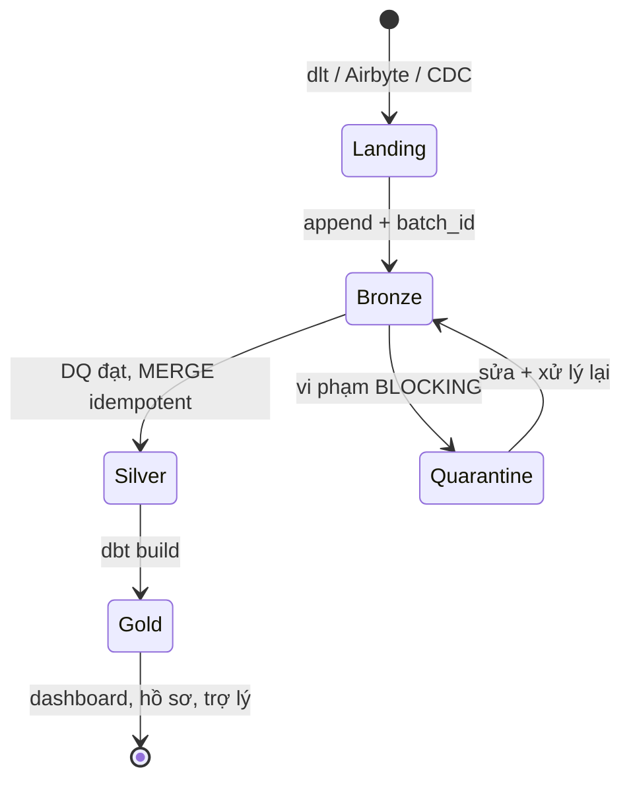
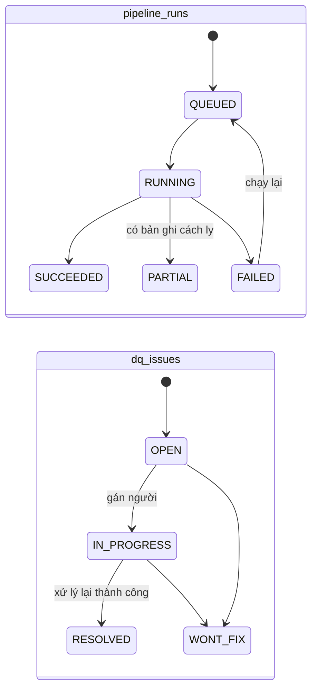
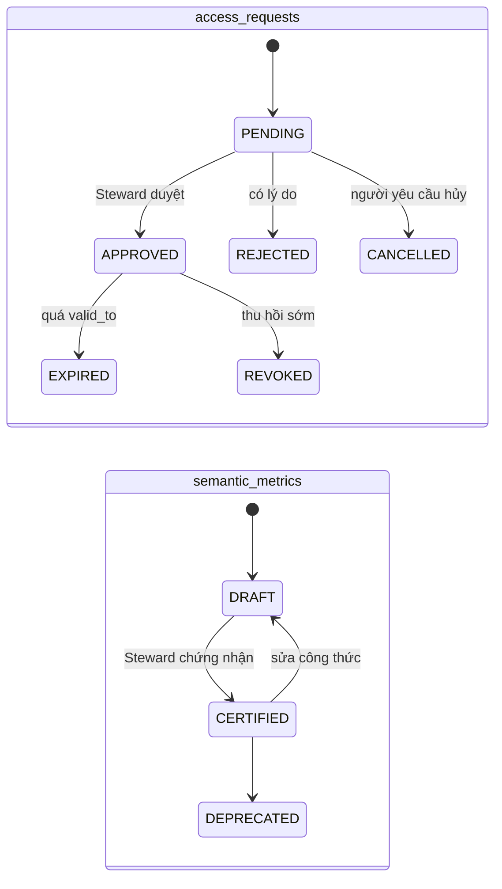

# 05 — Mô hình dữ liệu

> DBML: [aiia.dbml](../src/database/aiia.dbml) · SQL: [aiia.sql](../src/database/aiia.sql) · ER Mermaid: [DATABASE.md](DATABASE.md)
> Đã kiểm tra: `aiia.sql` chạy trọn vẹn trên PostgreSQL 18 (PGlite); các ràng buộc tự duyệt, thời hạn quyền > 180 ngày, sửa audit log, gỡ Admin cuối cùng đều bị chặn. DBML qua `@dbml/cli`.

## 1. Nhóm bảng

### 1.1. Control plane — PostgreSQL, database `aiia`, schema `app`

| Nhóm | Bảng | Vai trò |
| --- | --- | --- |
| Định danh & tổ chức | `org_units`, `users`, `user_roles` | Cây đơn vị, tài khoản, vai trò kèm phạm vi đơn vị |
| Nguồn & ingest | `data_sources`, `ingestion_batches`, `pipeline_runs`, `schema_mappings` | Nguồn được phép, lô dữ liệu, lần chạy, ánh xạ có phiên bản |
| Catalog | `datasets`, `dataset_columns`, `glossary_terms` | Metadata dataset, mức nhạy cảm từng cột, thuật ngữ |
| Chất lượng | `dq_rules`, `dq_rule_results`, `dq_issues`, `dq_issue_comments` | Quy tắc, kết quả theo run, issue |
| Đối soát danh tính | `match_candidates`, `person_merge_events` | Cặp nghi trùng, lịch sử gộp/tách |
| Cấp quyền & chính sách | `access_requests`, `access_grants`, `access_policies`, `access_policy_versions` | Yêu cầu, quyền có hạn, chính sách dòng/cột có phiên bản |
| BI & semantic | `dashboards`, `dashboard_widgets`, `dashboard_shares`, `dashboard_favorites`, `semantic_metrics`, `semantic_metric_versions`, `semantic_dimensions` | Dashboard, metric chuẩn |
| Báo cáo tự động | `report_subscriptions`, `subscription_recipients`, `report_deliveries` | Đăng ký và lịch sử gửi |
| Bất thường & lineage | `anomaly_detectors`, `anomaly_alerts`, `lineage_nodes`, `lineage_edges` | Cảnh báo, đồ thị lineage |
| Hỏi-đáp, thông báo, audit | `qa_conversations`, `qa_messages`, `qa_blocked_topics`, `notifications`, `audit_logs` | Trợ lý, thông báo, kiểm toán bất biến |

### 1.2. Lakehouse — Iceberg, catalog JDBC trên database `iceberg_catalog`

| Lớp | Bảng | Ghi |
| --- | --- | --- |
| Bronze | `bronze.sis_students`, … | Append-only, kèm `_batch_id`, `_ingested_at`, cột `_dlt_*`; chứa định danh gốc (`RESTRICTED`) |
| Silver | `silver.silver_sis_students`, … | Một dòng mới nhất mỗi khóa nghiệp vụ; CCCD chỉ còn dạng băm có salt |
| Gold | `dim_person`, `dim_student`, `dim_lecturer`, `dim_staff`, `fact_*`, `mart_*` | Star schema quanh `dim_person` — chi tiết trong [DATABASE.md §6](DATABASE.md#6-mô-hình-gold--hồ-sơ-360-apache-iceberg) |

### 1.3. Nguồn giả lập — database `mock_source`

| Bảng | Hệ thống nguồn | Khóa | Endpoint |
| --- | --- | --- | --- |
| `sis_students` | SIS | `student_id` | `GET /api/v1/sis/students` |
| `sis_enrollments` | SIS | `enrollment_id` | `GET /api/v1/sis/enrollments` |
| `hrm_staff` | HRM | `staff_id` | `GET /api/v1/hrm/staff` |
| `fin_tuition` | FIN | `tuition_id` | `GET /api/v1/fin/tuition` |
| `lms_activity` | LMS | `activity_id` | `GET /api/v1/lms/activity` |

Mọi bảng có `updated_at` (incremental). Publication `aiia_sis_pub` trên `sis_students`, `sis_enrollments` phục vụ Debezium. Khoảng 10% cán bộ có thêm bản ghi sinh viên cùng CCCD nhưng tên không dấu, để kiểm thử đối soát danh tính.

## 2. Từ điển dữ liệu — bảng chính

### `data_sources`

| Cột | Kiểu | Ràng buộc | Ý nghĩa |
| --- | --- | --- | --- |
| `code` | varchar(32) | unique | VD `SRC-SIS` |
| `type` | `source_type` | not null | `FILE` / `JDBC` / `API` |
| `status` | `source_status` | default `DRAFT` | Chỉ `ACTIVE` được ingest (BR01) |
| `purpose`, `legal_basis_ref` | text / varchar | không rỗng (`chk_source_legal_basis`) | Mục đích và căn cứ cho phép |
| `connection_config` | jsonb | | Host, endpoint… **không chứa bí mật** |
| `secret_ref` | varchar | bắt buộc với JDBC/API khi rời `DRAFT` | Tham chiếu secret store |
| `file_template` | jsonb | bắt buộc với `FILE` | Cột bắt buộc để kiểm tra header |

### `access_requests`

| Cột | Ràng buộc | Quy tắc |
| --- | --- | --- |
| `purpose` | ≥ 10 ký tự | Mục đích rõ ràng |
| `requested_days` | 1..180 | BR09 |
| `reviewer_id` | ≠ `requester_id` | Không tự duyệt |
| `review_note` | bắt buộc khi `REJECTED` | Từ chối có lý do |

### `access_grants`

| Cột | Ràng buộc | Ý nghĩa |
| --- | --- | --- |
| `valid_from`, `valid_to` | `valid_to > valid_from` và ≤ 180 ngày | Quyền luôn có hạn |
| `revoked_at` | | Thu hồi sớm |
| `scope` | jsonb | VD `{"orgUnitCodes": ["CNTT"]}` |

### `match_candidates`

| Cột | Ràng buộc | Ý nghĩa |
| --- | --- | --- |
| `score` | 0..1 | Điểm khớp tổng |
| `feature_scores` | jsonb | Điểm từng trường; trường `RESTRICTED` chỉ lưu khớp/không khớp |
| `status` | `AUTO_MERGED` chỉ khi `score ≥ 0,95`; `MERGED`/`REJECTED` phải có `decided_by` | BR05 |

### `dq_rules`

| Cột | Ràng buộc | Ý nghĩa |
| --- | --- | --- |
| `rule_type` | `NOT_NULL`, `UNIQUE`, `RANGE`, `REGEX`, `REFERENCE`, `FRESHNESS`, `CUSTOM_SQL` | |
| `params` | `CUSTOM_SQL` cần `sql`; `REGEX` cần `pattern`; `REFERENCE` cần `ref_dataset`, `ref_column` | Tham số quy tắc |
| `column_id` | bắt buộc trừ `CUSTOM_SQL`, `FRESHNESS` | |
| `severity` | `BLOCKING` / `WARNING` | `BLOCKING` → quarantine (BR03) |

### `qa_messages`

| Cột | Ràng buộc | Ý nghĩa |
| --- | --- | --- |
| `status` | NULL khi `role = USER` | `ANSWERED`, `CLARIFYING`, `REFUSED`, `FAILED` |
| `metric_codes`, `data_as_of` | bắt buộc khi `ANSWERED` | BR16 |
| `refusal_reason` | bắt buộc khi `REFUSED` | `OUT_OF_SCOPE`, `BLOCKED_TOPIC`, `RESTRICTED_DETAIL`, `NO_METRIC` |
| `semantic_query`, `compiled_sql` | | Truy vấn có cấu trúc và SQL đã chạy |

### `dashboard_widgets.query_spec` (JSONB — `SemanticQuery`)

```json
{
  "metrics": ["academic_warning_rate"],
  "dimensions": ["faculty", "term"],
  "filters": [{ "dimension": "academic_year", "op": "eq", "value": "2025-2026" }],
  "orderBy": [{ "field": "term", "direction": "asc" }],
  "drillPath": ["faculty", "program", "class"],
  "limit": 500
}
```

## 3. Enum

| Enum | Giá trị |
| --- | --- |
| `role_code` | PLATFORM_ADMIN, DATA_ENGINEER, DATA_STEWARD, BI_ANALYST, REPORT_VIEWER |
| `sensitivity_level` | PUBLIC, INTERNAL, CONFIDENTIAL, RESTRICTED |
| `source_type` / `source_status` | FILE, JDBC, API / DRAFT, ACTIVE, PAUSED, ARCHIVED |
| `run_status` | QUEUED, RUNNING, SUCCEEDED, PARTIAL, FAILED |
| `data_layer` | BRONZE, SILVER, GOLD, QUARANTINE |
| `dq_dimension` | COMPLETENESS, UNIQUENESS, VALIDITY, CONSISTENCY, TIMELINESS |
| `dq_issue_status` | OPEN, IN_PROGRESS, RESOLVED, WONT_FIX |
| `match_status` | PENDING, AUTO_MERGED, MERGED, REJECTED, UNMERGED |
| `access_request_status` | PENDING, APPROVED, REJECTED, CANCELLED, EXPIRED, REVOKED |
| `metric_status` | DRAFT, CERTIFIED, DEPRECATED |
| `alert_status` | OPEN, ACKNOWLEDGED, RESOLVED, DISMISSED |
| `qa_status` | ANSWERED, CLARIFYING, REFUSED, FAILED |

Danh sách đầy đủ 34 enum: [aiia.sql](../src/database/aiia.sql).

## 4. Chỉ mục và ràng buộc quan trọng

| Đối tượng | Mục đích |
| --- | --- |
| `uq_user_roles` (`NULLS NOT DISTINCT`) | Không gán trùng vai trò toàn trường |
| `trg_user_roles_last_admin` | Không gỡ được `PLATFORM_ADMIN` cuối cùng (AC24) |
| `chk_source_legal_basis` | BR01 |
| `ix_batches_checksum` | Phát hiện file trùng (AC05) |
| `ix_runs_active` (một phần) | Danh sách run đang chạy |
| `uq_mapping_active` (một phần) | Một mapping đang dùng cho mỗi cặp nguồn–dataset |
| `uq_dq_issue_open_per_rule` (một phần) | Một issue mở cho mỗi quy tắc |
| `ix_match_pending` (một phần) | Hàng đợi đối soát theo điểm |
| `ix_access_requests_queue`, `ix_grants_lookup`, `ix_grants_expiry` | Hàng đợi duyệt, tra quyền, quét hết hạn |
| `audit_logs` phân vùng theo tháng + `trg_audit_immutable` | BR10 |
| `v_effective_grants` | Quyền còn hiệu lực (AC03) |
| `v_stale_datasets` | Dataset vượt SLA (BR15) |
| `expire_access()` | Worker gọi hằng giờ (BR09) |

## 5. Từ truy vấn ngữ nghĩa tới SQL (tham khảo)

`SemanticQuery` ở §2 được Semantic Service biên dịch thành SQL Trino:

```sql
SELECT
    k.faculty_code                                                  AS faculty,
    k.term_code                                                     AS term,
    sum(k.n_academic_warning) * 1.0 / nullif(sum(k.n_students), 0)  AS academic_warning_rate,
    sum(k.n_students)                                               AS _group_size
FROM iceberg.gold.mart_student_term_kpi AS k
JOIN iceberg.gold.dim_term AS t ON t.term_code = k.term_code
WHERE t.academic_year = '2025-2026'
GROUP BY 1, 2
ORDER BY 2
LIMIT 500
```

Sau đó:

1. Truy vấn chạy với `X-Trino-User` là người xem. Trino áp row filter và column mask theo chính sách, ví dụ thêm `faculty_code = 'CNTT'` cho trưởng khoa CNTT (BR08, BR11).
2. Query Gateway thay giá trị các nhóm có `_group_size < 5` bằng `{"suppressed": true}` và bỏ cột `_group_size` (BR12).
3. Kết quả kèm `dataAsOf` lấy từ `datasets.last_updated_at`.

## 6. Vòng đời dữ liệu

### 6.1. Dữ liệu qua các lớp



### 6.2. Lần chạy pipeline và issue chất lượng



### 6.3. Yêu cầu truy cập và metric


