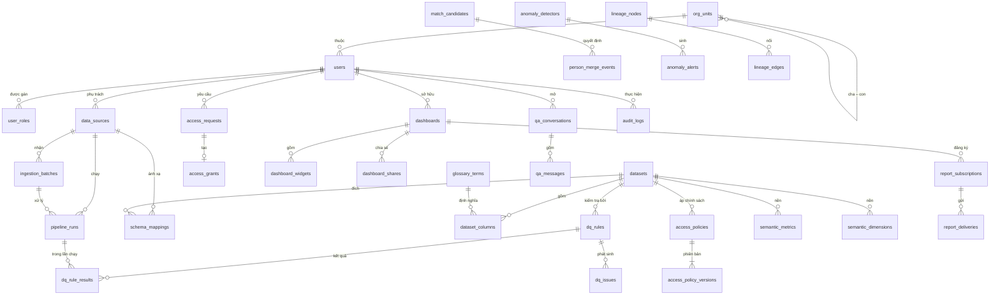
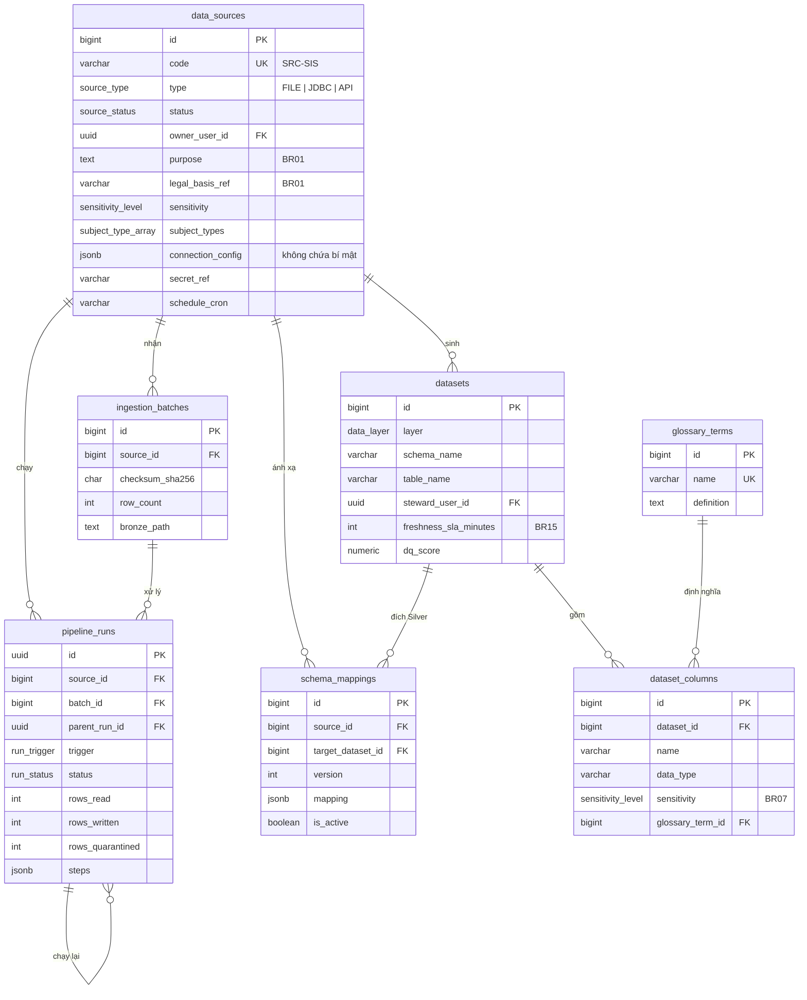
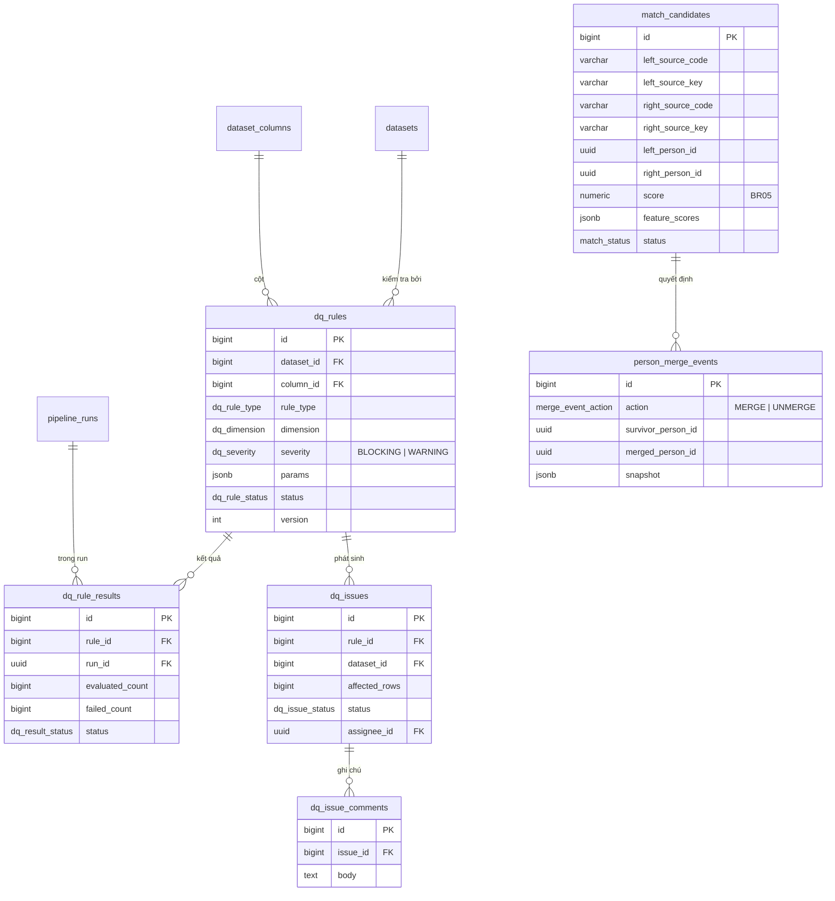
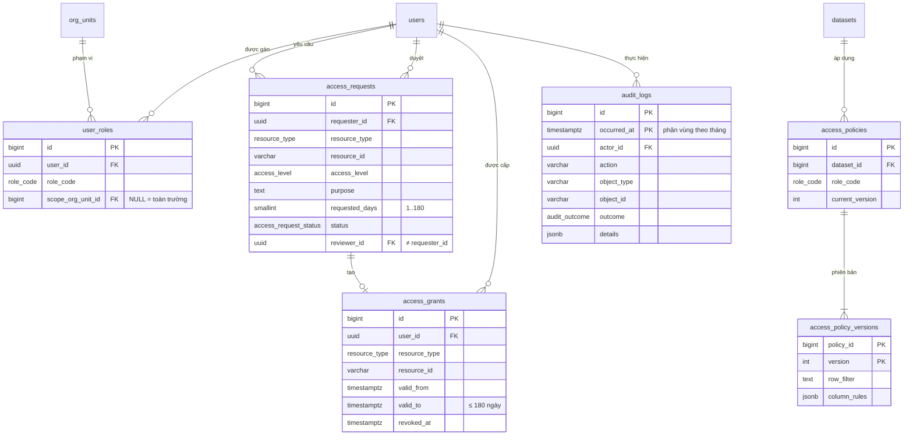
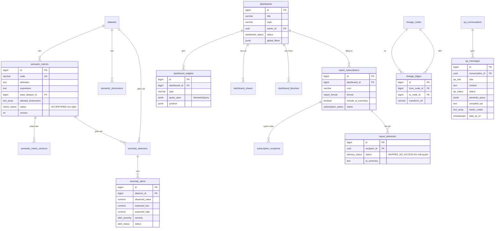
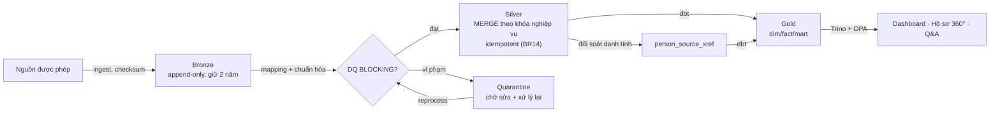

# Thiết kế cơ sở dữ liệu (ER — Mermaid)

AiiA có hai vùng lưu trữ với vai trò khác nhau:

| Vùng | Công nghệ | Nội dung | Nguồn sự thật |
| --- | --- | --- | --- |
| **Control plane** (schema `app`) | PostgreSQL 18 | Người dùng, vai trò, nguồn, lần chạy pipeline, catalog, quy tắc DQ, đối soát danh tính, cấp quyền, chính sách, dashboard, semantic model, cảnh báo, lineage, hỏi-đáp, audit | [aiia.dbml](../src/database/aiia.dbml) · schema chạy được [aiia.sql](../src/database/aiia.sql) |
| **Lakehouse** (Bronze/Silver/Gold) | MinIO (S3) + Apache Iceberg, truy vấn qua Trino | Dữ liệu nguồn thô, dữ liệu chuẩn hóa, mô hình hồ sơ 360° và mart phân tích | Schema `gold` trong [aiia.dbml](../src/database/aiia.dbml); Silver/Gold được sinh bởi dbt |

> Nguyên tắc: **dữ liệu cá nhân chỉ nằm trong Lakehouse**; PostgreSQL chỉ lưu metadata và tham chiếu (`person_id`, `source_key`). Mọi truy vấn dữ liệu cá nhân đi qua Trino để áp chính sách dòng/cột (BR08).

## 1. Toàn cảnh schema `app`

Các nhóm bảng:

| Nhóm | Bảng | Phục vụ |
| --- | --- | --- |
| Định danh & tổ chức | `org_units`, `users`, `user_roles` | US01–US03, US24 |
| Nguồn & ingest | `data_sources`, `ingestion_batches`, `pipeline_runs`, `schema_mappings` | US04–US09 |
| Catalog | `datasets`, `dataset_columns`, `glossary_terms` | US21–US22 |
| Chất lượng dữ liệu | `dq_rules`, `dq_rule_results`, `dq_issues`, `dq_issue_comments` | US17–US20 |
| Đối soát danh tính | `match_candidates`, `person_merge_events` | US10 |
| Cấp quyền & chính sách | `access_requests`, `access_grants`, `access_policies`, `access_policy_versions` | US23, US33 |
| BI & semantic | `dashboards`, `dashboard_widgets`, `dashboard_shares`, `dashboard_favorites`, `semantic_metrics`, `semantic_metric_versions`, `semantic_dimensions` | US26–US30, US36 |
| Báo cáo tự động | `report_subscriptions`, `subscription_recipients`, `report_deliveries` | US37–US38 |
| Bất thường & lineage | `anomaly_detectors`, `anomaly_alerts`, `lineage_nodes`, `lineage_edges` | US31–US32, US34–US35 |
| Hỏi-đáp, thông báo, audit | `qa_conversations`, `qa_messages`, `qa_blocked_topics`, `notifications`, `audit_logs` | US25, US39–US40 |

## 2. Tích hợp dữ liệu và catalog

## 3. Chất lượng dữ liệu và đối soát danh tính

## 4. Cấp quyền, chính sách, audit

## 5. BI, semantic model, báo cáo, cảnh báo, hỏi-đáp

## 6. Mô hình Gold — hồ sơ 360° (Apache Iceberg)

Mô hình dạng **star schema** xoay quanh `dim_person` (golden record, BR06). Mỗi hồ sơ vai trò (`dim_student`, `dim_lecturer`, `dim_staff`) trỏ về `person_id`; các bảng fact là khía cạnh (facet) của hồ sơ 360°.

```mermaid
erDiagram
    dim_person ||--o{ person_source_xref : "định danh nguồn"
    dim_person ||--o{ person_attribute_provenance : "nguồn gốc thuộc tính"
    dim_person ||--o| dim_student : "vai trò SV"
    dim_person ||--o| dim_lecturer : "vai trò GV"
    dim_person ||--o| dim_staff : "vai trò CB"
    dim_person ||--o{ fact_profile_event : "dòng thời gian"
    dim_person ||--o{ fact_lms_activity_daily : "hoạt động LMS"
    dim_person ||--o{ fact_library_loan : "thư viện"
    dim_person ||--o{ fact_research_output : "nghiên cứu"
    dim_person ||--o{ fact_award_discipline : "khen thưởng – kỷ luật"
    dim_student ||--o{ fact_enrollment : "đăng ký học phần"
    dim_student ||--o{ fact_term_result : "kết quả học kỳ"
    dim_student ||--o{ fact_tuition : "học phí"
    dim_lecturer ||--o{ fact_teaching_load : "giảng dạy"
    dim_lecturer ||--o{ fact_teaching_evaluation : "đánh giá"
    dim_term ||--o{ fact_term_result : ""
    dim_course ||--o{ fact_enrollment : ""
    dim_program ||--o{ dim_student : ""
    dim_org_unit ||--o{ dim_student : "khoa"

    dim_person {
        uuid person_id PK
        varchar full_name "INTERNAL"
        date date_of_birth "RESTRICTED"
        varchar email "INTERNAL"
        varchar national_id_hash "RESTRICTED"
        varchar primary_org_unit_code FK
        array roles
    }
    person_source_xref {
        varchar source_code PK
        varchar source_key PK
        uuid person_id FK
        varchar match_method
        decimal match_score
    }
    person_attribute_provenance {
        uuid person_id PK
        varchar attribute PK
        varchar value_source
        timestamp source_updated_at
        varchar survivorship_rule
    }
    dim_student {
        varchar student_id PK
        uuid person_id FK
        varchar program_code FK
        varchar faculty_code FK
        varchar cohort
        varchar status
    }
    dim_lecturer {
        varchar lecturer_id PK
        uuid person_id FK
        varchar academic_title
        varchar degree
    }
    dim_staff {
        varchar staff_id PK
        uuid person_id FK
        varchar position
        varchar grade "CONFIDENTIAL"
    }
    fact_term_result {
        varchar student_id PK
        varchar term_code PK
        decimal gpa_term "CONFIDENTIAL"
        decimal gpa_cumulative "CONFIDENTIAL"
        smallint academic_warning_level
        smallint conduct_score
    }
    fact_tuition {
        varchar student_id PK
        varchar term_code PK
        decimal amount_due "CONFIDENTIAL"
        decimal amount_paid "CONFIDENTIAL"
        varchar payment_status
    }
    fact_profile_event {
        varchar event_id PK
        uuid person_id FK
        timestamp event_time
        varchar event_type
        varchar facet
        varchar source_code
    }
```

Các bảng còn lại của Gold (`dim_org_unit`, `dim_term`, `dim_program`, `dim_course`, `fact_enrollment`, `fact_lms_activity_daily`, `fact_library_loan`, `fact_teaching_load`, `fact_teaching_evaluation`, `fact_research_output`, `fact_award_discipline`, `mart_student_term_kpi`) được mô tả đầy đủ trong [aiia.dbml](../src/database/aiia.dbml).

### 6.1. Ánh xạ tab hồ sơ 360° ↔ bảng Gold

| Hồ sơ | Tab (facet) | Bảng Gold | Nguồn chính |
| --- | --- | --- | --- |
| Sinh viên | Tổng quan | `dim_person`, `dim_student` | SIS |
| | Học tập | `fact_enrollment`, `fact_term_result` | SIS |
| | Tài chính | `fact_tuition` | FIN |
| | Rèn luyện | `fact_term_result.conduct_score`, `fact_award_discipline` | STA |
| | Hoạt động | `fact_lms_activity_daily`, `fact_library_loan` | LMS, LIB |
| | Đầu ra | `dim_student.status`, khảo sát việc làm | SIS, SUR |
| Giảng viên | Giảng dạy | `fact_teaching_load` | SIS |
| | Nghiên cứu | `fact_research_output` | RES |
| | Đánh giá | `fact_teaching_evaluation` | SUR |
| Cán bộ | Nhân sự | `dim_staff` | HRM |
| | Phát triển, Thi đua | `fact_hr_event`*, `fact_award_discipline` | HRM |
| Tất cả | Dòng thời gian | `fact_profile_event` | Mọi nguồn |

\* `fact_hr_event` (đào tạo, bồi dưỡng, thay đổi chức vụ) sẽ được bổ sung khi có dữ liệu mẫu HRM chi tiết.

## 7. Từ điển dữ liệu — bảng trọng tâm

### `data_sources`

| Cột | Kiểu | Ràng buộc | Ý nghĩa |
| --- | --- | --- | --- |
| `code` | varchar(32) | unique | Mã nguồn, VD `SRC-SIS` |
| `type` | `source_type` | not null | `FILE` / `JDBC` / `API` |
| `status` | `source_status` | mặc định `DRAFT` | Chỉ `ACTIVE` mới được ingest (BR01) |
| `purpose`, `legal_basis_ref` | text / varchar | not null, không rỗng | Mục đích và căn cứ cho phép (BR01) |
| `sensitivity` | `sensitivity_level` | not null | Mức nhạy cảm cao nhất của nguồn |
| `connection_config` | jsonb | | Host, DB, endpoint… **không chứa mật khẩu** |
| `secret_ref` | varchar | bắt buộc với JDBC/API khi rời `DRAFT` | Khóa tham chiếu secret store |
| `file_template` | jsonb | bắt buộc với `FILE` | Danh sách cột bắt buộc để kiểm tra header (AC05) |

### `access_requests` / `access_grants`

| Cột | Ràng buộc | Quy tắc |
| --- | --- | --- |
| `requested_days` | `1..180` | BR09 |
| `reviewer_id` | `≠ requester_id` | Không tự duyệt |
| `review_note` | bắt buộc khi `REJECTED` | Từ chối phải nêu lý do (AC23) |
| `valid_to` | `> valid_from` và `≤ valid_from + 180 ngày` | Quyền luôn có hạn |
| `revoked_at` | | Thu hồi sớm; view `v_effective_grants` chỉ trả quyền còn hiệu lực của người dùng `ACTIVE` |

### `match_candidates`

| Cột | Ràng buộc | Quy tắc |
| --- | --- | --- |
| `score` | `0..1` | BR05 |
| `status = AUTO_MERGED` | chỉ khi `score ≥ 0,95` | Vùng xám bắt buộc người duyệt |
| `status ∈ {MERGED, REJECTED}` | `decided_by` not null | Ghi nhận người quyết định |
| `feature_scores` | jsonb | Trường `RESTRICTED` chỉ lưu kết quả khớp/không khớp, không lưu giá trị |

### `qa_messages`

| Cột | Ràng buộc | Quy tắc |
| --- | --- | --- |
| `status` | NULL khi `role = USER` | Chỉ câu trả lời có trạng thái |
| `metric_codes`, `data_as_of` | bắt buộc khi `ANSWERED` | Câu trả lời luôn kèm metric và thời điểm dữ liệu (BR16) |
| `refusal_reason` | bắt buộc khi `REFUSED` | `OUT_OF_SCOPE`, `BLOCKED_TOPIC`, `RESTRICTED_DETAIL`, `NO_METRIC` |
| `semantic_query`, `compiled_sql` | | LLM chỉ sinh truy vấn có cấu trúc; SQL do Semantic Service biên dịch |

### `audit_logs`

Phân vùng theo tháng (`PARTITION BY RANGE (occurred_at)`), có partition `DEFAULT` dự phòng. Trigger `trg_audit_immutable` chặn mọi `UPDATE`/`DELETE` (BR10); tài khoản ứng dụng chỉ được cấp `INSERT, SELECT`. Job bảo trì tạo partition tháng kế tiếp và chuyển partition quá hạn lưu trữ sang kho lưu trữ lạnh.

## 8. Ràng buộc, trigger và view

| Đối tượng | Loại | Mục đích |
| --- | --- | --- |
| `chk_source_legal_basis` | CHECK | Nguồn phải có mục đích và căn cứ cho phép (BR01) |
| `uq_mapping_active` | Unique một phần | Một mapping đang dùng cho mỗi cặp nguồn–dataset |
| `uq_dq_issue_open_per_rule` | Unique một phần | Mỗi quy tắc chỉ có một issue đang mở; lần chạy sau cập nhật issue cũ |
| `dq_issues` CHECK | CHECK | `resolved_at` có giá trị khi và chỉ khi issue đã đóng |
| `pipeline_runs` CHECK | CHECK | Run `RERUN`/`REPROCESS` phải trỏ run gốc; `PARTIAL` phải có bản ghi cách ly |
| `anomaly_detectors` CHECK | CHECK | Giám sát đúng một đối tượng (dataset **hoặc** metric) |
| `semantic_metrics` CHECK | CHECK | Metric `CERTIFIED` phải có người và thời điểm chứng nhận |
| `trg_user_roles_last_admin` | Trigger | Không gỡ được `PLATFORM_ADMIN` cuối cùng (AC24) |
| `trg_audit_immutable` | Trigger | Audit chỉ cho phép thêm (BR10) |
| `set_updated_at` | Trigger | Tự cập nhật `updated_at` |
| `v_effective_grants` | View | Quyền dữ liệu đang hiệu lực (AC03) |
| `v_stale_datasets` | View | Dataset vượt SLA độ mới (BR15) |
| `expire_access()` | Hàm | Worker gọi hằng giờ để chuyển yêu cầu hết hạn sang `EXPIRED` |

## 9. Vòng đời dữ liệu trong Lakehouse

| Lớp | Định dạng | Ghi | Lưu giữ |
| --- | --- | --- | --- |
| Bronze | Iceberg, phân vùng theo `source_code`, `ingest_date` | Append-only kèm `batch_id`, `checksum` | 24 tháng |
| Silver | Iceberg | `MERGE INTO` theo khóa nghiệp vụ + `batch_id` → chạy lại không nhân bản | Theo vòng đời nguồn |
| Quarantine | Iceberg | Bản ghi lỗi + mã quy tắc vi phạm | 90 ngày sau khi issue đóng |
| Gold | Iceberg | dbt rebuild/incremental; snapshot Iceberg cho time-travel | Snapshot 30 ngày |
